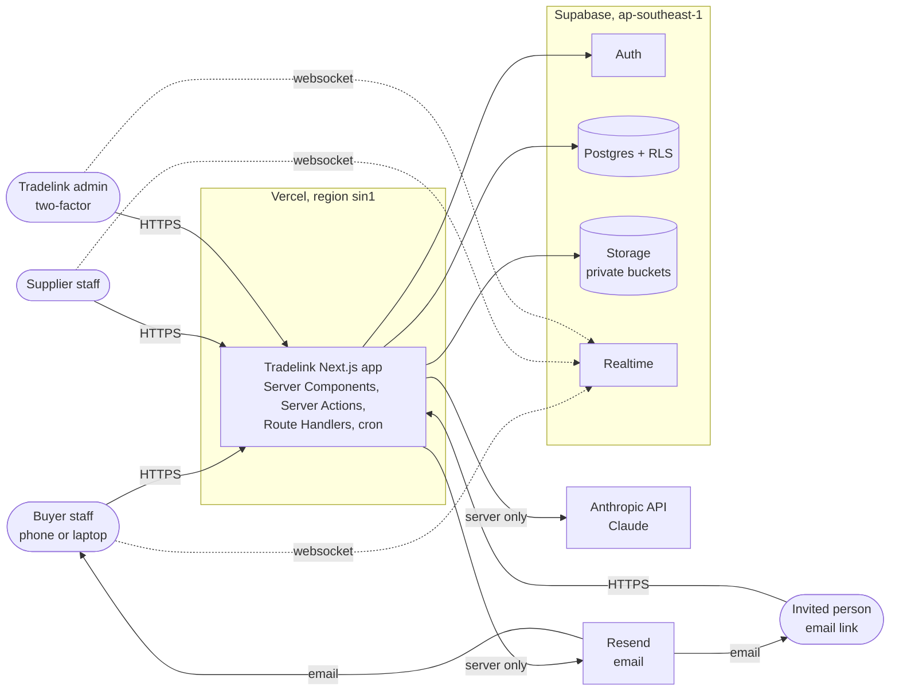
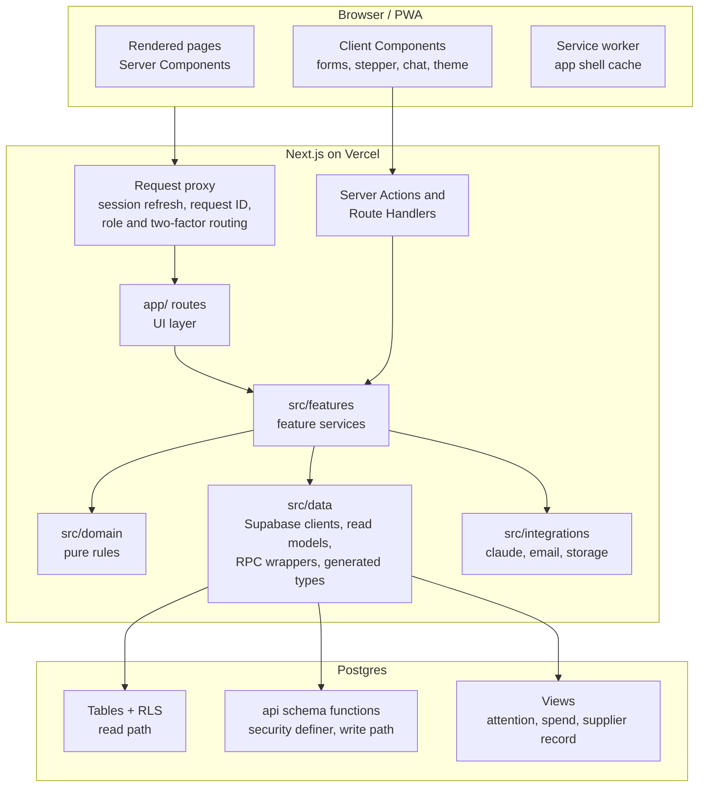
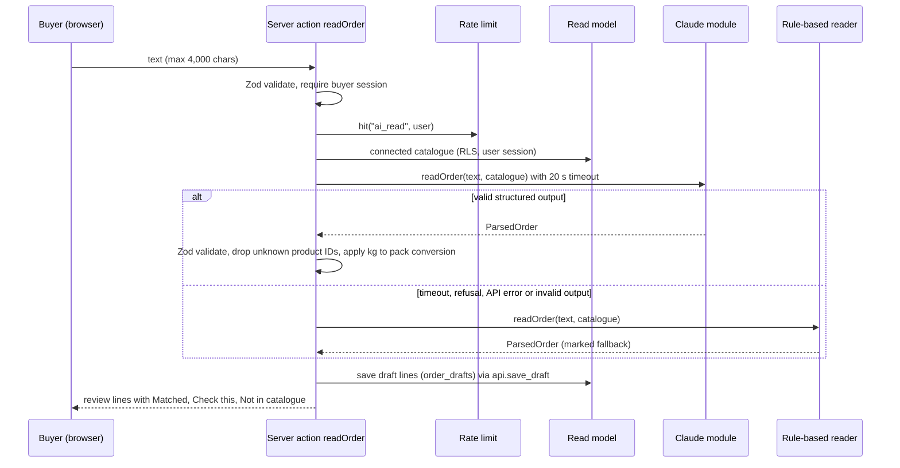
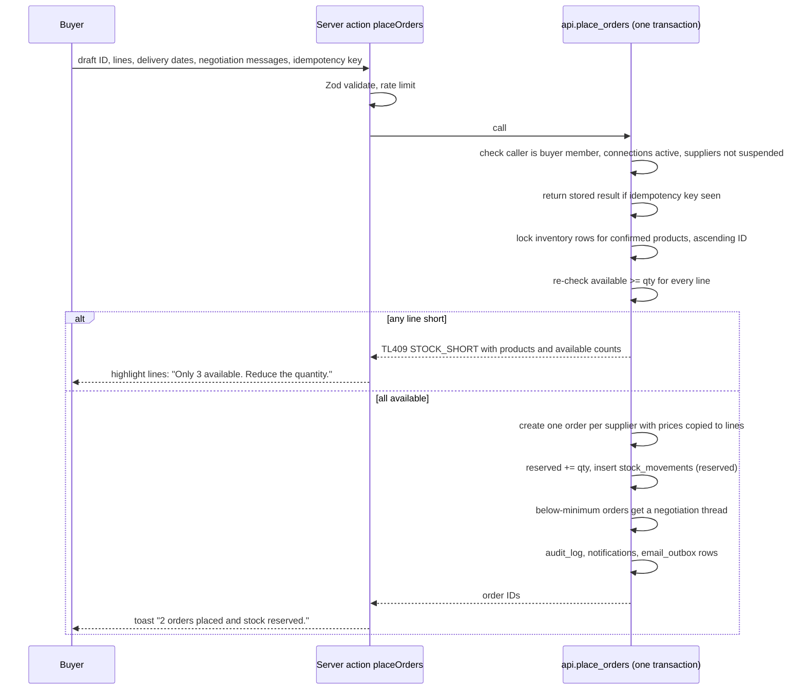
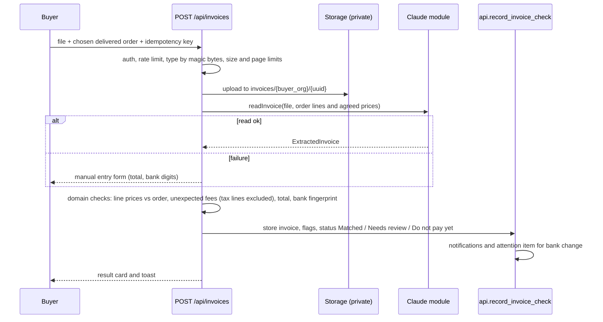

# Architecture

Status: Phase 1 draft for review. Decisions referenced as D1 to D11 are in `docs/DISCOVERY.md` section 11. ADRs are in `docs/adr/`.

> **Update 3 November 2026:** two-factor sign-in is switched off and buyers and suppliers can create their own accounts, by owner decision. See ADR 0024, which supersedes the two-factor and invitation-only parts below.

## 1. Goals and constraints

- Replace WhatsApp ordering between small food businesses and their suppliers with one secure web app that matches the approved prototype.
- Phone first: busy, standing up, one hand. A responsive PWA works on phone, tablet and laptop.
- Permissions are enforced on the server and in Row Level Security. Each buyer and supplier organisation is fully isolated.
- Stock is never oversold. Every stock change is in the stock history. Critical actions are idempotent.
- AI suggests and prepares; people confirm. AI never sends orders, changes stock, pays or changes bank details.
- No payments. Tradelink checks invoices but never pays them (D6).
- S$, Asia/Singapore, English (en-SG).

## 2. System context



The browser talks only to the Next.js app and, for live updates, to Supabase Realtime. It holds the publishable key and the user's session cookie. The Anthropic key, Supabase secret key, Resend key, cron secret and bank fingerprint key stay on the server.

## 3. Containers and layers



### 3.1 Layer rules

| Layer | Folder | Holds | May import |
| --- | --- | --- | --- |
| UI | `app/`, `src/ui/` | Routes, layouts, pages, design-system components, feature components | `src/features`, `src/domain` (types and pure helpers only) |
| Feature services | `src/features/<feature>/` | Server actions, use-case functions, Zod input schemas, error-to-copy mapping | `src/domain`, `src/data`, `src/integrations`, `src/lib` |
| Domain | `src/domain/` | Pure TypeScript: money, quantities, stock health, state machines, reorder plan, rule-based order reader, invoice checks, attention rules, cut-off and delivery dates | nothing outside `src/domain` and `src/lib/time` |
| Data | `src/data/` | Supabase client factories (browser, server, admin), typed read queries, RPC wrappers, `database.types.ts` | `src/lib`, `src/domain` types |
| Integrations | `src/integrations/` | `claude/` (ADR 0008), `email/` (Resend), `storage/` (signed URLs, upload checks) | `src/lib`, `src/domain` types |
| Library | `src/lib/` | Env parsing (Zod), logger, errors, rate limit, idempotency keys, time zone helpers | nothing app-specific |

ESLint `no-restricted-imports` rules enforce these boundaries. `server-only` is imported by everything in `src/data/admin-client.ts`, `src/integrations/` and every feature service. The admin client (secret key) is used only by modules listed in `docs/SECURITY.md` section 6.

### 3.2 Repository layout

```
app/
  (public)/sign-in, forgot-password, reset-password, invite/[token], offline
  (auth)/two-factor/setup, two-factor/verify
  buyer/            home, order, ask, orders, insights, availability, settings, notifications
  supplier/         home, orders, inventory, activity, stock-history, settings, notifications
  admin/            home, attention, orders, suppliers, suppliers/[id], users, users/buyers/[id],
                    notifications, operators, status, audit, settings
  api/health, api/health/ready, api/ask, api/invoices, api/cron/*
  manifest.ts, layout.tsx, error.tsx, not-found.tsx
src/ui/             design-system components and the app shell
src/features/       ordering, review, deliveries, issues, invoices, credits, negotiation, catalogue,
                    inventory, fulfilment, invitations, team, notifications, insights, attention,
                    admin-records, system-status, settings, ask
src/domain/         money, quantity, stock, order, issue, invoice, invitation, negotiation,
                    reorder, reader, attention, delivery-dates
src/data/           clients, queries, rpc, database.types.ts
src/integrations/   claude, email, storage
src/lib/            env, logger, errors, rate-limit, idempotency, time
supabase/           config.toml, migrations/, seed.sql, tests/ (pgTAP)
evals/              order-reading/, invoices/, injection/
tests/              integration/, concurrency/, e2e/, visual/
scripts/            build-tokens.ts, generate-transitions.ts
docs/               this folder
```

### 3.3 Routing and roles

- `/` redirects to `/buyer`, `/supplier` or `/admin` from the user's organisation kind.
- The request proxy refreshes the Supabase session and redirects:
  - unsigned users on app routes to `/sign-in`;
  - users on another role's routes to their own home (logged as a denied attempt);
  - admins without an `aal2` session to two-factor setup or verify;
  - members of a supplier organisation that is still `invited` to `/invite/...`; members of a suspended organisation to a read-only view.
- Each role layout renders the shell: top bar (wordmark, org, bell, ThemeToggle), BottomNav or side rail from 760px, "who" block and CartBar. Routes behind More on phone are the same as in the prototype (DISCOVERY section 2.2).
- The proxy is a convenience. Every page query and action is still checked by RLS or a database function.

### 3.4 Screens added beyond the prototype

These have no prototype design. They are built only from existing components and content rules, and are reviewed with screenshots in the phase that adds them: sign in, forgot password, set new password, two-factor setup and verify, accept or decline an invitation (buyer, supplier, colleague, admin), notifications for buyers and suppliers, team members in Settings, editable business profile (including delivery days, cut-off, minimum order and bank details), stock adjustment, delivery date in review and on supplier acceptance, minimum-order negotiation, invoice upload with order selection, admin "Invite a buyer", offline banner, and error and not-found pages.

## 4. Key data flows

### 4.1 Read an order (AI with fallback)



Nothing is sent to a supplier. Usage is logged to `ai_usage`.

### 4.2 Confirm and reserve stock



### 4.3 Supplier fulfilment

Accept (with a confirmed delivery date, D4), part accept, reject, mark out for delivery and mark delivered each call one function. It locks the order row, asserts the transition, adjusts reservations and the stock history, notifies the buyer and writes the audit log. Accepting an order with unconfirmed products first requires the supplier to confirm those products' stock and price; pending orders take the confirmed price, and a price rise waits for the buyer (Q10 default).

### 4.4 Delivery check and problems

All here, Report a problem and Not here yet each call one function. If the order is still Out for delivery, All here and Report a problem first move it to Delivered: on hand and reserved both go down, and a `delivered` stock history row is written. Then the check status is set, the buyer's shop counts are updated and the supplier is notified. A problem creates an issue, and its amount is the quantity times the line's order price.

### 4.5 Invoice check



### 4.6 Invitation

An invitation is created by `api.create_invitation`, which stores the token hash and an outbox email holding the plain token. The email is sent by the outbox job. The link `/invite/{token}` is looked up by hash, with rate limiting, and the page shows the minimum details. Accept or Decline calls one function that locks the row, checks it is pending, unexpired and for that email, and changes the invitation, organisation, connection and orders together (declining hides products and cancels open orders, as in the prototype). Accepting then leads to setting a password, and two-factor setup for admins.

### 4.7 Ask

The browser posts a message to `/api/ask`. The handler runs the tool runner with read-only tools that query through the user's session (ADR 0009) and streams text and typed cards back as server-sent events. "Review order" saves the prepared lines to the user's draft and opens Order review.

### 4.8 Notifications and email

Functions insert `notifications` rows (shown live through Realtime) and `email_outbox` rows in the same transaction. The outbox job sends emails with Resend, records the result and retries with backoff up to 5 times.

### 4.9 Health and system status

The 5-minute health job checks each service and writes `service_checks`. System status shows the latest state, 30-day uptime and average response, plus AI usage counts from `ai_usage`. "Degraded" means a check slower than its threshold or failing intermittently; "Down" means failing for 3 checks in a row.

## 5. Live updates

Clients subscribe to Realtime `postgres_changes` on `orders`, `issues`, `notifications` and `negotiation_messages`. RLS filters events per user. On an event the client refreshes the affected route (`router.refresh()`), so the server stays the source of truth.

## 6. Error handling

- Database functions raise typed codes: `TL400` (invalid input), `TL401` (not signed in), `TL403` (not allowed), `TL404` (not found or not visible), `TL409` (conflict: stock, state or duplicate), `TL429` (rate limited). Each includes a machine-readable detail.
- Feature services map codes to the prototype's copy ("You do not have access to do that.", "Only 3 available. Reduce the quantity.") and return `{ ok: false, error }` to forms. Forms show one error under the form that says what to fix.
- Unexpected errors are logged with the request ID and shown with that ID. No stack traces reach the browser.
- Loading, empty, error and offline states are designed for every page (see the user stories).

## 7. Environments and delivery

| | Development | Preview | Production |
| --- | --- | --- | --- |
| App | `next dev` on the developer machine | Vercel preview per PR | Vercel production |
| Database | Local Supabase CLI stack | Preview Supabase project (or branches) | Production Supabase project |
| Data | Seed demo data | Seed demo data | Seeded demo accounts for buyer, supplier and admin, plus real data |
| Email | Local mail catcher | Resend test mode | Resend with a verified domain |
| AI | Owner's key in `.env.local` | Key in Vercel preview env | Key in Vercel production env |
| Cron | Run by hand | Off | On |

CI runs on GitHub Actions (ADR 0022). Production deploys and migrations need the owner's approval.

## 8. Performance and scale targets

- Home pages: largest contentful paint under 2.5 s on a mid-range phone over 4G; under 150 KB of client JavaScript per route (gzipped) excluding fonts.
- Server actions: p95 under 500 ms excluding AI. Order reading: p95 under 6 s; fallback at 20 s.
- Expected scale for release: up to 500 organisations, 5,000 orders a day. Indexes on every foreign key and on the filters each list uses. All lists paginate (cursor-based, 30 per page).

## 9. Cross-cutting concerns

| Concern | Approach | Reference |
| --- | --- | --- |
| Authentication | Supabase Auth, cookies through `@supabase/ssr`, two-factor for admins | ADR 0011 |
| Authorisation | RLS for reads, security definer functions for writes, proxy for routing only | ADR 0004, `SECURITY.md` |
| Validation | Zod at every server boundary; checked again in SQL | `API.md` |
| Idempotency | `idempotency_keys` per user and action; clients send a UUID per user intent | `API.md` section 2 |
| Audit | Append-only `audit_log`, including denied attempts | `DATA_MODEL.md` |
| Time | Asia/Singapore for display, cut-offs, weeks and delivery dates | ADR 0019 |
| Theming | Tokens to CSS variables and Tailwind; System, Light, Dark | ADR 0015 |
| Accessibility | WCAG 2.2 AA, keyboard, focus ring, reduced motion, labelled controls | `TEST_PLAN.md` |
| Observability | JSON logs, request IDs, health checks, AI usage | ADR 0017 |
