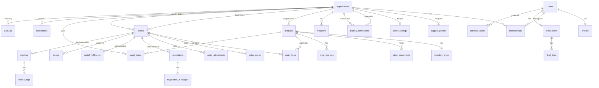
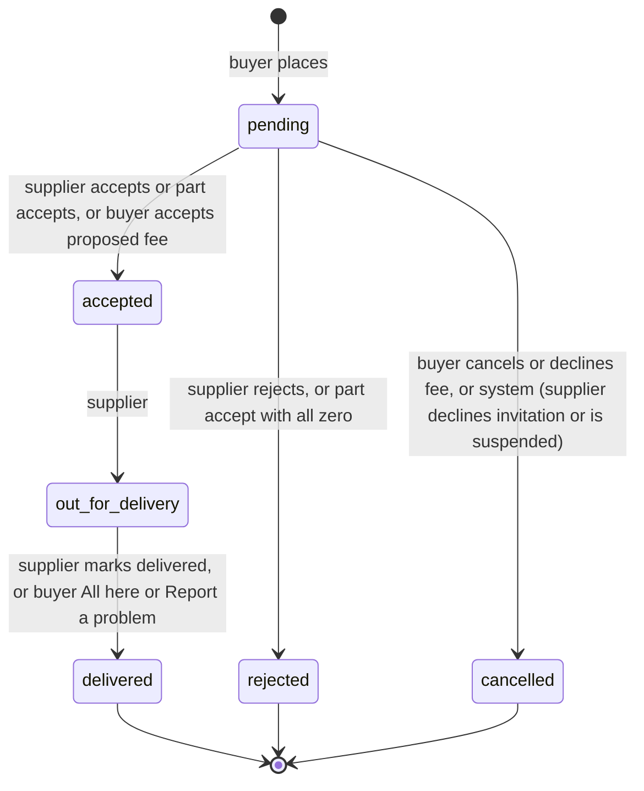
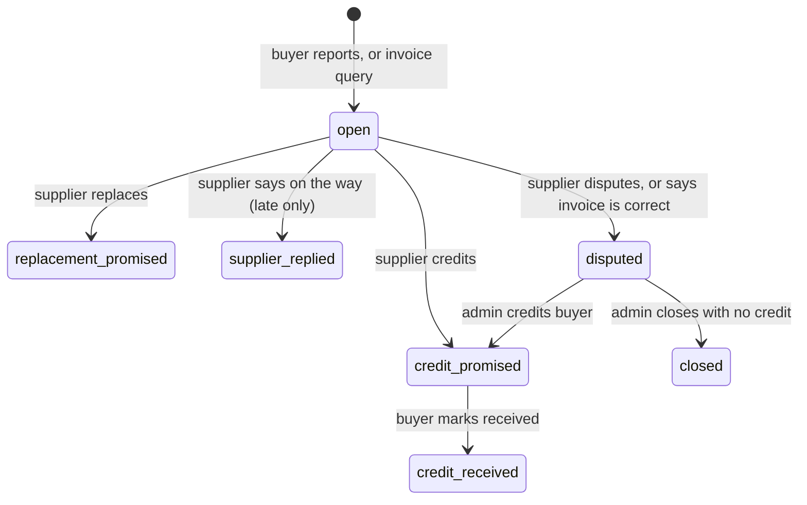
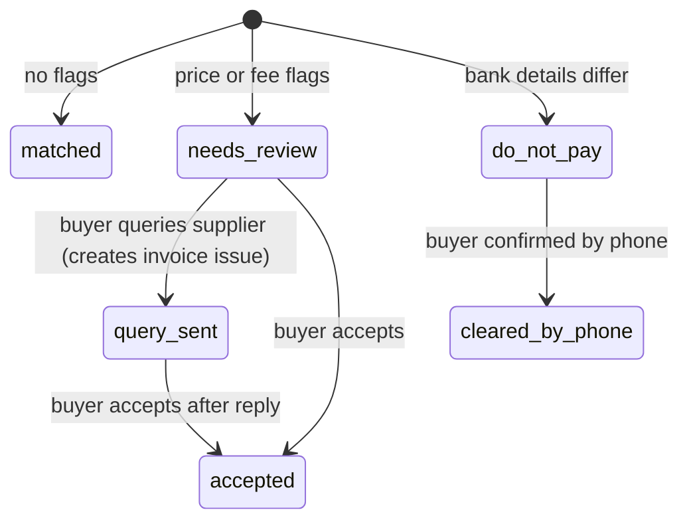
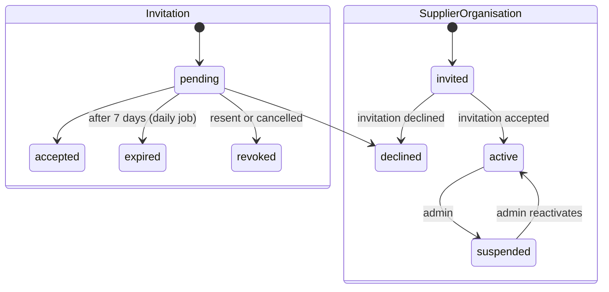
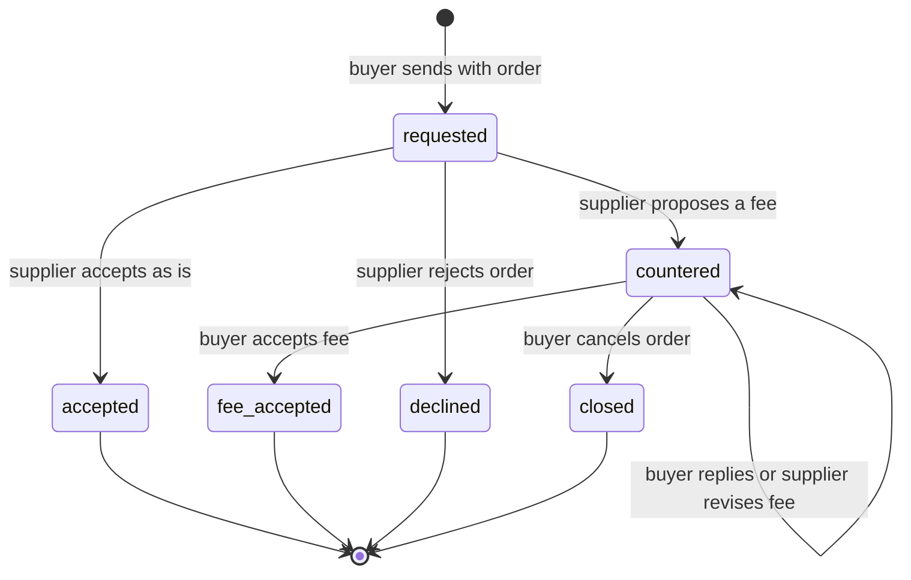

# Data model

Postgres on Supabase. All tables live in `public` with RLS enabled. Write functions live in the `api` schema, and helpers in `app` (ADR 0004). Money is `numeric(12,2)`, quantities are `integer`, and times are `timestamptz` (ADR 0019). Every table has `id uuid primary key default gen_random_uuid()` and `created_at timestamptz not null default now()` unless shown otherwise.

## 1. Entity relationship diagram

`users` is Supabase's `auth.users`. Application tables reference it by `user_id`.

## 2. Tables

### 2.1 Identity and tenancy

| Table | Key columns | Constraints and notes |
| --- | --- | --- |
| `organisations` | `kind` (`buyer`, `supplier`, `platform`), `name`, `status` (`invited`, `active`, `suspended`, `declined`), `contact_name`, `phone`, `email`, `address`, `logo_path`, `joined_at` | Unique lower(`name`) per kind. One `platform` row. |
| `profiles` | `user_id` (PK, FK auth.users), `full_name`, `phone`, `theme` (`system`, `light`, `dark`), `last_seen_at` | One per user. `last_seen_at` gives operator presence. |
| `memberships` | `user_id` (unique), `organisation_id` | A user belongs to one organisation (ADR 0005). |
| `buyer_settings` | `organisation_id` (PK), `trading_hours`, `weekly_budget numeric(12,2)` > 0, `suggest_reorder bool`, `price_alerts bool`, `budget_warning bool` | Defaults: budget S$900.00, all switches on. |
| `supplier_profiles` | `organisation_id` (PK), `product_range`, `delivery_days smallint[]` (1 = Monday to 7 = Sunday), `lead_time_days smallint`, `cutoff_time time` (default 16:00), `minimum_order numeric(12,2)`, `bank_name`, `bank_account_hmac bytea`, `bank_last4 char(4)`, `bank_updated_at` | Full account numbers are never stored (ADR 0021). |
| `admin_profiles` | `user_id` (PK), `team` (`Operations lead`, `Order desk`, `Supplier onboarding`, `Customer support`), `shift` | For the Operators page (D3). |
| `trading_connections` | `buyer_org_id`, `supplier_org_id`, `status` (`invited`, `active`, `declined`, `ended`), `created_by` | Unique (`buyer_org_id`, `supplier_org_id`). A check confirms the kind of both organisations. |
| `invitations` | `kind` (`buyer_org`, `supplier_org`, `member`, `admin`), `organisation_id`, `email citext`, `token_hash bytea` (unique), `status` (`pending`, `accepted`, `declined`, `expired`, `revoked`), `invited_by`, `invited_by_org_id`, `expires_at`, `used_at`, `sent_count` | Partial unique index: one `pending` row per (organisation, email). |
| `team` (view) | Members of the caller's organisation with names and emails | For the Team panel in Settings. |

### 2.2 Catalogue and inventory

| Table | Key columns | Constraints and notes |
| --- | --- | --- |
| `products` | `supplier_org_id`, `sku`, `name`, `unit` (`bag`, `bottle`, `box`, `can`, `carton`, `pack`, `packet`, `tin`, `tray`, `tub`), `price numeric(12,2)` > 0 and ≤ 99,999, `category` (`fresh`, `dry_goods`, `oils_sauces`, `supplies`), `art` (`egg`, `sack`, `bottle`, `tin`, `packet`, `box`, `tub`, `block`, `leaf`, `soap`), `pack_kg numeric(8,3)`, `reorder_level int` ≥ 0, `aliases text[]`, `status` (`active`, `unconfirmed`, `hidden`), `added_by_org_id` | Unique (`supplier_org_id`, lower(`name`)) and (`supplier_org_id`, `sku`). SKUs are generated per supplier (a prefix from the organisation, as in `DG-1001`) and can be edited. Trigram index on name and aliases for search. |
| `inventory_levels` | `product_id` (PK), `on_hand int`, `reserved int`, `updated_at` | `on_hand >= 0`, `reserved >= 0`, `reserved <= on_hand`. Changed only by `api` functions. |
| `stock_movements` | `product_id`, `type` (`received`, `reserved`, `released`, `delivered`, `adjusted`), `on_hand_change`, `reserved_change`, `on_hand_after`, `reserved_after`, `reason` (`damaged`, `expired`, `count_correction`, `opening_stock`, null), `order_id`, `actor_user_id`, `note` | Append-only: no update or delete grants, and a trigger raises on update or delete. |
| `price_changes` | `product_id`, `old_price`, `new_price`, `changed_by` | Append-only. |
| `price_change_acks` | `price_change_id`, `buyer_org_id`, `acked_by`, `acked_at` | "OK, noted" on buyer Home. |

Derived values (in views and the domain layer): available = `on_hand - reserved`. Health is `unconfirmed`, `out` (available ≤ 0), `low` (available ≤ reorder level) or `healthy`.

### 2.3 Ordering

| Table | Key columns | Constraints and notes |
| --- | --- | --- |
| `order_drafts` | `user_id` (unique), `buyer_org_id`, `source_text`, `updated_at` | The cart behind CartBar and review. One per user. |
| `draft_lines` | `draft_id`, `position`, `source_text`, `product_id` (null until chosen), `qty int` ≥ 1, `kg numeric`, `state` (`matched`, `check`, `not_found`, `added`, `suggested`, `manual`), `options uuid[]`, `qty_assumed bool`, `read_by` (`ai`, `rules`, `user`) | Product IDs are checked to be visible to the buyer on save. |
| `orders` | `number bigint` (sequence from 1044, shown as `ORD-1044`), `buyer_org_id`, `supplier_org_id`, `status` (`pending`, `accepted`, `out_for_delivery`, `delivered`, `rejected`, `cancelled`), `requested_delivery_date date` (optional), `confirmed_delivery_date date` (set on accept), `delivered_at`, `check_status` (`unchecked`, `all_here`, `problem`), `below_minimum bool`, `placed_by`, `checkout_id uuid` | Indexes on (`buyer_org_id`, `created_at desc`) and (`supplier_org_id`, `status`). |
| `order_lines` | `order_id`, `product_id`, `qty int` > 0, `asked_qty int`, `unit_price numeric(12,2)`, `held bool`, `price_state` (`confirmed`, `estimated`, `awaiting_buyer`), `source_text` | Price copied at the time of ordering. `held = false` for unconfirmed products. |
| `order_events` | `order_id`, `from_status`, `to_status`, `actor_user_id`, `actor_role`, `note` | Append-only history. |
| `order_adjustments` | `order_id`, `kind` (`delivery_fee`), `amount`, `status` (`proposed`, `accepted`, `declined`), `proposed_by`, `decided_by` | Counted in the total only when `accepted`. |
| `negotiations` | `order_id` (unique), `status` (`requested`, `accepted`, `countered`, `fee_accepted`, `declined`, `closed`), `minimum_order`, `gap` | ADR 0020. |
| `negotiation_messages` | `negotiation_id`, `author` (`buyer`, `supplier`), `drafted_by_ai bool`, `edited_by_user bool`, `body text` (≤ 1,000 chars), `approved_by`, `sent_at` | A buyer message is stored only once a person approves it. At most 3 buyer messages per negotiation. |
| `partial_fulfilments` | `order_id`, `product_id`, `asked`, `sent`, `status` (`new`, `added`, `skipped`) | Buyer To do: "can only send 3 of 5". |
| `usual_items` | `buyer_org_id`, `product_id`, `usual_qty`, `use_per_day numeric(10,3)`, `use_per_day_override`, `in_shop numeric(10,3)`, `in_shop_override`, `last_paid numeric(12,2)` | Unique (`buyer_org_id`, `product_id`). The daily job recalculates `use_per_day` from the last 28 days (Q8 default). |
| `restock_skips` | `buyer_org_id`, `product_id`, `skip_date date` | "Not today". Cleared daily. |

### 2.4 After delivery

| Table | Key columns | Constraints and notes |
| --- | --- | --- |
| `issues` | `number` (`ISS-301`), `order_id`, `buyer_org_id`, `supplier_org_id`, `product_id`, `type` (`short`, `damaged`, `wrong_item`, `expired`, `late`, `invoice`), `qty`, `amount numeric(12,2)`, `note` (≤ 500), `status` (`open`, `credit_promised`, `replacement_promised`, `supplier_replied`, `disputed`, `closed`, `credit_received`), `buyer_seen bool`, `answered_at` | Partial unique index: one open `late` issue per order. |
| `invoices` | `number` (`INV-302`), `supplier_invoice_ref`, `order_id`, `buyer_org_id`, `supplier_org_id`, `file_path`, `total`, `expected_total`, `bank_last4_on_invoice`, `bank_matches bool`, `status` (`matched`, `needs_review`, `query_sent`, `accepted`, `do_not_pay`, `cleared_by_phone`), `read_by` (`ai`, `manual`), `extracted jsonb` | |
| `invoice_flags` | `invoice_id`, `kind` (`higher_price`, `unexpected_fee`, `bank_changed`, `total_mismatch`), `detail`, `amount` | |
| `credits` (view) | Issues with status `credit_promised` or `credit_received` | The Credits panel. |

### 2.5 Platform and operations

| Table | Key columns | Constraints and notes |
| --- | --- | --- |
| `notifications` | `recipient_org_id`, `recipient_user_id` (optional), `kind`, `title`, `body`, `link`, `subject_org_id`, `read_at` | Kinds include the prototype's six, plus order, issue, negotiation and price events. |
| `email_outbox` | `to_email`, `template`, `payload jsonb`, `status` (`pending`, `sent`, `failed`), `attempts`, `next_attempt_at`, `provider_id` | The payload may hold an invitation token until sent; the token is then removed. |
| `attention_states` | `item_key` (PK), `assigned_user_id`, `handled_at`, `handled_by` | Assignment and "Mark handled" (ADR 0013). |
| `audit_log` | `id bigint identity`, `at`, `actor_user_id`, `actor_org_id`, `actor_role`, `action`, `target_type`, `target_id`, `related_org_ids uuid[]`, `outcome` (`allowed`, `denied`), `request_id`, `metadata jsonb` | Append-only (section 4). GIN index on `related_org_ids`. |
| `service_checks` | `service` (`web`, `api`, `database`, `ai_reader`, `email`, `backup`), `status` (`operational`, `degraded`, `down`), `latency_ms`, `detail` | Kept for 90 days. |
| `ai_usage` | `organisation_id`, `user_id`, `feature` (`order_read`, `invoice_read`, `ask`, `negotiation_draft`), `model`, `input_tokens`, `output_tokens`, `cache_read_tokens`, `latency_ms`, `outcome` (`ok`, `fallback`, `refusal`, `timeout`, `error`, `invalid_output`), `lines_read`, `lines_matched` | Kept with no time limit; holds counts only. |
| `ai_runs` | `usage_id`, `input_text`, `output jsonb` | Deleted after 90 days (Q13 default). Readable by admins only. |
| `ask_messages` | `user_id`, `role`, `content jsonb` | Deleted after 90 days. |
| `idempotency_keys` | `key uuid`, `user_id`, `action`, `result jsonb`, `created_at` | PK (`user_id`, `action`, `key`). Deleted after 7 days. |
| `rate_limits` | `key`, `window_start`, `count` | ADR 0014. |
| `state_transitions` | `entity`, `from_status`, `to_status`, `action`, `roles text[]` | Generated from the TypeScript machines (ADR 0007). |

### 2.6 Views (read models)

| View | Purpose |
| --- | --- |
| `v_catalogue` | Products visible to the caller, with available, health and supplier name. |
| `v_order_cards` | Orders with lines, totals (lines plus accepted adjustments), progress and check status. |
| `v_week_spend` | Spend per buyer per week (Monday start, Asia/Singapore), excluding rejected and cancelled orders. |
| `v_supplier_record` | Per buyer and supplier: on-time % (delivered on or before the confirmed date), problem count, cut-off. |
| `v_restock_plan` | The prototype's Ready for tomorrow rule (DISCOVERY 6.3) per buyer. |
| `v_connected_buyers` | For suppliers: name, contact, address and phone of connected buyers. |
| `v_attention` | Admin attention items (DISCOVERY 6.6) with the key, priority, type, title, detail and links. Admins only. |
| `v_service_status` | Latest status, 30-day uptime and average latency per service. |
| `v_admin_supplier_rows`, `v_admin_buyer_rows` | Counts for the admin lists. |

## 3. State machines

The `api` functions and a trigger on each table enforce these machines (ADR 0007). Any transition not drawn is rejected with `TL409 INVALID_TRANSITION` and logged as denied.

### 3.1 Order

Side effects:
- Reject and cancel release held stock.
- Part accept releases the difference and creates `partial_fulfilments`.
- Delivered removes held stock from both on hand and reserved.
- The delivery check (`unchecked` to `all_here` or `problem`) happens once, by the buyer, when the order is delivered or is being moved to delivered.

### 3.2 Issue

### 3.3 Invoice

### 3.4 Invitation and supplier organisation

A trading connection follows the supplier's invitation, from `invited` to `active` or `declined`. An admin can end a connection, from `active` to `ended`.

### 3.5 Negotiation (ADR 0020)

### 3.6 Smaller machines

| Entity | Transitions |
| --- | --- |
| Partial fulfilment | `new` to `added` (buyer orders the rest) or `skipped` |
| Order line price | `estimated` to `confirmed` (supplier confirms at the same or a lower price), or to `awaiting_buyer` (higher price), then `confirmed` (buyer keeps it) or the line is removed (buyer removes it) |
| Order adjustment | `proposed` to `accepted` or `declined` |
| Notification | Unread to read |
| Attention item | Open to assigned. Open to handled (System and Blocked action items only). Other items close when their cause clears. |

## 4. Integrity, append-only tables and retention

- `audit_log`, `stock_movements`, `price_changes`, `order_events` and `negotiation_messages` are append-only. `update`, `delete` and `truncate` are revoked from every role except the migration owner, and a `before update or delete` trigger raises an error. Rows are inserted only by `api` functions and `api.log_denied`.
- A pgTAP test proves that the sum of `stock_movements` per product equals `inventory_levels`.
- Retention (Q13 default):
  - kept for 5 years: orders, invoices, issues, the audit log and the stock history;
  - deleted after 90 days: `ai_runs`, `ask_messages`, raw `order_drafts.source_text` and `service_checks`;
  - deleted after 7 days: `idempotency_keys`;
  - deleted after 1 day: `rate_limits`.

## 5. Row Level Security

### 5.1 Helper functions

All in the `app` schema, declared `security definer` and `stable`, with `search_path = ''`.

| Function | Returns |
| --- | --- |
| `app.my_org_id()` | The caller's organisation ID, from `memberships`. |
| `app.my_org_kind()` | `buyer`, `supplier` or `platform`. |
| `app.is_admin()` | True only if the caller is in the platform organisation **and** `auth.jwt() ->> 'aal' = 'aal2'`. |
| `app.connected(buyer, supplier)` | True if the connection is `invited` or `active`. |
| `app.can_see_org(org)` | True for the caller's own organisation, a connected organisation, or any organisation for an admin. |
| `app.org_is_open(org)` | True if the status is `active` or `invited`. Used to hide suspended and declined suppliers from buyers. |

### 5.2 Policies

Select only. All writes go through `api` functions.

| Table or view | Buyer member | Supplier member | Admin (aal2) |
| --- | --- | --- | --- |
| `organisations` | Own; connected suppliers that are open | Own; connected buyers through `v_connected_buyers` | All |
| `profiles` | Own; team members | Own; team members | All |
| `memberships`, `team` | Own organisation | Own organisation | All |
| `buyer_settings` | Own | None | All |
| `supplier_profiles` | Connected suppliers, without bank columns (column grants revoke `bank_account_hmac`) | Own (HMAC not selectable; last 4 visible) | All except the HMAC |
| `admin_profiles` | None | None | All |
| `trading_connections` | Own rows | Own rows | All |
| `invitations` | Rows they created, without `token_hash` | Rows they created, without `token_hash` | All, without `token_hash` |
| `products`, `inventory_levels` | Products of connected, open suppliers with status `active` or `unconfirmed` | Own products | All |
| `stock_movements` | None | Own products | All |
| `price_changes` | For products they can see | Own products | All |
| `price_change_acks`, `usual_items`, `restock_skips` | Own | None | All |
| `order_drafts`, `draft_lines` | Own user only | None | None |
| `orders`, `order_lines`, `order_events`, `order_adjustments` | Orders placed by own organisation | Orders sent to own organisation | All (read only) |
| `negotiations`, `negotiation_messages` | Own orders (sent messages only) | Orders to own organisation (sent messages only) | All |
| `partial_fulfilments` | Own orders | Own orders | All |
| `issues` | Own | Own (as the supplier) | All |
| `invoices`, `invoice_flags` | Own | Invoices for own orders, once a query is sent | All |
| `notifications` | Sent to own organisation or own user | Same | Platform notifications |
| `audit_log` | None | Rows where `related_org_ids` contains own organisation (for Activity) | All |
| `attention_states`, `v_attention`, `service_checks`, `ai_usage`, `ai_runs` | None | None | All |
| `ask_messages` | Own user only | None | None |
| `idempotency_keys`, `rate_limits`, `email_outbox` | None | None | None (server only) |

Restrictive policies on every admin path require `aal2`, so an admin session without two-factor sees nothing. The RLS tests (TEST_PLAN section 4) cover every cell, including denied access across organisations.

### 5.3 Storage

| Bucket | Path | Access |
| --- | --- | --- |
| `invoices` (private) | `{buyer_org_id}/{invoice_id}.{ext}` | Buyer members insert and select in their own folder. Suppliers get access only through a signed URL issued by the server after it confirms the invoice was queried to them. Admins read all. |
| `logos` (private) | `{org_id}/logo.{ext}` | Members of the organisation write. Anyone who can see the organisation gets a signed URL. |

## 6. Database functions (write path)

All in the `api` schema, declared `security definer` with `search_path = ''`. Functions marked (I) are idempotent. Inputs and errors are listed in `docs/API.md`.

| Area | Functions |
| --- | --- |
| Drafts | `save_draft`, `add_draft_line`, `update_draft_line`, `remove_draft_line`, `clear_draft` |
| Ordering | `place_orders` (I), `cancel_order` (I), `answer_price_rise` (I) |
| Fulfilment | `accept_order` (I), `part_accept_order` (I), `reject_order` (I), `mark_out_for_delivery` (I), `mark_delivered` (I) |
| Negotiation | `send_negotiation_message` (I), `supplier_respond_minimum` (I), `buyer_answer_fee` (I) |
| Delivery checks | `confirm_all_here` (I), `report_problem` (I), `report_not_here` (I) |
| Issues and credits | `answer_issue` (I), `resolve_dispute` (I, admin), `mark_credit_received` (I), `mark_issue_seen` |
| Invoices | `record_invoice_check` (I), `query_invoice` (I), `accept_invoice` (I), `clear_bank_warning` (I) |
| Catalogue | `buyer_add_product` (I; may create a supplier and an invitation), `supplier_add_product` (I), `confirm_product_stock` (I), `change_price` (I) |
| Inventory | `receive_stock` (I), `adjust_stock` (I) |
| Usuals and plan | `set_usual_item`, `skip_restock_today`, `ack_price_change`, `resolve_partial` |
| Invitations and team | `create_invitation` (I), `resend_invitation`, `revoke_invitation`, `accept_invitation` (I), `decline_invitation` (I), `remove_member` |
| Organisations | `update_business_profile`, `update_bank_details` (I; needs a recent sign-in), `update_buyer_settings`, `set_supplier_status` (I, admin), `create_connection` (admin) |
| Admin | `assign_attention`, `mark_attention_handled`, `update_admin_profile` |
| Notifications | `mark_notifications_read` |
| Profile | `update_profile`, `set_theme`, `touch_last_seen` |
| System | `log_denied`, `record_service_check` (cron), `record_ai_usage` (server) |

## 7. Seed data

`supabase/seed.sql` creates the prototype's fictional data:
- buyers: Mei's Noodle House (Mei Tan) and Seaside Kopitiam (Arif Rahman);
- suppliers: Harbour Dry Goods (Priya Nair), Fresh Lane Produce (Daniel Koh) and the invited Bright Pantry Supplies (Lina Ong);
- platform users: admin Hannah Lim and the operators Farid Ismail, Grace Chua and Vikram Menon;
- the 13 products, with stock, reorder levels and aliases;
- connections between each buyer and its suppliers;
- orders ORD-1038 to ORD-1043, with matching reservations and stock history rows;
- issue ISS-301, invoice INV-301, the cooking oil price change and the usual items;
- four weeks of earlier orders, so Insights shows real history.

Demo passwords are set only in local and preview seeds.
