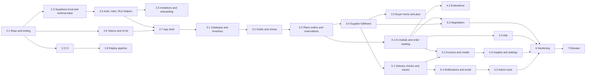

# Implementation plan

Status: Phase 1 draft for review. Each milestone (M) is one pull request or a small set of them, using Conventional Commits. For each feature, the order is: confirm the story, write tests, implement, run checks, update docs, commit. Each phase ends with a summary and test results, and waits for approval.

## 1. Before Phase 2: owner actions

| # | Action | Why | Blocking |
| --- | --- | --- | --- |
| O1 | Install Node 24 LTS (replace Node 20.15) | Vitest 5 and supabase-js need Node 22 or later (ADR 0002) | M2.1 |
| O2 | Install Docker Desktop and the Supabase CLI | Local database and tests (ADR 0022) | M2.3 |
| O3 | Decide the GitHub account or organisation for a private `tradelink` repository; I can create it with `gh` after your approval | Source control and CI | M2.1 push |
| O4 | Decide the Vercel team and plan (Hobby or Pro) | Hosting and cron frequency (ADR 0013) | M2.8 |
| O5 | Decide the Supabase organisation and plan for preview and production projects | Hosted databases (ADR 0003) | M2.8 |
| O6 | Add `ANTHROPIC_API_KEY` to `.env.local` yourself (never paste it in chat) | AI features and evaluation | M4.1 |
| O7 | Choose a domain and set up Resend with it | Email from a verified domain (ADR 0012) | M5.6 (test mode works earlier) |
| O8 | Approve or adjust the `control-line` token values | Accessibility of controls (ADR 0015) | M2.6 |
| O9 | Provide or approve a privacy notice (PDPA) | Personal data and AI processing | Phase 7 |

The connected Supabase and Vercel tools in this workspace can create projects once you approve, in the phase that needs them. Nothing is pushed, deployed to production or created in a paid account without your approval.

## 2. Milestones

### Phase 2: Foundation

| M | Scope | Stories | Done when |
| --- | --- | --- | --- |
| 2.1 | Next.js 16 app, strict TypeScript, ESLint with import boundaries and no `any` or `console.log`, Prettier, Vitest, Playwright set up, `.env.example`, `src/lib/env.ts`, logger, error codes, `CLAUDE.md`, README skeleton | OPS-06 | `npm run lint`, `typecheck`, `test` pass |
| 2.2 | GitHub Actions: lint, types, unit, build, Supabase start, pgTAP, integration, E2E, axe; branch protection proposal; Dependabot; CodeQL; secret scan | OPS-11 | CI green on the first PR |
| 2.3 | Supabase config, migrations for organisations, profiles, memberships, settings, connections, invitations, audit log, state transitions, rate limits, idempotency keys; type generation check; seed of organisations and users | SH-11, OPS-03, OPS-07, OPS-08 (part) | `supabase db reset` works; types generated; pgTAP base tests pass |
| 2.4 | Supabase Auth with `@supabase/ssr`, request proxy (session, request ID, role routing, `aal2` routing), sign in, sign out, forgot and reset password, two-factor setup and verify, RLS helper functions, denied-attempt logging | AUTH-01 to AUTH-06, AUTH-08, AUTH-09 | Auth E2E and RLS helper tests pass |
| 2.5 | Invitation tokens and accept page for buyer, member and admin kinds; team panel | AUTH-07, SH-14 | Token reuse, expiry and concurrency tests pass |
| 2.6 | Token build script, Tailwind 4 theme, fonts, design-system components (Button, Pill, Chip, Segmented, Switch, Input, Panel, StatCard, ServiceGrid, HomeHero, OrderCard record, TodoItem, ProgressSteps, ProductArt, BusinessLogo, Toast, CartBar shell, BottomNav and rail, AttentionCard) with stories in a component gallery page | SH-03, SH-08, SH-12 | Component tests, axe on the gallery in both themes |
| 2.7 | App shell per role, More sheet, theme toggle and settings, notifications bell placeholder that reads a real table, error and not-found pages, offline banner, manifest and service worker | SH-01, SH-02 (layout), SH-04 to SH-07, SH-13 | Shell E2E on six viewport and theme combinations |
| 2.8 | Vercel project linked to the repository, preview deployments with a preview Supabase project, environment variables, `/api/health` and `/api/health/ready` | OPS-05 (endpoints) | A preview deploy of the shell works; production not deployed |

### Phase 3: Core commerce

| M | Scope | Stories | Done when |
| --- | --- | --- | --- |
| 3.1 | Products, inventory levels, stock history, price changes; supplier inventory page, add product, receive, confirm, change price, adjust; stock history; Availability page | SUP-10 to SUP-16, BUY-42, OPS-01 | Stock history replay test; RLS matrix for catalogue tables |
| 3.2 | Drafts and draft lines; Order page with usuals, manual add, product cards, CartBar; review lines with picker, stepper, substitutes, price warning; add a missing product and invite a supplier; summary with cut-offs, budget warning and delivery dates; rule-based reader as the first reader | BUY-12 to BUY-21, BUY-23, SUP-20, SUP-21 | Review E2E with the prototype's sample message |
| 3.3 | `place_orders` with locks, idempotency, split by supplier, unconfirmed lines; buyer Orders page and cancel | BUY-22, BUY-27, BUY-28, OPS-02, OPS-04 | Concurrency suite passes |
| 3.4 | Supplier Home and To do, Incoming orders, accept with date, part accept, reject, out for delivery, delivered, Activity; business profile and bank details | SUP-01 to SUP-07, SUP-17 to SUP-19, BUY-26 | Fulfilment state machine tests pass |
| 3.5 | Buyer Home with To do (price, part delivery), Ready for tomorrow, Not today, Arriving; usual items in Settings | BUY-01 to BUY-03, BUY-08, BUY-09, BUY-46 | Reorder plan unit tests; buyer home E2E |

### Phase 4: AI

| M | Scope | Stories | Done when |
| --- | --- | --- | --- |
| 4.1 | `src/integrations/claude` with typed `readOrder`, structured outputs, catalogue checks, timeouts, refusal fallback, rule-based fallback, usage logging, prompt caching | BUY-10, BUY-11, AI-01 to AI-03, AI-05 | Mocked tests for every failure mode |
| 4.2 | Labelled evaluation sets (orders, invoices, injection), evaluation script and nightly workflow; tune effort and prompts | AI-04, AI-06 | First evaluation report; thresholds agreed with owner |
| 4.3 | Ask with streaming, read-only tools, cards, "Review order", refusal copy | BUY-47 to BUY-50 | Tool scoping tests; Ask E2E with a mocked model |

### Phase 5: Operations

| M | Scope | Stories | Done when |
| --- | --- | --- | --- |
| 5.1 | All here, Report a problem, Not here yet, issues and supplier answers, To do replies | BUY-04, BUY-29 to BUY-31, SUP-09 | Issue state machine tests |
| 5.2 | Invoice upload, `readInvoice`, checks, bank fingerprint, manual entry, query, accept, clear, credits | BUY-05, BUY-06, BUY-32 to BUY-37, AI-07 | Invoice E2E for all four outcomes |
| 5.3 | Minimum-order negotiation: warning, item suggestions, AI drafts, buyer approval, supplier responses, fee flow | BUY-07, BUY-24, BUY-25, SUP-08, AI-08 | Negotiation E2E; no unapproved send path |
| 5.4 | Notifications table and pages for all roles, Realtime, email outbox and Resend (test mode), templates | SH-09, SH-10, OPS-10 | Notification and outbox tests |
| 5.5 | Admin: home, needs attention (view, filters, assign, handled), notifications, all orders, suppliers and profile, suspend and reactivate, users, buyer details, invite buyer, operators, system status with cron health checks, audit log, settings, connections | ADM-01 to ADM-20, SUP-22, OPS-05 | Admin E2E with two-factor; attention rule tests |
| 5.6 | Insights (tiles, weekly chart, spend by supplier, supplier record, price changes), buyer settings (budget, switches, can and cannot) | BUY-38 to BUY-41, BUY-43 to BUY-45 | Insights figures match seed calculations |

### Phase 6: Hardening

| M | Scope | Done when |
| --- | --- | --- |
| 6.1 | Security review: every `security definer` function, headers and CSP, OWASP ASVS level 2 checklist, dependency audit, secret bundle check | Checklist in `docs/SECURITY.md` complete |
| 6.2 | Accessibility: full axe sweep, keyboard runs, screen reader checks, contrast fix sign-off | Zero violations; manual notes recorded |
| 6.3 | Performance: Lighthouse CI budgets, query plans, indexes, pagination | Budgets met (OPS-12) |
| 6.4 | Concurrency and load: extended concurrency suite, 5,000 orders a day simulation on the preview project | No oversell; p95 targets met |
| 6.5 | Full E2E coverage on six combinations; visual comparison with the prototype; baselines approved by the owner | Story map in TEST_PLAN section 11 fully green |
| 6.6 | Retention jobs and housekeeping | OPS-09 |

### Phase 7: Release

| M | Scope | Done when |
| --- | --- | --- |
| 7.1 | Production Supabase and Vercel environments, production secrets, Resend domain, cron, backups confirmed (with owner approval) | Production configured |
| 7.2 | Production migrations and demo accounts seed (buyer, supplier, admin) | Demo accounts sign in on production |
| 7.3 | Smoke tests on production: sign in for each role, place and fulfil an order between demo businesses, invoice check, health endpoints | All pass |
| 7.4 | Documentation: README with the deployed URL, USER_GUIDE, TECHNICAL_DESIGN, RUNBOOK (deploy, rollback, incidents, key rotation), SECURITY, TESTING, CHANGELOG, CLAUDE.md | A new engineer can run, test and deploy from the docs |

## 3. Risks and mitigations

| Risk | Impact | Mitigation |
| --- | --- | --- |
| AI misreads orders | Wrong items ordered | Mandatory review, catalogue-only matching, evaluation thresholds, fallback reader |
| Negotiation feature has no approved design | Rework | Build from existing components; screenshot review at M5.3 before polishing |
| TypeScript 7 not yet supported by Next.js | Tooling friction | Use the newest supported version (ADR 0002) |
| Vercel Hobby cron limits | Health and email delays | Move frequent jobs to `pg_cron` (ADR 0013) |
| Supabase free tier pauses | Preview or demo unavailable | Paid plan before release (O5) |
| Scope size | Phases run long | Must stories first; Should and Could stories can move to after release with owner approval |
| Owner availability for approvals | Blocked phases | Each phase lists owner actions up front |

## 4. Definition of done (per story)

1. Story confirmed and acceptance criteria unchanged or updated with approval.
2. Tests written first and passing at every level listed in TEST_PLAN section 11.
3. Implemented with no `any`, no TODOs, no dead code and no debug logs.
4. Lint, types, all tests and build pass in CI.
5. Docs updated (API, DATA_MODEL, USER_GUIDE, CHANGELOG as relevant).
6. Committed with a Conventional Commit message and merged by pull request.
