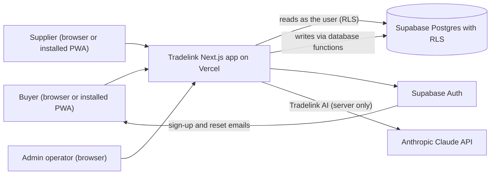
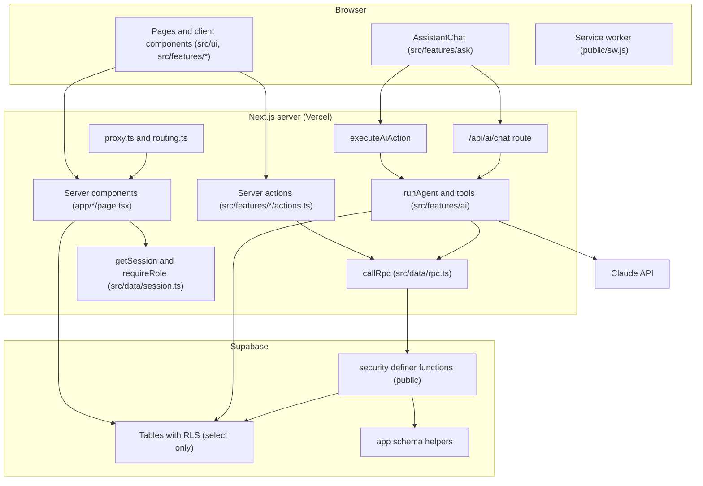
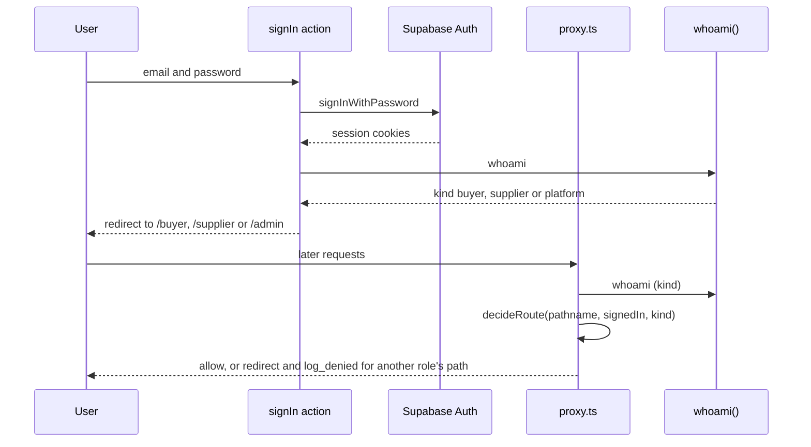
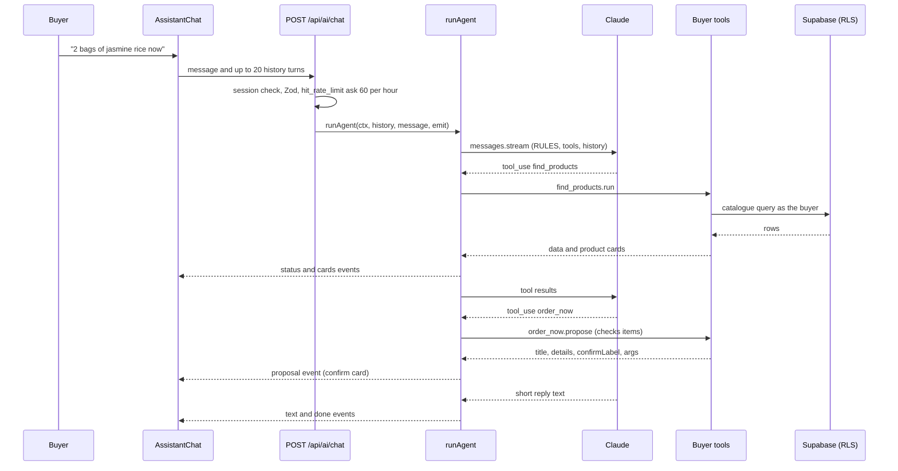
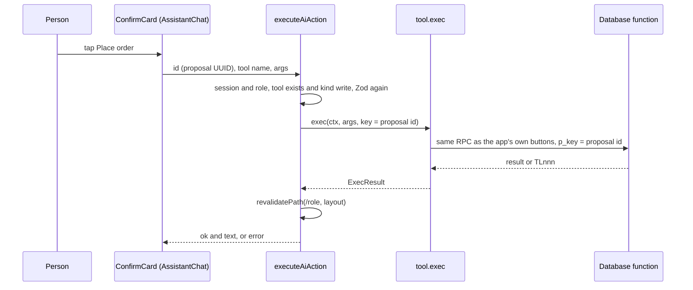
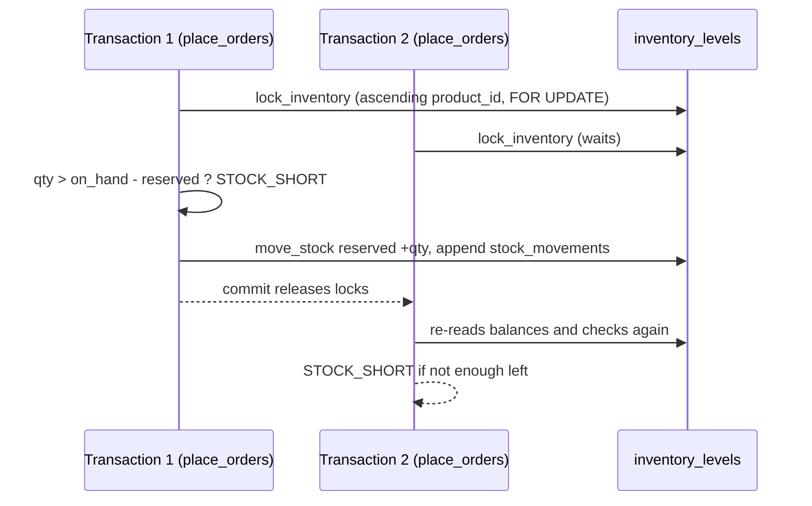
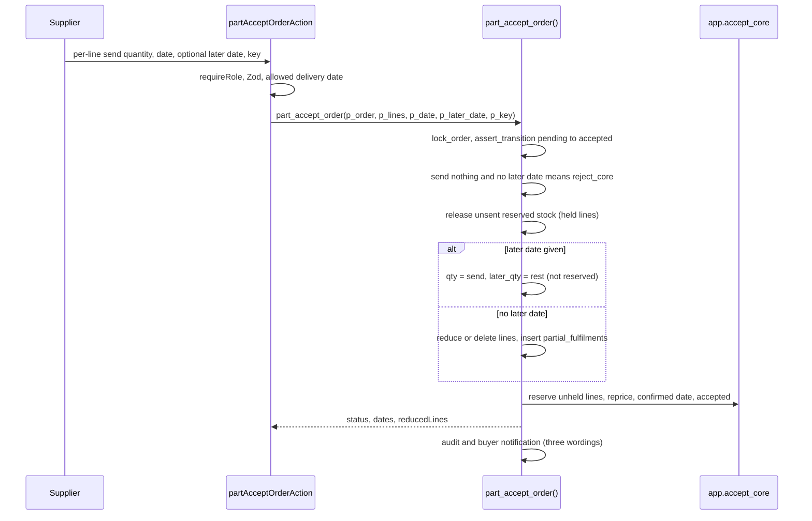
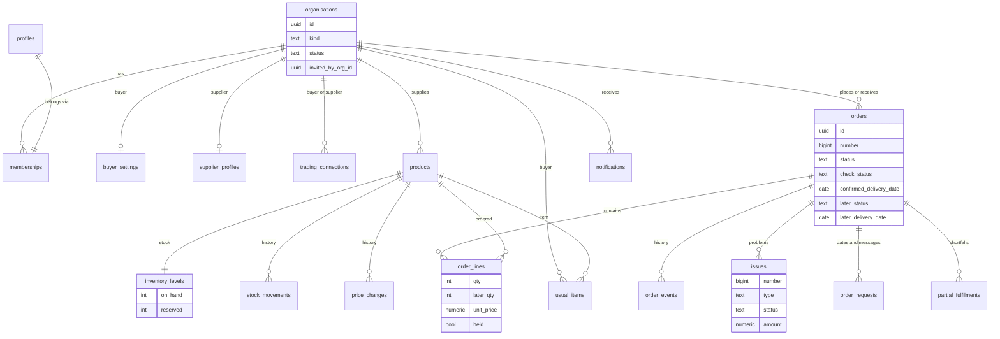
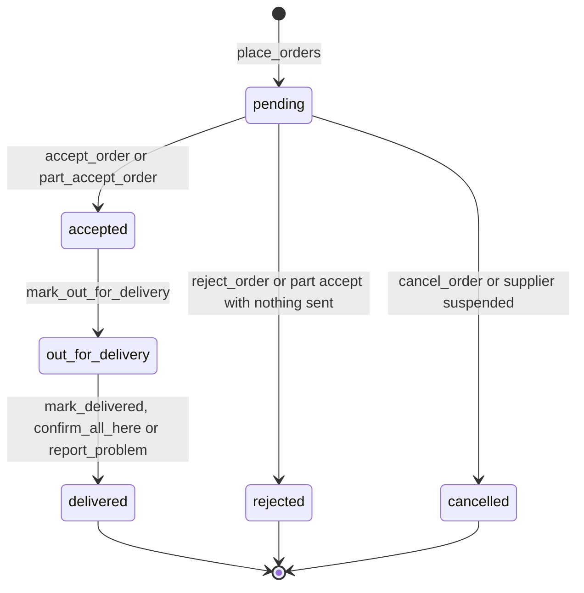

# Tradelink Technical Specification

| Field | Value |
| --- | --- |
| Document | Technical Specification Document (TSD), as built |
| Product | Tradelink, with Tradelink AI |
| Version | 1.1 |
| Date | 4 November 2026 |
| Status | Draft for review |
| Owner | Janya Mali |
| Code baseline | `develop` at commit `9250e98` and 17 applied database migrations (latest `20261104040939`) |

## Contents

1. [Overview](#1-overview)
2. [Technology choices](#2-technology-choices)
3. [Considered but not used](#3-considered-but-not-used)
4. [Architecture](#4-architecture)
5. [Key flows](#5-key-flows)
6. [Data model](#6-data-model)
7. [Security](#7-security)
8. [Testing](#8-testing)
9. [Delivery and operations](#9-delivery-and-operations)
10. [Running cost](#10-running-cost)

**Purpose.** How Tradelink is built, what it uses and why, and what was left out and why. For engineers maintaining the code. Requirements are in the [Functional Specification](Functional_Specification.md). Where a reason was not recorded, it is marked **Inferred rationale**.

---

## 1. Overview



- The browser never talks to Supabase or Claude directly; every read and write runs on the server as the signed-in user.
- One responsive app serves phone and laptop (layout switches at 760 px) and installs as a PWA.
- Layout: `app/<role>/` routes, `src/features/` actions and queries, `src/domain/` pure rules, `src/data/` Supabase clients, `src/integrations/claude/` AI client, `src/ui/` components.

## 2. Technology choices

Versions are from [`package.json`](../../package.json).

| Technology | Version | Why it is used |
| --- | --- | --- |
| Next.js (App Router) | 16.4.2 | Server components and server actions keep keys, data access and AI on the server; one codebase for phone and laptop; Vercel deploys it natively ([ADR 0002](../adr/0002-nextjs-on-vercel.md)) |
| React | 19.3.1 | Comes with Next.js; `useActionState` and transitions handle form saves |
| TypeScript (strict) | 6.0.3 | Catches errors at build time; `any` is banned by lint |
| Tailwind CSS, with design tokens | 4.3.3 | Utility classes generated from the design system's `tokens.json`; one token file drives light and dark mode ([ADR 0015](../adr/0015-design-tokens-and-tailwind.md)) |
| Supabase: Postgres, Auth, RLS | supabase-js 2.118.0, ssr 0.12.7 | Real transactions and row locks for stock; Row Level Security for tenancy; managed sign-in and password reset ([ADR 0003](../adr/0003-supabase-platform.md)) |
| `security definer` database functions | — | Every write checks role, state, stock, audit and notification in one transaction; there are no write policies ([ADR 0004](../adr/0004-writes-through-postgres-functions.md)) |
| Claude Sonnet 5.5 via `@anthropic-ai/sdk` | 0.135.0, model `claude-sonnet-5-5` | Tradelink AI: tool use for reading and proposing actions, streaming replies, prompt caching ([ADR 0008](../adr/0008-claude-integration.md)) |
| Zod | 4.6.7 | One schema validates action input, route bodies and AI tool input |
| Vitest | 4.1.12 | Fast unit tests for pure domain rules and feature logic |
| Playwright | 1.56.1 | End-to-end tests on desktop Chrome and a Pixel 7 profile; also captures documentation screenshots |
| Vercel | Hobby plan | Git-connected deploys: `develop` previews, `main` production |
| `web-push` | 3.6.7 | Installed for push notifications; not switched on (section 3) |

**Rules that follow:** reads use the user's session, so RLS decides visibility; writes go only through database functions (`callRpc`), with an idempotency key on critical ones; money is integer cents in TypeScript and `numeric(12,2)` in Postgres, times in Asia/Singapore ([ADR 0019](../adr/0019-money-time-and-quantities.md)); the AI never writes without a person's tap.

## 3. Considered but not used

| Option | Status | Why not (limitation or decision) |
| --- | --- | --- |
| Native iOS and Android apps | Not used | One responsive PWA covers phone and laptop with one codebase; users already work in a browser or WhatsApp ([ADR 0016](../adr/0016-pwa-and-offline.md)) |
| Stripe or any payments | Not used | Owner decision, 4 November 2026: no payments or subscription billing |
| Email provider (Resend) | Not configured | No provider account or key; only Supabase Auth's own sign-up and reset emails are sent ([ADR 0012](../adr/0012-notifications-and-email.md) is not built) |
| Push notifications | Built, not switched on | Plumbing exists (`web-push`, `/api/push/*`, service worker), but no opt-in button and no sender call it; VAPID keys are not set in Vercel |
| Scheduled jobs (`pg_cron`) | Not applied | The runner and `supabase/migrations/pending_ai_job_cron.sql` exist; the schedule waits for the server secret key in Vercel. Nothing in the live app needs jobs |
| Supabase branching for a test database | Not available | Needs the Supabase Pro plan; the attempt failed on the Free plan, so tests that write were not run |
| CI (GitHub Actions) | None | Checks run locally with `npm run check` before pushing. Inferred rationale: a one-developer sprint |
| Coverage tooling | None | No coverage package is installed; coverage is not measured |
| Content Security Policy | None | Other headers are set in `next.config.ts`; a CSP was planned in [ADR 0010](../adr/0010-untrusted-content-and-prompt-injection.md) but not added |
| Two-factor sign-in | Removed | Owner decision for a working demo with self sign-up ([ADR 0024](../adr/0024-self-sign-up-without-two-factor.md)) |
| Invoice upload and checks (OCR) | Not built | Out of the sprint scope; only an unused `invoice` problem type remains |
| Rules-based order reader in the live path | Not used | `readOrderWithClaude` with grounding and a rules fallback exists but has no UI caller; the live assistant uses tools instead |
| AI evaluation set | None | No `evals/` folder; AI behaviour is covered by unit tests with a mocked SDK |

## 4. Architecture



- **Server and client.** Server modules import `server-only`, so a client import fails the build; client components hold no keys.
- **Rendering.** Pages are server components that call `requireRole` and read through RLS; changes are server actions ending in `revalidatePath`.
- **Dependencies.** `app/` → `src/features/` → `src/data/`, `src/domain/`, `src/ui/`; `src/domain/` imports nothing, so its rules are tested without a database.
- **Errors.** Database functions raise `TLnnn:REASON:detail`; [`callRpc`](../../src/data/rpc.ts) maps the reason to fixed copy ([`src/lib/errors.ts`](../../src/lib/errors.ts)) and logs blocked attempts.
- **Logging.** [`src/lib/logger.ts`](../../src/lib/logger.ts) writes JSON lines to Vercel logs and redacts sensitive field names.

## 5. Key flows

### 5.1 Sign-in and roles



The organisation's `kind` is the role and also drives RLS. The proxy only redirects; the database enforces every permission. Self sign-up runs `app.handle_new_user`, which creates the organisation and connects it to every active counterpart.

### 5.2 Tradelink AI with confirm cards





- **Why.** The model only reads and proposes. A change runs after a person taps, is validated again on the server and uses the same database functions as the app's buttons; the proposal id is the idempotency key.
- **Limits.** 2,000 characters per message, 20 history turns, 60 messages per hour, 6 tool rounds; prompt caching on rules, tools and conversation.
- **Tools.** Buyers: 11 read, 17 confirm, 2 card-only. Suppliers: 7 read, 17 confirm, 1 card-only ([`buyer-tools.ts`](../../src/features/ai/buyer-tools.ts), [`supplier-tools.ts`](../../src/features/ai/supplier-tools.ts)).
- **Safety.** Tool results are data, tools run as the user under RLS, and writes need a tap ([ADR 0010](../adr/0010-untrusted-content-and-prompt-injection.md)). Without a key the route returns 503.

### 5.3 Placing orders and reserving stock

`place_orders` locks inventory, checks availability, creates one order per supplier, reserves stock and writes events, audit and notifications in one transaction.



`supabase/migrations/20261103085139_app_functions.sql`
```sql
create function app.lock_inventory(p_products uuid[]) returns void
language plpgsql set search_path = '' as $$
begin
  perform 1 from public.inventory_levels i
  where i.product_id = any (p_products)
  order by i.product_id
  for update;
end $$;
```

**Why.** Checking and reserving under row locks in one transaction is the simplest way to prevent overselling ([ADR 0006](../adr/0006-inventory-history-and-reservations.md)); a fixed lock order avoids deadlocks, and `reserved <= on_hand` is a backstop constraint.

### 5.4 Part acceptance and delivery



The rest of a part-accepted order is not reserved (Inferred rationale: the stock is not there yet); `deliver_rest` checks free stock when it goes.

### 5.5 Delivery, problems, credits and disputes

- `mark_out_for_delivery`, then `mark_delivered`, which removes the quantity from `on_hand` and `reserved`.
- The buyer confirms (`confirm_all_here`) or reports a problem (`report_problem`, amount = quantity × unit price).
- The supplier answers (`answer_issue`): credit, replace, on the way or dispute; disputes are settled by an admin (`resolve_dispute`). A credit closes when the buyer confirms it (`mark_credit_received`).
- Notifications are in-app rows written in the same transaction as the change.

## 6. Data model





| Rule | Enforced by |
| --- | --- |
| Status moves only along allowed edges (orders, issues, organisations) | `app.state_transitions` table plus the `app.guard_status` trigger; functions call `app.assert_transition` first for a friendly message ([ADR 0007](../adr/0007-state-machines.md)) |
| Reserved stock never exceeds stock on hand | Check constraints, plus checks under lock in `place_orders` and `accept_core` |
| History cannot be edited | `app.forbid_change` triggers on `audit_log`, `stock_movements`, `price_changes`, `order_events` |
| One open "late" problem per order | Unique index `issues_one_open_late` |
| Schema changes | A new file in `supabase/migrations/`, named with the applied version; applied migrations are never edited |

The migrations also create about 40 `rs_*` tables for a Tradelink AI foundation (cards, jobs, push), used only by the `/r` page.

## 7. Security

| Area | How it is handled |
| --- | --- |
| Authentication | Supabase Auth with cookie sessions (`@supabase/ssr`); no two-factor sign-in ([ADR 0024](../adr/0024-self-sign-up-without-two-factor.md)) |
| Authorisation | `requireRole` on pages and actions; RLS on every table; every write function calls `app.require_kind` or `app.require_member`; the operations lead is `admin_profiles.is_lead` |
| Data isolation | Tenancy by organisation; another business's order raises the same `NOT_FOUND` as a missing one |
| Secrets | `ANTHROPIC_API_KEY`, `SUPABASE_SECRET_KEY` and `VAPID_PRIVATE_KEY` are server only, in `.env.local` (git-ignored) and Vercel; the demo password is not in the repository |
| Input validation | Zod in every action and route, argument checks in database functions, table constraints |
| Rate limits | Postgres fixed window per user: AI chat 60 per hour, order messages 30 per hour |
| Audit | Every write calls `app.audit`; blocked attempts are logged; the log is append-only |
| Headers | `X-Frame-Options: DENY`, `nosniff`, HSTS, Referrer-Policy, Permissions-Policy; no CSP |
| File uploads | None |

**Accepted risks:** no two-factor sign-in; self sign-up connects a new business to every counterpart; a demo password remains in old commits (owner decision).

## 8. Testing

| Suite | Command | Result on 4 November 2026 |
| --- | --- | --- |
| Unit (Vitest, 72 files) | `npm test` | **838 passed, 1 skipped** (71 files passed, 1 skipped; 33 s) |
| End to end, read only | `npx playwright test e2e/smoke.spec.ts e2e/pages.spec.ts` | **16 passed** (8 tests on desktop Chrome and on a Pixel 7 profile) |
| End to end, order flow | `npx playwright test e2e/order-flow.spec.ts` | Not run: writes real orders to the live database |
| Stock concurrency (24 parallel orders) | `RUN_DB_TESTS=1 NODE_OPTIONS=--experimental-websocket npm test -- tests/concurrency` | Not run: writes to the live database |
| Coverage | — | Not measured: no coverage tool |
| Type-check and lint | `npm run typecheck`, `npm run lint` | Clean |

End-to-end tests read the demo password from `E2E_PASSWORD` in `.env.local`.

## 9. Delivery and operations

- **Releases.** Work on `develop`; release by fast-forwarding `main`. Run `npm run check` before pushing (no CI).
- **Vercel.** `develop` makes previews, `main` deploys production; server-only variables are marked sensitive.
- **Database.** Test a migration in a rolled-back transaction, apply it, then save it in `supabase/migrations/`; keep changes backward compatible.
- **Rollback.** Promote the previous Vercel deployment; for the database, a new migration restoring the earlier definition.
- **Monitoring.** `GET /api/health` (liveness), JSON logs in Vercel, AI tokens in `ai_usage`.

## 10. Running cost

| Item | Today | Note |
| --- | --- | --- |
| Hosting (Vercel) | Hobby plan, free | Personal and non-commercial use only; Pro is US$20 per developer seat per month |
| Database (Supabase) | Free plan | Pauses after 7 idle days, 500 MB database; Pro is US$25 per month per organisation |
| AI (Claude Sonnet 5.5) | Pay per use | US$2 per million input tokens, US$10 per million output tokens, cache reads US$0.20 |

**Measured AI use** (`public.ai_usage`, 3 to 4 November 2026): 135 Tradelink AI replies, averaging 6,551 input and 223 output tokens. That is at most about **US$0.015 per reply** (all input at the full rate; caching lowers it), or about **US$2.07** for all 135.

Hosting prices are list prices from third-party summaries; check vercel.com/pricing and supabase.com/pricing before buying.
