# Tradelink Technical Specification

| Field | Value |
| --- | --- |
| Document | Technical Specification Document (TSD), as built |
| Product | Tradelink, with Tradelink AI |
| Version | 1.0 |
| Date | 4 November 2026 |
| Status | Draft for review |
| Owner | Janya Mali |
| Code baseline | `develop` at commit `9250e98` and 17 applied database migrations (latest `20261104040939`) |

## Contents

1. [Technical overview](#1-technical-overview)
2. [Repository guide](#2-repository-guide)
3. [Local development](#3-local-development)
4. [Architecture](#4-architecture)
5. [Key code walkthroughs](#5-key-code-walkthroughs)
6. [Domain model](#6-domain-model)
7. [Database reference](#7-database-reference)
8. [API and server action reference](#8-api-and-server-action-reference)
9. [Frontend reference](#9-frontend-reference)
10. [AI integration](#10-ai-integration)
11. [Security](#11-security)
12. [Testing](#12-testing)
13. [Delivery and operations](#13-delivery-and-operations)
14. [Decision log](#14-decision-log)
15. [Performance and scalability](#15-performance-and-scalability)
16. [Maintenance guide](#16-maintenance-guide)
17. [Known technical debt](#17-known-technical-debt)
- [Appendix A. Differences from older documents](#appendix-a-differences-from-older-documents)
- [Appendix B. Possible defects found during documentation](#appendix-b-possible-defects-found-during-documentation)
- [Glossary](#glossary)
- [Document history](#document-history)

## Purpose, audience and scope

**Purpose.** This document explains how Tradelink works as built. It covers where each part lives in the repository and why it is designed that way. It is code documentation, not a list of requirements; the requirements are in the Functional Specification.

**Audience.** Engineers who maintain or extend this codebase.

**Scope.**
- **Covered:**
  - the Next.js application in `app/` and `src/`;
  - the Supabase database defined by `supabase/migrations/`;
  - the Claude integration;
  - tests, tooling, deployment and operations.
- **Built but not used by the live app** (described briefly in [section 10.8](#108-tradelink-ai-foundation-not-in-use)):
  - the "Tradelink AI shop" foundation: `/r`, the `rs_*` tables and functions, jobs and the push notification service.
- **Not built, and described as not built where relevant:** invoices, invitation emails and push opt-in.

**Sources.** Every statement comes from the code, the migrations, the tests or an ADR. When code and an older document disagree, this document follows the code and lists the difference in [Appendix A](#appendix-a-differences-from-older-documents). When a design reason is not recorded anywhere, it is marked **Inferred rationale** and listed in [section 14.1](#141-items-for-owner-review).

---

## 1. Technical overview

### 1.1 System context

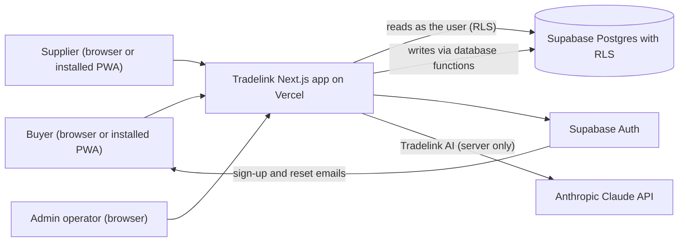

- **The browser never talks to Supabase or Claude directly.** Every read and write runs in a Next.js server component, server action or route handler, as the signed-in user.
- **Email:** the only outgoing email is Supabase Auth's own sign-up confirmation and password reset. The app has no email provider.

### 1.2 Technology stack

Versions are taken from [`package.json`](../../package.json).

| Layer | Technology | Version |
| --- | --- | --- |
| Framework | Next.js (App Router, `proxy.ts` middleware) | 16.4.2 |
| UI | React and React DOM | 19.3.1 |
| Language | TypeScript, strict | 6.0.3 |
| Styling | Tailwind CSS with `@tailwindcss/postcss` | 4.3.3 |
| Database and auth | `@supabase/supabase-js` / `@supabase/ssr` | 2.118.0 / 0.12.7 |
| AI | `@anthropic-ai/sdk` (default model `claude-sonnet-5-5`) | 0.135.0 |
| Validation | Zod | 4.6.7 |
| Web push (built, not used) | `web-push` | 3.6.7 |
| Unit tests | Vitest | 4.1.12 |
| End-to-end tests | `@playwright/test` | 1.56.1 |
| Lint | ESLint with `eslint-config-next` | 9.39.5 / 16.4.2 |
| Runtime | Node.js (`engines.node >= 20.9.0`) | — |
| Hosting | Vercel (project connected to GitHub) | — |

### 1.3 Major design principles

| Principle | Where it shows | Record |
| --- | --- | --- |
| Reads go through the user's session, so RLS decides what is visible | `src/data/supabase/server.ts`, every `*_read` policy | [ADR 0004](../adr/0004-writes-through-postgres-functions.md), [ADR 0005](../adr/0005-tenancy-and-connections.md) |
| Writes go only through `security definer` database functions; there are no insert, update or delete policies | [`src/data/rpc.ts`](../../src/data/rpc.ts), `supabase/migrations/20261103085139_app_functions.sql` | [ADR 0004](../adr/0004-writes-through-postgres-functions.md) |
| State changes are checked against a transition table | `app.state_transitions`, `app.guard_status` | [ADR 0007](../adr/0007-state-machines.md) |
| Stock is reserved inside the same transaction that creates the order | `app.lock_inventory`, `app.move_stock` | [ADR 0006](../adr/0006-inventory-history-and-reservations.md) |
| Critical writes are idempotent | `app.idem_get` / `app.idem_put`, `p_key` arguments | [ADR 0004](../adr/0004-writes-through-postgres-functions.md) |
| Money is integer cents in TypeScript and `numeric(12,2)` in Postgres; times use Asia/Singapore | [`src/domain/money.ts`](../../src/domain/money.ts), [`src/domain/singapore-time.ts`](../../src/domain/singapore-time.ts) | [ADR 0019](../adr/0019-money-time-and-quantities.md) |
| AI is server only, and every AI change needs a person's tap | [`src/integrations/claude/client.ts`](../../src/integrations/claude/client.ts), [`src/features/ai/execute.ts`](../../src/features/ai/execute.ts) | [ADR 0008](../adr/0008-claude-integration.md), [ADR 0010](../adr/0010-untrusted-content-and-prompt-injection.md) |
| One responsive app for phone and laptop, installable as a PWA | `rail:` breakpoint (760px), [`app/manifest.ts`](../../app/manifest.ts), [`public/sw.js`](../../public/sw.js) | [ADR 0002](../adr/0002-nextjs-on-vercel.md), [ADR 0016](../adr/0016-pwa-and-offline.md) |
| Append-only history tables | `app.forbid_change` triggers | [ADR 0006](../adr/0006-inventory-history-and-reservations.md) |

---

## 2. Repository guide

### 2.1 Folder structure

| Path | Responsibility |
| --- | --- |
| `app/` | Next.js routes. `app/buyer/`, `app/supplier/` and `app/admin/` hold each role's pages, layouts, `loading.tsx` and `error.tsx`. `app/api/` holds the route handlers. The auth pages are `sign-in`, `sign-up`, `forgot-password`, `reset-password` and `auth/callback`. Also `offline`, `r` (Tradelink AI shop) and `(dev)/kit` (UI kit, development only). |
| `src/ui/` | Design-system components (`Button`, `DataTable`, `Pill`, `PageHeader` and others) and the app shell in `src/ui/shell/`. |
| `src/features/<feature>/` | Server actions, queries and feature components. Features: admin, ai, ask, auth, buyer, cards, home, insights, notifications, ordering, orders, products, settings, shell, supplier. |
| `src/domain/` | Pure business rules with no I/O, unit tested: money, Singapore time, cut-off, minimum order, reorder, to-dos, insights, review, and the order reader in `reader/`. |
| `src/data/` | Supabase clients (`supabase/server.ts`, `browser.ts`, `admin.ts`), the session (`session.ts`), `callRpc` (`rpc.ts`) and the catalogue reader. |
| `src/integrations/claude/` | The Claude client and the (currently unused) order reader. Server only. |
| `src/lib/` | `errors.ts` (error codes to copy), `logger.ts` (structured logs), `env.ts` (public environment schema), `events.ts`. |
| `src/agents/`, `src/cards/`, `src/jobs/`, `src/notifications/`, `src/offline/`, `src/pwa/`, `src/i18n/` | The Tradelink AI foundation: card definitions, job runner, push notification service, offline outbox, PWA chrome and translations. Section 10.8 explains what is live. |
| `src/styles/` | `tokens.css`, generated by `npm run tokens`. |
| `supabase/migrations/` | Schema, RLS and functions, one file per applied migration, named with the version Supabase records. |
| `supabase/seed.sql`, `mock-data.sql`, `tradelink-ai-mock-data.sql` | Fictional demo data. The password placeholder is `__DEMO_PASSWORD__`. |
| `e2e/` | Playwright specs and helpers. |
| `tests/concurrency/` | An opt-in test that runs against a real Supabase project. |
| `scripts/` | `build-tokens.mjs` and `build-icons.mjs`. |
| `design-handoff/` | The design system: tokens, component READMEs and previews, logos. |
| `docs/` | Product and architecture documents, ADRs and these final documents. |

### 2.2 Naming and coding conventions

These conventions come from the project rules and are enforced by [`eslint.config.mjs`](../../eslint.config.mjs) and review.

- **Strict TypeScript.** No `any` (`@typescript-eslint/no-explicit-any: error`). No `console.*` outside [`src/lib/logger.ts`](../../src/lib/logger.ts) and `scripts/`.
- **Server action names** end in `Action` (for example `acceptOrderAction`). Database function names are `snake_case` verbs (for example `place_orders`). AI tool names are `snake_case` (for example `order_now`).
- **Every write action:**
  - validates its input with Zod;
  - sends `p_key` (a UUID) when the function takes one;
  - maps errors through [`src/lib/errors.ts`](../../src/lib/errors.ts);
  - calls `revalidatePath`.
- **Copy:** sentence case, no exclamation marks, no emoji. Buttons are named with a verb and an object (for example "Place order").
- **Money:** handled as integer `Cents` in TypeScript, never floats.
- **Files:** components are in `PascalCase.tsx`, modules in `kebab-case.ts` or `camelCase.ts`, and tests sit next to their code as `*.test.ts`.
- **Formatting:** Prettier with a print width of 150 is used in practice. There is no committed Prettier config.

### 2.3 How a request moves through the layers

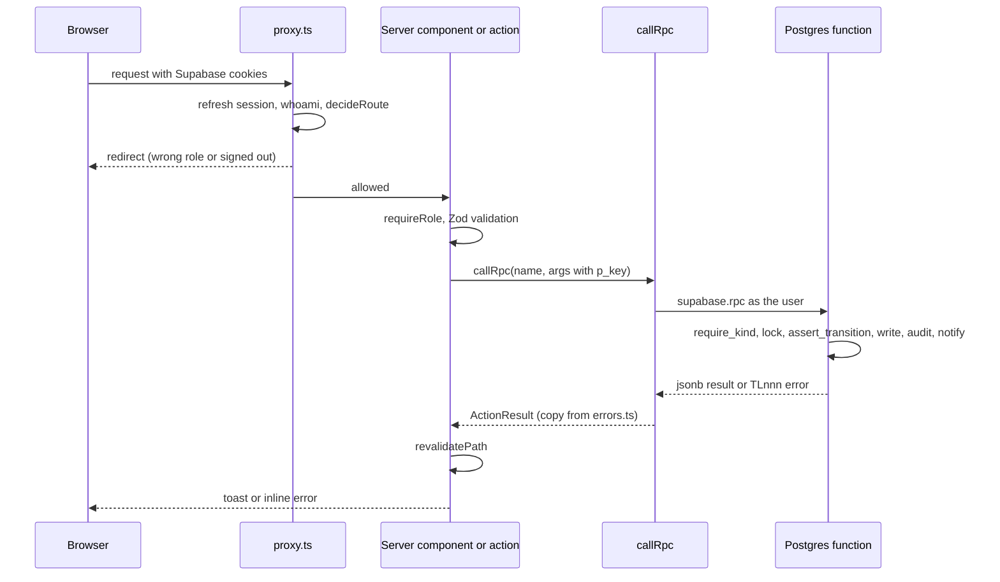

---

## 3. Local development

### 3.1 Prerequisites

- **Node.js 24 LTS.** Any version from 20.9 works for the app. The tests use `--configLoader runner` so that Vitest also runs on Node 20.15.
- **A Supabase project** with the migrations applied.
- **An Anthropic API key**, for Tradelink AI. The app runs without one, and Tradelink AI then shows "Tradelink AI is not set up yet."

### 3.2 Setup

```bash
npm install --legacy-peer-deps
```

The flag works around a peer-dependency bug in npm 10.7.

1. Copy `.env.example` to `.env.local` and fill in the values. `.env.local` is git-ignored.
2. Start the dev server:

```bash
npm run dev
```

### 3.3 Environment variables

Names only; never commit values. The list matches [`.env.example`](../../.env.example).

| Name | Used by | Purpose |
| --- | --- | --- |
| `NEXT_PUBLIC_SUPABASE_URL` | Browser and server ([`src/lib/env.ts`](../../src/lib/env.ts), [`proxy.ts`](../../proxy.ts)) | Supabase project URL |
| `NEXT_PUBLIC_SUPABASE_PUBLISHABLE_KEY` | Browser and server | Publishable (anon) key; RLS applies |
| `SUPABASE_SECRET_KEY` | Server only ([`src/data/supabase/admin.ts`](../../src/data/supabase/admin.ts)) | Service client for agent output and jobs (the Tradelink AI foundation) |
| `ANTHROPIC_API_KEY` | Server only ([`src/integrations/claude/client.ts`](../../src/integrations/claude/client.ts)) | Claude API key |
| `ANTHROPIC_MODEL` | Server only | Overrides the default `claude-sonnet-5-5` |
| `NEXT_PUBLIC_SITE_URL` | Server (password reset links) | Fixes the origin used in emailed links |
| `NEXT_PUBLIC_VAPID_PUBLIC_KEY`, `VAPID_PRIVATE_KEY`, `VAPID_SUBJECT` | Push service (not used today) | Web push keys |
| `E2E_PASSWORD` | Tests only | Demo accounts' password for the e2e and concurrency tests |

These are not in `.env.example`:
- `E2E_BASE_URL`, `E2E_BUYER_EMAIL`, `E2E_SUPPLIER_EMAIL`, `E2E_PRODUCT` and `E2E_OWNER_PASSWORD`: optional test overrides, read in [`e2e/helpers.ts`](../../e2e/helpers.ts), [`e2e/smoke.spec.ts`](../../e2e/smoke.spec.ts) and [`playwright.config.ts`](../../playwright.config.ts).
- `RUN_DB_TESTS`: turns on the concurrency test.
- `TRADELINK_AI_DEV_PAGES`: turns on the development card pages in production. Read in [`src/features/cards/shop.ts`](../../src/features/cards/shop.ts).
- `NEXT_PUBLIC_ENABLE_SW`: registers the service worker in development. Read in [`src/pwa/serviceWorker.ts`](../../src/pwa/serviceWorker.ts).

### 3.4 Migrations and seed data

- **Migrations.** `supabase/migrations/` holds the 17 applied migrations, each named `<version>_<name>.sql` with the version Supabase recorded. In this project they were applied with the Supabase tooling (`apply_migration`) and then saved here. There is no `supabase/config.toml`, so the Supabase CLI is not set up for a local stack.
- **Pending files.** Any `pending_*.sql` file is local only and git-ignored. `pending_ai_job_cron.sql` (the job cron) is not applied.
- **Seed data.** `supabase/seed.sql`, then `mock-data.sql` and `tradelink-ai-mock-data.sql`, create fictional businesses, products and orders. Replace `__DEMO_PASSWORD__` with a password of your choice before running them, and never commit it.

### 3.5 Common commands

| Command | What it does |
| --- | --- |
| `npm run dev` | Development server on port 3000 |
| `npm run build` / `npm start` | Production build and serve |
| `npm run lint` | `eslint .` |
| `npm run typecheck` | `tsc --noEmit` |
| `npm test` | `vitest run --configLoader runner` |
| `npm run e2e` | `playwright test` (starts `npm run dev` if nothing is running) |
| `npm run check` | `tokens`, then `lint`, `typecheck` and `test` |
| `npm run tokens` | Regenerates `src/styles/tokens.css` from `design-handoff/design-system/tokens.json` |
| `npm run icons` | Regenerates the PWA icons |

> **Note for Windows and OneDrive:** in this working copy, `npm run build` failed with `EPERM ... rmdir .next\build` because OneDrive was syncing `.next/`. Keep the repository outside a synced folder.

---

## 4. Architecture

### 4.1 Components

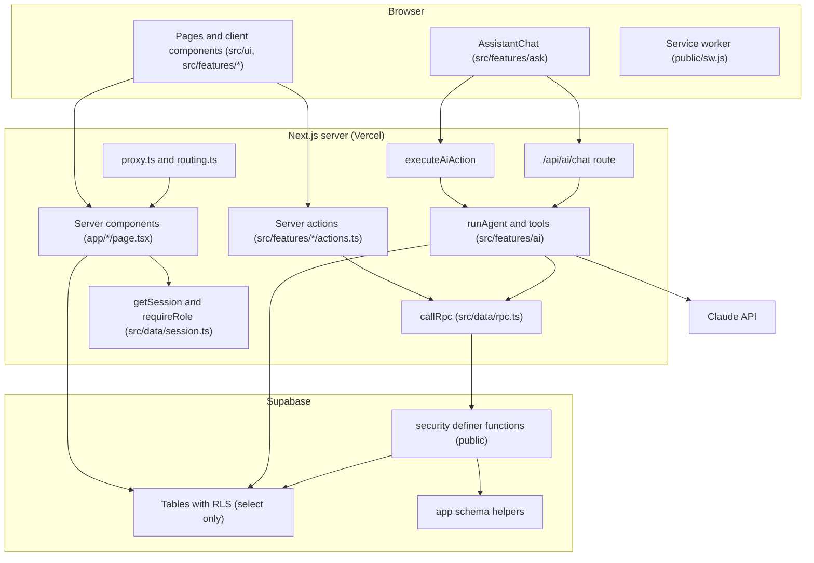

### 4.2 Server and client boundaries

- **`server-only`.** Server code imports `"server-only"` so that importing it from a client component fails the build. Examples:
  - `src/data/session.ts`, `src/data/rpc.ts` and `src/data/supabase/admin.ts`;
  - `src/integrations/claude/client.ts`;
  - `src/features/ai/agent.ts` and `src/features/ai/registry.ts`.
- **Client components** (`"use client"`) never hold keys. They call server actions such as `executeAiAction` or `placeOrdersAction`, or the `/api/ai/chat` route.
- **Supabase clients.** The server client uses the user's cookies, so RLS applies. The admin client (secret key) is used only by the Tradelink AI foundation: cards, jobs and notifications.

### 4.3 Rendering and data fetching

- **Pages are async server components.** Each page:
  - calls `requireRole(...)`;
  - reads through the Supabase server client (tables and `security_invoker` views such as `v_catalogue`, `v_order_totals` and `v_attention`);
  - renders the result.
- **Session caching.** `getSession` is wrapped in React `cache`, so one request calls `whoami` once.
- **Mutations** are server actions that end with `revalidatePath("/<role>", "layout")`, so every page of that role refreshes.
- **Tradelink AI streams.** `/api/ai/chat` returns NDJSON events over a `ReadableStream`.
- **No client-side data library.** There is no React Query or SWR. Client state is local React state plus a few `useSyncExternalStore` stores (section 9.5).

### 4.4 Dependency direction

```text
app/  ->  src/features/*  ->  src/data/, src/domain/, src/integrations/, src/ui/
src/domain/  ->  nothing (pure functions)
src/ui/  ->  src/ui/ only (no data access)
```

`src/domain/` has no imports from `src/data` or `src/features`, which is why its rules can be unit tested without a database. Inferred rationale: this layering is documented in the README and CLAUDE.md; no lint rule enforces it.

### 4.5 Error handling and logging

**Database errors.** Database functions raise `TLnnn:REASON:detail`. `callRpc` turns that into an `ActionResult` with plain copy, and logs denied attempts:

`src/data/rpc.ts`
```ts
export async function callRpc<T = unknown>(name: string, args: Args): Promise<ActionResult<T>> {
  const supabase = await createSupabaseServerClient();
  const { data, error } = await supabase.rpc(name, args);
  if (!error) return { ok: true, data: data as T };

  const parsed = parseDbError(error.message);
  if (parsed.code === "TL500") logger.error("rpc_failed", { rpc: name, pgCode: error.code });
  if (parsed.code === "TL403" || parsed.reason === "INVALID_TRANSITION") {
    await supabase.rpc("log_denied", { p_action: `Blocked from ${name.replaceAll("_", " ")}` });
  }
  return { ok: false, error: parsed.message, reason: parsed.reason, detail: parsed.detail };
}
```

`src/lib/errors.ts`
```ts
export function parseDbError(raw: string | undefined | null): AppError {
  const match = /(TL\d{3}):([A-Z_]+):?(.*)/s.exec(raw ?? "");
  if (!match) return { code: "TL500", reason: "UNEXPECTED", detail: "", message: FALLBACK };
  const [, code = "TL500", reason = "UNEXPECTED", detail = ""] = match;
  return { code, reason, detail: detail.trim(), message: MESSAGES[reason] ?? FALLBACK };
}
```

Why: the database is the only place that knows why a write failed, such as a stale draft or short stock. A typed reason lets the UI show one consistent sentence and highlight the right lines; for `STOCK_SHORT`, the detail is JSON listing each product and what is available.

**Error boundaries:**
- `app/buyer/error.tsx`, `app/supplier/error.tsx` and `app/admin/error.tsx` show a `role="alert"` message with Try again.
- `app/global-error.tsx` covers the root layout.
- **Admin save failures** are a special case. [`useAdminAction`](../../src/features/admin/components/useAdminAction.ts) catches a server action that throws (for example a page opened before a deploy) and returns "This did not save. Reload the page and try again." instead of reaching the error boundary.

**Logging.** [`src/lib/logger.ts`](../../src/lib/logger.ts) writes one JSON line per event and redacts by field name:

```ts
const REDACTED_KEYS = /password|token|secret|key|authorization|cookie|text|email/i;
```

- The redaction is by field name only; values are never inspected.
- Request, user and organisation IDs are not added automatically. `proxy.ts` sets an `x-request-id` response header only.

---

## 5. Key code walkthroughs

### 5.1 Sign-in and role resolution

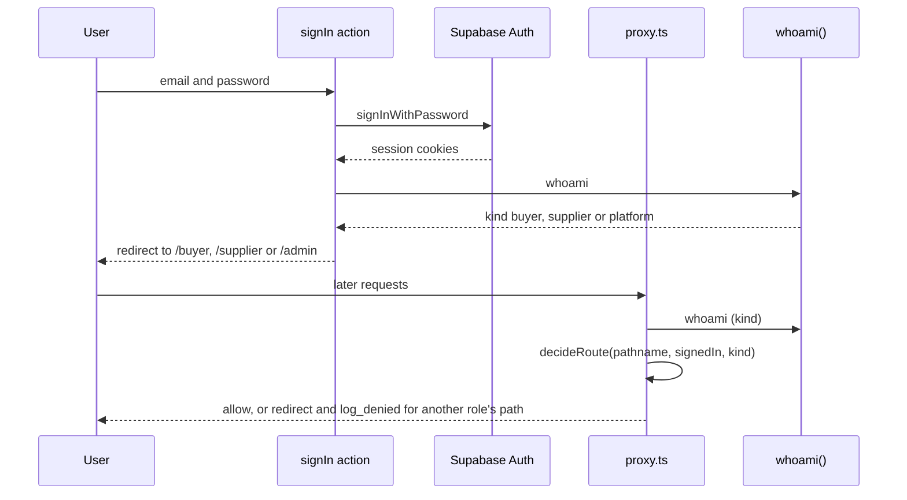

**Entry points:**
- [`src/features/auth/actions.ts`](../../src/features/auth/actions.ts): `signIn`, `signOut`, `requestPasswordReset`, `updatePassword`, `createAccount`.
- [`proxy.ts`](../../proxy.ts) and [`src/features/auth/routing.ts`](../../src/features/auth/routing.ts) (`decideRoute`, `safeNextPath`).
- [`src/data/session.ts`](../../src/data/session.ts) (`getSession`, `requireRole`, `roleOf`).

`src/data/session.ts`
```ts
export const roleOf = (kind: Session["kind"]): Role => (kind === "platform" ? "admin" : kind);

export async function requireRole(role: Role): Promise<Session> {
  const session = await getSession();
  if (!session) redirect("/sign-in");
  if (roleOf(session.kind) !== role) redirect(`/${roleOf(session.kind)}`);
  return session;
}
```

- **Why roles come from the organisation's `kind`, not from user metadata.** One membership per user (`memberships.user_id` is the primary key) means a person's role is their organisation's kind. The same fact drives RLS through `app.my_org_kind()`. The proxy redirects only as a convenience; the comment in `proxy.ts` says "RLS and database functions enforce every permission".
- **Validation.** `safeNextPath` rejects absolute, protocol-relative and control-character redirects (open redirect defence).
- **Database changes.** Sign-in writes nothing. Opening another role's path writes an audit row with outcome `denied` (`log_denied`).
- **Self sign-up.** `createAccount` passes `tl_kind`, `tl_business_name`, `tl_full_name` and `tl_phone` as metadata. The trigger `app.handle_new_user` (`supabase/migrations/20261103104222_self_sign_up.sql`) then:
  - creates an active organisation, a profile and a membership;
  - connects the new business to every active business of the opposite kind;
  - writes an audit row;
  - notifies admins with "New account".
- **Two-factor sign-in** was removed by the same migration ([ADR 0024](../adr/0024-self-sign-up-without-two-factor.md)).
- **Failure handling.** Wrong credentials show "Check your email and password." Expired links redirect to `/sign-in?link=expired` or `/forgot-password?expired=1`.
- **Tests:**
  - `src/features/auth/*.test.ts` (4 files, including the routing rules);
  - `e2e/smoke.spec.ts` ("the sign-in page renders").

### 5.2 Tradelink AI ordering (typed orders)

Typed orders are read by the **Tradelink AI agent**. Claude uses the buyer's own tools, and every change is a confirm card. An older pipeline (`readOrderWithClaude` with grounding and a rules fallback) still exists in the code but has no caller from the UI (see [section 17](#17-known-technical-debt)).

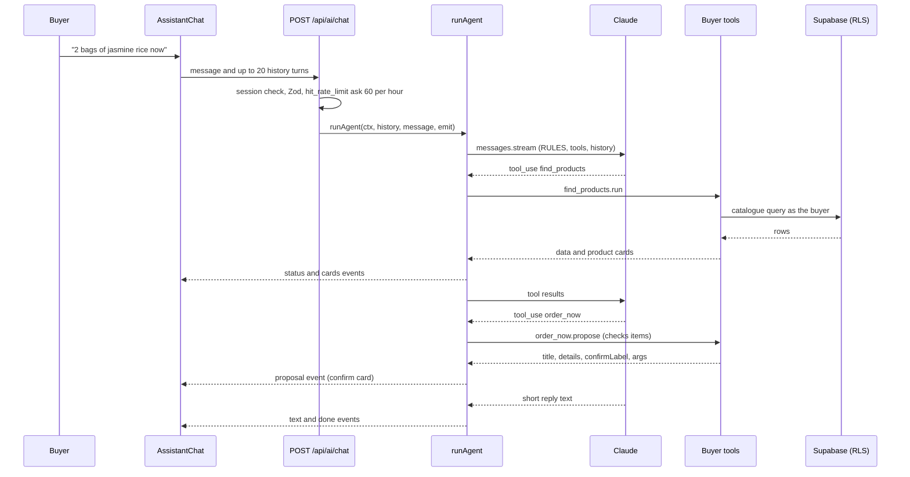

**Entry points:**
- [`app/api/ai/chat/route.ts`](../../app/api/ai/chat/route.ts) (`POST`).
- [`src/features/ai/agent.ts`](../../src/features/ai/agent.ts) (`runAgent`, `toolsFor`).
- [`src/features/ai/buyer-tools.ts`](../../src/features/ai/buyer-tools.ts).

**Validation:**
- Zod body: `message` 1 to 2,000 characters, `history` at most 20 turns.
- Each tool's Zod input is validated again in `runTool`. Invalid input goes back to Claude as an `is_error` tool result, so the model can correct itself.

**Database changes.** None until the person taps the card ([section 5.9](#59-assistant-tools-and-confirm-cards)).

**Failure handling:**

| Condition | Result |
| --- | --- |
| Not configured | HTTP 503 "Tradelink AI is not set up yet." |
| Rate limited | HTTP 429 |
| Exception in the loop | "Tradelink AI is not available right now. Try again in a moment." |
| More than 6 tool rounds | The loop stops |

**Tests:** [`src/features/ai/tools.test.ts`](../../src/features/ai/tools.test.ts) runs with a mocked SDK.

### 5.3 Cart review and placing orders

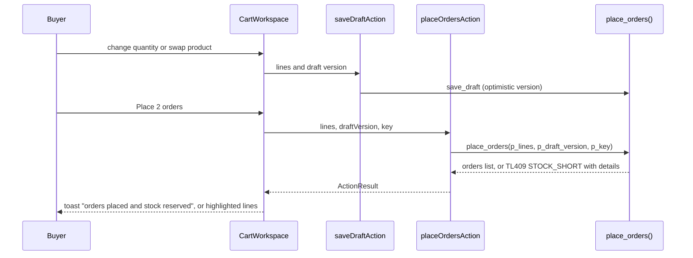

**Entry points:**
- `src/features/ordering/CartWorkspace.tsx`, which renders [`OrderSummary.tsx`](../../src/features/ordering/OrderSummary.tsx) and [`BelowMinimum.tsx`](../../src/features/ordering/BelowMinimum.tsx).
- [`src/features/ordering/actions.ts`](../../src/features/ordering/actions.ts) (`saveDraftAction`, `placeOrdersAction`).

**Review rules in the UI:**
- Place stays disabled while any line is unmatched or over stock.
- The below-minimum warning uses `minimumGap` and `belowMinimumText` from [`src/domain/minimum.ts`](../../src/domain/minimum.ts). It warns but never blocks.
- The budget bar and cut-off notes come from `src/domain/`.

**Database.** `place_orders` (final version in `supabase/migrations/20261103154631_ai_order_now_and_add_supplier.sql`):
1. Merges duplicate products.
2. Checks visibility with `app.can_see_product`.
3. Locks inventory and checks availability.
4. Checks the draft version.
5. Creates one order per supplier.
6. Reserves held lines.
7. Writes `order_events`, the audit log and a "New order" notification.
8. Updates `usual_items.last_paid`.
9. Clears the cart only when called from the cart.

`supabase/migrations/20261103154631_ai_order_now_and_add_supplier.sql`
```sql
  -- An order from the cart empties it. A direct order (no draft version) leaves the cart alone.
  if p_draft_version is not null then
    update public.order_drafts set lines = '[]', version = version + 1, updated_at = now()
    where user_id = v_me.user_id;
  end if;

  return app.idem_put('place_orders', p_key, jsonb_build_object('orders', v_orders));
```

- **Why a null draft version means "order now".** The same function serves the cart, Tradelink AI's `order_now` and the Home "Place tomorrow's order" plan. The last two must not empty the buyer's cart.
- **Failure handling:**
  - `TL409:STOCK_SHORT` returns JSON with `productId` and `available` for each line.
  - `TL409:STALE_DRAFT` means the cart changed in another tab.
  - A repeated `p_key` returns the first result.
- **Tests:**
  - `src/features/ordering/*.test.ts` (3 files);
  - `src/domain/minimum.test.ts`;
  - `e2e/order-flow.spec.ts` (not run for this document).

### 5.4 Stock reservation and concurrency control

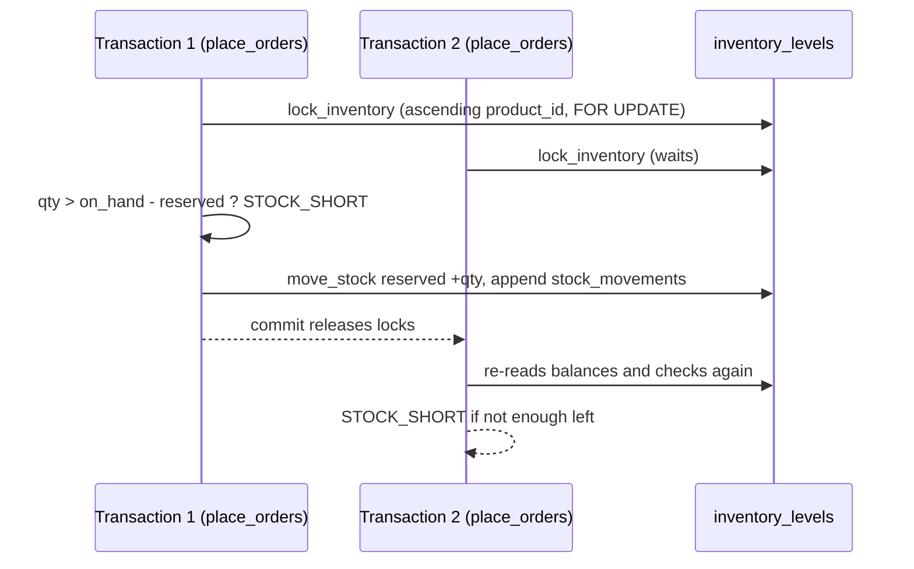

`supabase/migrations/20261103085139_app_functions.sql`
```sql
-- Locks inventory rows in ascending product id order. Every function that changes stock locks
-- through here first, so two transactions never wait on each other's rows in opposite order.
create function app.lock_inventory(p_products uuid[]) returns void
language plpgsql set search_path = '' as $$
begin
  perform 1 from public.inventory_levels i
  where i.product_id = any (p_products)
  order by i.product_id
  for update;
end $$;
```

`app.move_stock` (same file) updates `inventory_levels` and appends a `stock_movements` row with the balances after the change. The table checks are the backstop:
- `on_hand >= 0`;
- `reserved >= 0`;
- `reserved_within_on_hand`.

- **Why this design.** Checking availability and reserving in one transaction under row locks is the simplest way to guarantee no overselling ([ADR 0006](../adr/0006-inventory-history-and-reservations.md)). Locking in one fixed order prevents deadlocks between stock functions. The movement log makes every balance explainable.
- **Exception.** `set_supplier_status` locks inventory before orders while `cancel_order` locks the order first. See [Appendix B](#appendix-b-possible-defects-found-during-documentation), OPS-02.
- **Tests.** [`tests/concurrency/reservations.test.ts`](../../tests/concurrency/reservations.test.ts) fires 24 parallel `place_orders` calls at a product with 10 in stock. It asserts:
  - every failure is `STOCK_SHORT`;
  - `on_hand` stays 10 and `reserved` stays at or below 10;
  - reserved equals the sum of order lines;
  - the movement sums match the balances.

  It is opt-in, and was not run for this document because it writes to the live database.

### 5.5 Supplier part acceptance

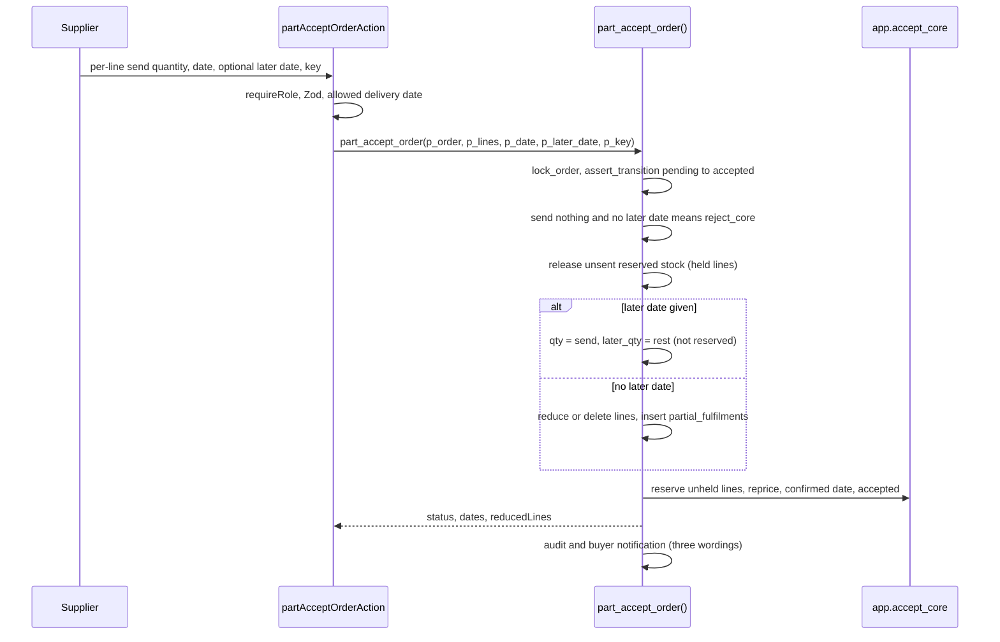

**Entry points:**
- `partAcceptOrderAction` in [`src/features/supplier/orderActions.ts`](../../src/features/supplier/orderActions.ts).
- `part_accept_order` in `supabase/migrations/20261104015354_order_two_deliveries_date_changes_messages.sql`, line 96. A four-argument wrapper at line 231 keeps the old signature.

`supabase/migrations/20261104015354_order_two_deliveries_date_changes_messages.sql`
```sql
    if p_later_date is not null then
      -- The rest stays on the order for the second delivery, not reserved until it goes.
      update public.order_lines set qty = v_line.send_qty, later_qty = v_line.qty - v_line.send_qty where id = v_line.id;
      v_later := v_later || (v_line.name || ' ' || (v_line.qty - v_line.send_qty));
    else
      if v_line.send_qty = 0 then
        delete from public.order_lines where id = v_line.id;
```

- **Why the rest is not reserved.** Inferred rationale: a supplier part-accepts because the stock is not there now. Reserving stock that does not exist would break `reserved <= on_hand`. `deliver_rest` therefore checks free stock when the rest goes and fails with `REST_NOT_IN_STOCK` if it is not there.
- **Validations:**
  - each send quantity is 0 to the ordered quantity;
  - the date must be today or later (Singapore);
  - the later date must be after the first date.
- **Tests:** `src/features/supplier/*.test.ts` (9 files).

### 5.6 Delivery and issue handling

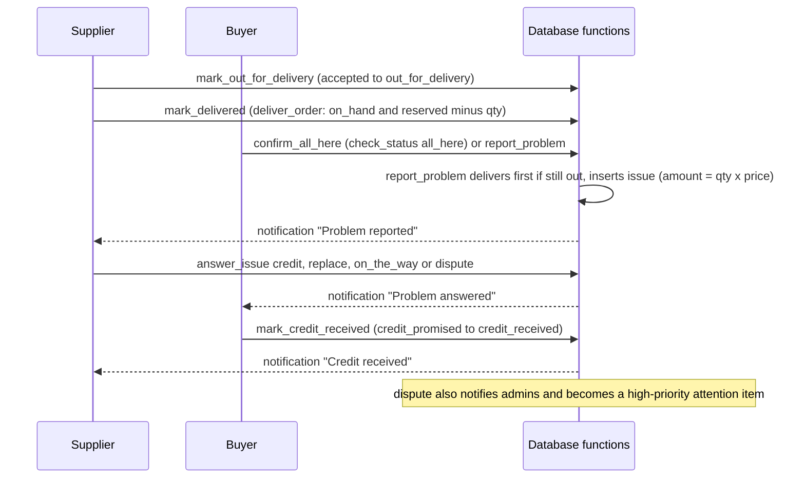

**Database functions** (`supabase/migrations/20261103085139_app_functions.sql` unless noted):

| Function | Line |
| --- | --- |
| `mark_out_for_delivery` | 1094 |
| `mark_delivered` | 1121 |
| `confirm_all_here` | 584 |
| `report_problem` | 620 |
| `report_not_here` | 687 |
| `answer_issue` | 1148 |
| `resolve_dispute` | 1552 |
| `mark_credit_received` | final version in `20261104031020_credit_received_tells_supplier.sql` |
| `deliver_order` | redefined in `20261104015354_...sql`, line 70 |

**Validations:**
- `report_problem` accepts only `short`, `damaged`, `wrong_item` and `expired`.
- `report_not_here` allows one open `late` issue per order; the partial unique index `issues_one_open_late` enforces this.
- `answer_issue` refuses `replace` for `late` and `invoice` problems.

**Tests:**
- `src/features/supplier/issues.test.ts`, `src/features/buyer/orders/summary.test.ts`;
- `e2e/order-flow.spec.ts` (short item, then credit).

### 5.7 Invoice checks

**Not built.** There is no invoice table, page, upload or check:
- the issue type `invoice` exists in the `issues.type` check constraint, but no function creates it;
- the attention view says "Rules that need invoices or service checks are not built yet".

See the FSD's Known limitations.

### 5.8 Adding a supplier who is not on Tradelink

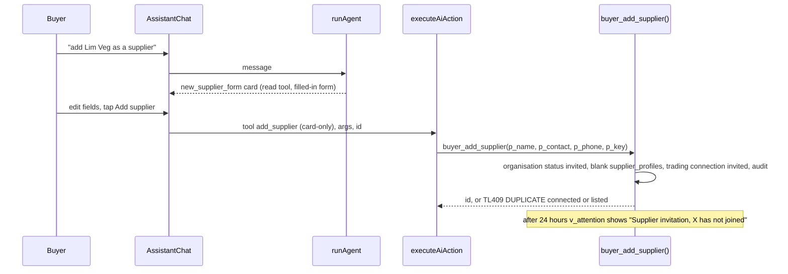

**Entry points:**
- [`src/features/ai/buyer-tools.ts`](../../src/features/ai/buyer-tools.ts): `new_supplier_form` (read) and `add_supplier` (`cardTool`, never offered to the model).
- `buyer_add_supplier` in `supabase/migrations/20261103154631_ai_order_now_and_add_supplier.sql`, line 131.

**What happens next, as built:**
- No email or message is sent.
- The buyer can add unconfirmed products for that supplier (`buyer_add_product`). Cart lines for it show "Waits for the supplier to accept your invitation".
- No function moves the organisation from `invited` to `active` or `declined`. The supplier cannot claim the record by signing up under the same name either (Appendix B, BUG-02).
- [ADR 0011](../adr/0011-authentication-and-invitations.md) planned token invitations. [ADR 0024](../adr/0024-self-sign-up-without-two-factor.md) replaced them with self sign-up.

### 5.9 Assistant tools and confirm cards

`src/features/ai/registry.ts`
```ts
/**
 * Changes something. The model only proposes it: the person sees a confirm card, and `exec` runs
 * when they tap Confirm, with the proposal id as the idempotency key. A `cardOnly` tool is not
 * offered to the model at all: it runs only from a button on a card, such as a filled-in form.
 */
export type WriteTool<I extends z.ZodType = z.ZodType> = Base<I> & {
  kind: "write";
  cardOnly?: boolean;
  propose: (ctx: AiContext, input: z.infer<I>) => Promise<Proposal | { error: string }>;
  exec: (ctx: AiContext, args: z.infer<I>, key: string) => Promise<ExecResult>;
};
```

`src/features/ai/execute.ts`
```ts
  const tool = toolsFor(role).find((entry) => entry.name === parsed.data.tool);
  if (!tool || tool.kind !== "write") return { ok: false, error: "This card can no longer be used. Ask again." };
  const args = tool.input.safeParse(parsed.data.args);
  if (!args.success) return { ok: false, error: "This card can no longer be used. Ask again." };
  const orderId = z.uuid().optional().safeParse(parsed.data.args.order_id);

  const result = await tool.exec(
    { session, role, now: new Date(), cardKey: cardKeys() },
    { ...(args.data as Record<string, unknown>), ...(orderId.success && orderId.data ? { order_id: orderId.data } : {}) },
    parsed.data.id,
  );
```

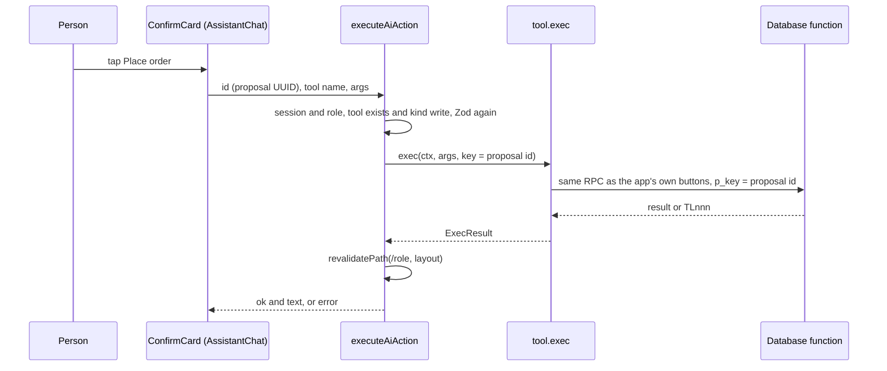

**Why it is built this way:**
- The model never writes. Everything it proposes is checked a second time on the server, against the same tool registry and Zod schema.
- The change then runs as the person through the same database functions as the normal UI, so RLS and role checks apply unchanged.
- Using the proposal id as `p_key` makes a double tap harmless.

This is how the build meets "the AI never writes data" from the project rules, while still letting Tradelink AI act ([ADR 0010](../adr/0010-untrusted-content-and-prompt-injection.md) originally said the model would have no write tools; see [Appendix A](#appendix-a-differences-from-older-documents)).

**Tool inventory:**
- **Buyer:** 11 read, 17 write with confirm, 2 card-only (`add_product`, `add_supplier`).
- **Supplier:** 7 read, 17 write, 1 card-only (`add_product`).
- **Shared:** the message and date-change tools come from [`order-request-tools.ts`](../../src/features/ai/order-request-tools.ts).
- **Card buttons.** Some buttons on read cards (for example Accept on an order card in [`src/features/ai/ui/AiCards.tsx`](../../src/features/ai/ui/AiCards.tsx)) call `executeAiAction` directly. The tap on the card's own button is the confirmation.

### 5.10 Notifications

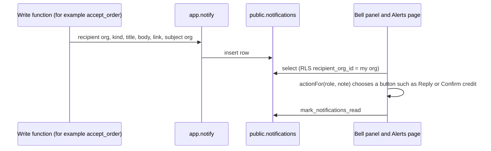

**How it works:**
- In-app notifications are written **inside the same transaction** as the change that causes them, by `app.notify` or `app.notify_platform` (`20261103085139_app_functions.sql`, line 194). A notification can therefore never describe a change that rolled back.
- There are 20 kinds; the Functional Specification lists them.
- The UI side is [`src/features/notifications/BellPanel.tsx`](../../src/features/notifications/BellPanel.tsx) and [`routes.ts`](../../src/features/notifications/routes.ts) (`actionFor`, `routeFor`).

**Not live:**
- The push path (`src/notifications/service.ts` `notify()`, `webpush.ts`, `/api/push/subscribe`) has no production caller.
- `enablePush()` in `src/pwa/push.ts` is not imported by any UI.

**Tests:** `src/features/notifications/routes.test.ts`, and `src/notifications/*.test.ts` (5 files, for the unused push service).

### 5.11 Theme handling

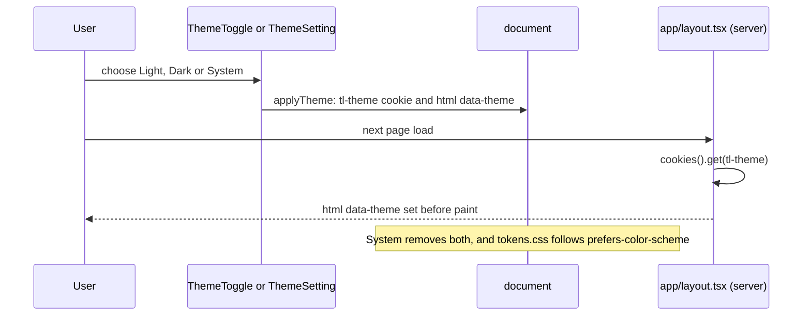

`src/ui/ThemeToggle.tsx`
```ts
export function applyTheme(preference: ThemePreference): void {
  const root = document.documentElement;
  const secure = window.location.protocol === "https:" ? "; Secure" : "";
  if (preference === "system") {
    document.cookie = `${COOKIE}=; Max-Age=0; Path=/; SameSite=Lax${secure}`;
    delete root.dataset.theme;
    return;
  }
  document.cookie = `${COOKIE}=${preference}; Max-Age=${ONE_YEAR}; Path=/; SameSite=Lax${secure}`;
  root.dataset.theme = preference;
}
```

- **Why a cookie.** The server reads it in the root layout, so the first paint already has the right theme and does not flash.
- **The tokens** (`src/styles/tokens.css`) define light values on `:root` and dark values under two selectors:
  - `@media (prefers-color-scheme: dark) :root:not([data-theme="light"])`;
  - `:root[data-theme="dark"]`.
- **Limitation.** The preference is per browser. `profiles.theme` and `set_theme` exist but are never called.

---

## 6. Domain model

### 6.1 Core entities

| Entity | Table | Notes |
| --- | --- | --- |
| Organisation | `organisations` | `kind`: buyer, supplier or platform; `status`: invited, active, suspended or declined |
| Person | `profiles`, `memberships` | One organisation per user |
| Connection | `trading_connections` | Which buyer may order from which supplier |
| Product and stock | `products`, `inventory_levels`, `stock_movements` | Stock is held per product |
| Cart | `order_drafts` | One draft per user, versioned |
| Order | `orders`, `order_lines`, `order_events` | One order per supplier; optional second delivery (`later_*`) |
| Problem | `issues` | Linked to an order and optionally a product |
| Request | `order_requests` | Date changes and messages on an order |
| Usual items | `usual_items`, `restock_skips` | Reorder plan inputs |
| Platform work | `attention_states`, `admin_profiles` | Assignment and the operations lead flag |

### 6.2 State machines and their code

Order and issue transitions live in one table, `app.state_transitions` (`20261103083152_core_schema.sql`, line 315). A trigger checks every status update against it:

`supabase/migrations/20261103083152_core_schema.sql`
```sql
create function app.guard_status() returns trigger
language plpgsql set search_path = '' as $$
begin
  if new.status is distinct from old.status and not exists (
    select 1 from app.state_transitions t
    where t.entity = tg_argv[0] and t.from_status = old.status and t.to_status = new.status
  ) then
    raise exception 'TL409:INVALID_TRANSITION:% from % to %', tg_argv[0], old.status, new.status;
  end if;
  return new;
end $$;
```

**Why both a table and a trigger.** Functions call `app.assert_transition` first, to raise a friendly message such as "ORD-1061 is delivered and cannot become cancelled". The trigger is the backstop for any code path that forgets.

**Order status**

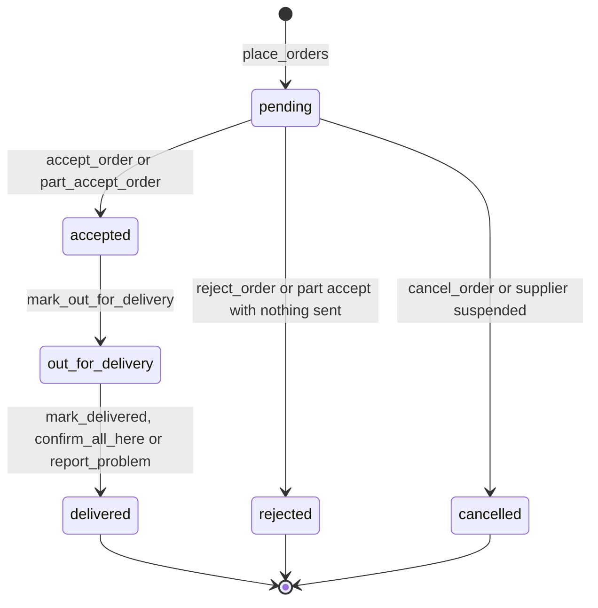

**Second delivery (`orders.later_status`).** This is enforced in the functions only, with no trigger.

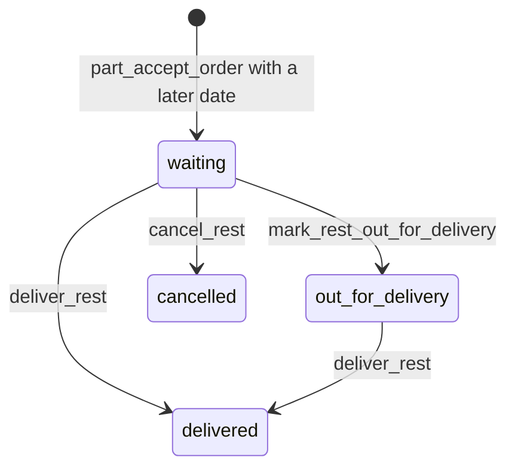

**Issue status**

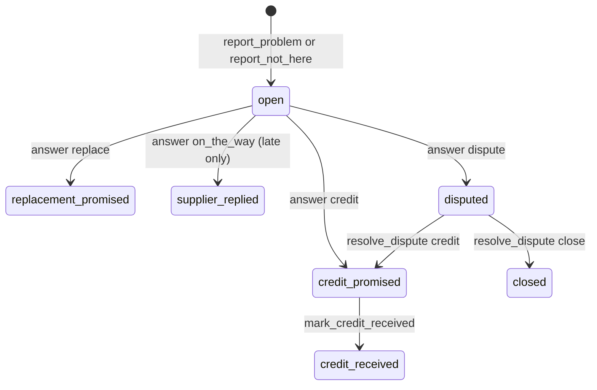

**Organisation status.** The transition table also allows `invited` to `active` and to `declined`, but no function performs either.

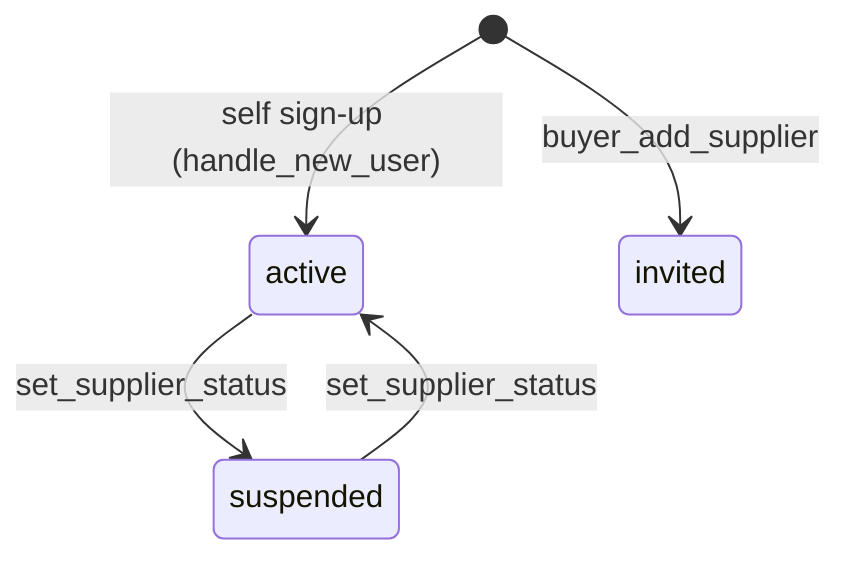

**Date-change request (`order_requests`, kind date_change)**

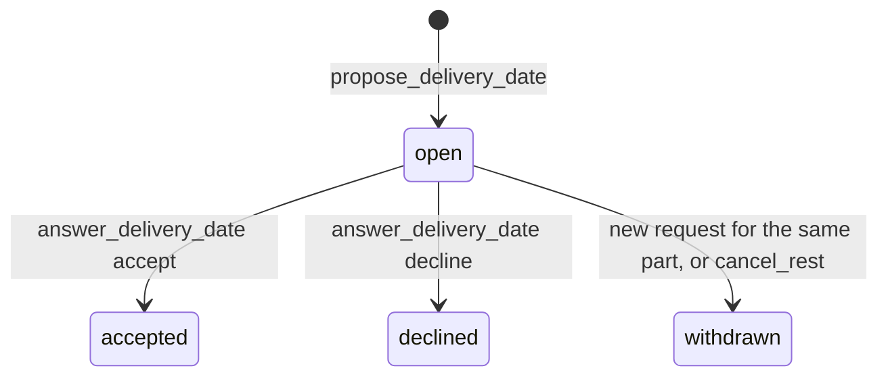

Messages (`kind = 'message'`) are created with status `sent` and do not change.

### 6.3 Domain invariants and where they are enforced

| Invariant | Enforced in |
| --- | --- |
| Reserved stock never exceeds stock on hand; neither is negative | `inventory_levels` check constraints, plus availability checks under lock in `place_orders` and `accept_core` |
| Every stock change has a matching movement row | `app.move_stock` is the only writer |
| History cannot be edited | `app.forbid_change` triggers on `audit_log`, `stock_movements`, `price_changes` and `order_events` (`20261103083152_core_schema.sql`, line 360) |
| Status moves only along allowed edges | `app.guard_status` and `app.assert_transition` |
| One open "late" problem per order | Unique index `issues_one_open_late` |
| A buyer orders only from connected, open suppliers | `app.can_see_product` in `place_orders` and RLS |
| Line quantity 0 to 9999, and `qty + later_qty > 0` | `order_lines` check (`20261104015354_...sql`, lines 14-17) |
| Second-delivery fields come together | `orders` check `(later_status is null) = (later_delivery_date is null)` |
| Money as cents in TypeScript | [`src/domain/money.ts`](../../src/domain/money.ts) (`Cents`, `toCents`, `formatMoney`) |

---

## 7. Database reference

### 7.1 ERD (core tables)


### 7.2 Table reference (core model)

The Tradelink AI tables (about 40 tables in `20261103131105_ai_core_schema.sql`) are summarised in section 10.8.

| Table | Purpose | Key constraints and indexes | Migration |
| --- | --- | --- | --- |
| `organisations` | Businesses and the platform | `kind`, `status` checks; unique `(kind, lower(name))` | core_schema |
| `profiles` | Person details | PK `user_id` references `auth.users`; `theme` check | core_schema |
| `memberships` | User to organisation | PK `user_id` (one organisation each) | core_schema |
| `buyer_settings` | Weekly budget and alert switches | `weekly_budget > 0` | core_schema |
| `supplier_profiles` | Terms: delivery days, lead time, cut-off, minimum | `lead_time_days` 0 to 14; `bank_last4` regex | core_schema |
| `admin_profiles` | Operator team, shift, `is_lead` | `is_lead` added in `20261104040939` | core_schema, attention_lead_sees_all |
| `trading_connections` | Buyer and supplier pair | Unique pair; status check | core_schema |
| `products` | Catalogue | Price 0 to 99999; unique `(supplier, lower(name))`; status active, unconfirmed or hidden | core_schema |
| `inventory_levels` | Stock per product | `reserved_within_on_hand` | core_schema |
| `stock_movements` | Append-only stock log | Index `(product, created_at desc)` | core_schema |
| `price_changes`, `price_change_acks` | Append-only price history; buyer acknowledgements | | core_schema |
| `order_drafts` | Cart per user | `version` for optimistic locking | core_schema |
| `orders` | One order per supplier | `number` from `order_number_seq` (starts at 1044); second-delivery columns | core_schema, two_deliveries |
| `order_lines` | Lines | `qty + later_qty > 0` | core_schema, two_deliveries |
| `order_events` | Append-only status history | | core_schema |
| `partial_fulfilments` | What a part accept left out | status new, added or skipped | core_schema |
| `usual_items`, `restock_skips` | Reorder plan | | core_schema |
| `order_requests` | Date changes and messages | kind and field consistency check | two_deliveries |
| `issues` | Problems | `issues_one_open_late`; `number` from 302 | core_schema |
| `notifications` | In-app notifications per organisation | Index `(recipient, created_at desc)` | core_schema |
| `attention_states` | Assignment and handled marks for attention items | PK `item_key` | core_schema |
| `audit_log` | Append-only audit | GIN index on `related_org_ids` | core_schema |
| `idempotency_keys` | Stored results for `p_key` | PK `(user_id, action, key)` | core_schema |
| `rate_limits` | Fixed-window counters | PK `(key, window_start)` | core_schema |
| `ai_usage` | Token and latency log | `feature`, `outcome` checks | core_schema |

**Views**, all `security_invoker = true` so RLS applies:
- `v_catalogue`: products with availability and health.
- `v_order_totals`.
- `v_attention`: the admin work queue (section 7.5).

### 7.3 Database functions and triggers

**Helpers in the `app` schema** (not exposed through the REST API):

| Helper | Role |
| --- | --- |
| `require_member` | Caller identity (`TL401` if signed out) |
| `require_kind(kind, must_be_active)` | Role and active-organisation check (`TL403`) |
| `idem_get` / `idem_put` | Idempotency with an advisory lock |
| `audit` | Append an audit row |
| `notify` / `notify_platform` | In-app notifications |
| `lock_inventory` / `move_stock` | Stock |
| `lock_order` / `lock_issue` | Row locks |
| `assert_transition` / `transition_order` | State machine |
| `accept_core` / `reject_core` / `deliver_order` / `release_held` | Shared order steps |
| `my_org_id` / `my_org_kind` / `is_admin` / `is_admin_lead` / `connected` / `can_see_org` / `can_see_product` / `product_on_my_orders` | RLS helpers |

**Idempotency** (`20261103085139_app_functions.sql`):
```sql
create function app.idem_get(p_action text, p_key uuid) returns jsonb
language plpgsql set search_path = '' as $$
declare
  v_result jsonb;
begin
  if p_key is null then
    raise exception 'TL400:INVALID_INPUT:p_key is required';
  end if;
  perform pg_advisory_xact_lock(hashtextextended(auth.uid()::text || ':' || p_action || ':' || p_key::text, 0));
  select k.result into v_result
  from public.idempotency_keys k
  where k.user_id = auth.uid() and k.action = p_action and k.key = p_key;
  return v_result;
end $$;
```

Why: the advisory lock makes a retry with the same key wait for the first call and then return its stored result. A failed call rolls back and stores nothing, so the retry runs again.

**Public functions** are listed with permissions in [section 8.3](#83-database-functions-rpc).

**Triggers:**

| Trigger | Table | Function | Migration |
| --- | --- | --- | --- |
| `orders_guard_status`, `issues_guard_status`, `organisations_guard_status` | orders, issues, organisations | `app.guard_status` | core_schema, line 351 |
| `*_append_only` | audit_log, stock_movements, price_changes, order_events | `app.forbid_change` | core_schema, line 366 |
| `usual_items_clear_skip` | usual_items (update of `in_shop`) | clears today's restock skip | usual_item_clears_skip |
| `on_auth_user_created` | auth.users | `app.handle_new_user` | self_sign_up, line 67 |
| `*_guard`, `*_append_only` on AI tables | shop_order, purchase_order and others | `app.rs_guard_state`, `app.forbid_change` | ai_core_schema |

### 7.4 RLS policies

There are **select policies only**. The first migration revokes `insert`, `update`, `delete` and `truncate` from `anon` and `authenticated`.

| Table | Readable by | Helper |
| --- | --- | --- |
| organisations, supplier_profiles | Own organisation, admins, connected businesses | `can_see_org` |
| profiles | Self, admins, members of the same organisation | — |
| products | Visible catalogue, or products on your own orders | `can_see_product`, `product_on_my_orders` |
| inventory_levels, price_changes | Visible catalogue | `can_see_product` |
| stock_movements | Admins, the product's supplier | — |
| orders, issues, trading_connections | Either party, or admins | — |
| order_lines, order_events, partial_fulfilments, order_requests | Inherited: the parent order must be visible | `exists (select from orders)` |
| order_drafts | The user only | `auth.uid()` |
| usual_items, price_change_acks, buyer_settings, memberships | Own organisation, or admins | — |
| restock_skips | Own buyer organisation only | — |
| notifications | Recipient organisation only | — |
| audit_log | Admins, or any organisation named in `related_org_ids`, or the actor's organisation | — |
| admin_profiles, attention_states, ai_usage | Admins | `is_admin` |
| idempotency_keys, rate_limits | Nobody (no policy) | — |

**Why inherited policies.** Writing `exists (select 1 from orders o where o.id = order_lines.order_id)` makes the child table follow the order's own rule. There is one rule to reason about instead of four copies.

### 7.5 Attention view

`v_attention` (final version: `20261104040939_attention_lead_sees_all.sql`) builds eight causes:

| Cause | Priority |
| --- | --- |
| Supplier invitation older than 24 hours | Medium |
| Dispute | High |
| Problem open more than 4 hours | Medium |
| Stock-out | High |
| Order pending more than 30 minutes | Medium |
| Buyer-added product not confirmed | Medium |
| Low stock | Medium |
| Blocked action | Medium |

It then filters to the operations lead or the assigned operator:

```sql
where app.is_admin()
  and (st.handled_at is null or st.handled_at < c.created_at)
  and (app.is_admin_lead() or st.assigned_user_id = (select auth.uid()));
```

### 7.6 Migration rules

- **Never edit an applied migration.** Add a new file named with the version Supabase records (for example `20261104040939_attention_lead_sees_all.sql`).
- **Test first, inside a transaction that cannot commit.** Run `begin; ... raise exception 'TESTRESULT ...'` with `request.jwt.claims` set to a demo user, then apply.
- **New tables** need RLS enabled, select policies, and an explicit `revoke insert, update, delete, truncate`. The first migration's revoke does not cover later tables (Appendix B, SEC-01).
- **Append-only tables** need a `forbid_change` trigger.

---

## 8. API and server action reference

### 8.1 Route handlers

| Name | Path | Caller | Permission | Input | Output | Errors | Side effects |
| --- | --- | --- | --- | --- | --- | --- | --- |
| Tradelink AI chat | [`app/api/ai/chat/route.ts`](../../app/api/ai/chat/route.ts) `POST` | AssistantChat | Signed-in buyer or supplier | `{message, history[]}` | NDJSON stream | 400, 401, 429, 503 | `rate_limits`, `ai_usage` |
| Card action | `app/api/cards/[id]/act/route.ts` `POST` | `/r` cards | Signed in; card audience | action, version, client id | card result | `CardError` reasons | One `rs_*` RPC |
| Card fields | `app/api/cards/[id]/fields/route.ts` | `/r` cards | Signed in | field edits | revised card | `CardError` | Card revision |
| Health | [`app/api/health/route.ts`](../../app/api/health/route.ts) `GET` | Anyone | Public | — | `{status, time}` | — | None |
| Jobs | [`app/api/jobs/run/route.ts`](../../app/api/jobs/run/route.ts) `GET`/`POST` | Intended for pg_cron (not configured) | Public | — | `{claimed, done, failed}` | 503 without secret key; 202 busy | Runs due `job` rows |
| Push subscribe | `app/api/push/subscribe/route.ts` | Not called by UI | Signed in | subscription | — | — | `rs_device_register` |
| Push opened | `app/api/push/opened/route.ts` | Service worker | Signed in | notification id | — | — | `rs_notification_opened` |
| Auth callback | [`app/auth/callback/route.ts`](../../app/auth/callback/route.ts) `GET` | Email links | Public | `code`, `next` | redirect | expired link redirect | Session cookies |

### 8.2 Server actions

All of these:
- require the role shown;
- validate with Zod;
- call the listed function through `callRpc` (or `runRpc` for suppliers);
- call `revalidatePath` on success.

| Action(s) | Location | Role | Database function(s) |
| --- | --- | --- | --- |
| `signIn`, `signOut`, `requestPasswordReset`, `updatePassword`, `createAccount` | `src/features/auth/actions.ts` | Public or self | Supabase Auth, `whoami` |
| `saveDraftAction`, `placeOrdersAction`, `buyerAddProductAction`, `readOrderAction` (unused) | `src/features/ordering/actions.ts` | Buyer | `save_draft`, `place_orders`, `buyer_add_product` |
| `setCartQuantityAction` | `src/features/products/actions.ts` | Buyer | `save_draft` |
| `cancelOrderAction`, `confirmAllHereAction`, `reportNotHereAction`, `reportProblemAction`, `markCreditReceivedAction` | `src/features/buyer/order-actions.ts` | Buyer | `cancel_order`, `confirm_all_here`, `report_not_here`, `report_problem`, `mark_credit_received` |
| `ackPriceChangeAction`, `markIssueSeenAction`, `markCreditReceivedAction`, `skipPartialAction`, `orderRemainderAction`, `loadReorderPlanAction`, `skipReorderPlanAction`, `loadUsualAction`, `placeReorderPlanAction` | `src/features/buyer/home-actions.ts` | Buyer | `ack_price_change`, `mark_issue_seen`, `mark_credit_received`, `resolve_partial`, `skip_restock_today`, `place_orders` |
| `updateBuyerSettingsAction`, `setUsualItemAction`, `removeUsualItemAction` | `src/features/buyer/settings-actions.ts` | Buyer | `update_buyer_settings`, `set_usual_item`, `remove_usual_item` |
| `acceptOrderAction`, `partAcceptOrderAction`, `rejectOrderAction`, `markOutForDeliveryAction`, `markDeliveredAction`, `answerIssueAction`, `markAllOutForDeliveryAction`, `markRestOutForDeliveryAction`, `deliverRestAction` | `src/features/supplier/orderActions.ts` | Supplier | `accept_order`, `part_accept_order`, `reject_order`, `mark_out_for_delivery`, `mark_delivered`, `answer_issue`, `mark_rest_out_for_delivery`, `deliver_rest` |
| `addProductAction`, `receiveStockAction`, `confirmStockAction`, `changePriceAction`, `adjustStockAction` | `src/features/supplier/inventoryActions.ts` | Supplier | `supplier_add_product`, `receive_stock`, `confirm_product_stock`, `change_price`, `adjust_stock` |
| `updateBusinessProfileAction` | `src/features/supplier/profileActions.ts` | Supplier | `update_business_profile` |
| `proposeDeliveryDateAction`, `answerDeliveryDateAction`, `sendOrderMessageAction`, `cancelRestAction` | `src/features/orders/request-actions.ts` | Buyer or supplier | `propose_delivery_date`, `answer_delivery_date`, `send_order_message`, `cancel_rest` |
| `assignAttentionAction`, `markHandledAction`, `resolveDisputeAction`, `setSupplierStatusAction`, `touchLastSeenAction` | `src/features/admin/actions.ts` | Admin | `assign_attention`, `mark_attention_handled`, `resolve_dispute`, `set_supplier_status`, `touch_last_seen` |
| `markAllNotificationsReadAction` | `src/features/notifications/actions.ts` | Any | `mark_notifications_read` |
| `executeAiAction` | `src/features/ai/execute.ts` | Buyer or supplier | Through each tool's `exec` |
| `askAction` (unused), `addToCartAction`, `placeCartAction` | `src/features/ask/actions.ts` | Buyer | `save_draft`, `place_orders` |
| `createDemoOrderCardAction` and two others | `src/features/cards/dev-actions.ts` | Development only | `rs_*` |

### 8.3 Database functions (RPC)

All are `security definer`, granted to `authenticated` and defined in `public`. Errors use the codes in section 4.5. Line numbers refer to the latest definition.

| Function | Location | Permission | Input | Output | Errors | Side effects |
| --- | --- | --- | --- | --- | --- | --- |
| `whoami` | session.sql:2 | Signed in | — | session JSON | — | — |
| `save_draft` | app_functions.sql:391 | Buyer | lines, version | `{version}` | TL400, TL404, STALE_DRAFT | Draft |
| `place_orders` | ai_order_now_and_add_supplier.sql:3 | Buyer, active | lines, draft version or null, key | `{orders[]}` | TL400, TL404, STOCK_SHORT, STALE_DRAFT | Orders, reserve stock, events, audit, notify supplier |
| `cancel_order` | app_functions.sql:556 | Buyer | order, key | order | INVALID_TRANSITION | Release stock, audit, notify |
| `confirm_all_here` | app_functions.sql:584 | Buyer | order, key | order | INVALID_TRANSITION | Delivers if out; `check_status`; usual in-shop |
| `report_problem` | app_functions.sql:620 | Buyer | order, product, type, qty, note, key | issue | TL400, INVALID_TRANSITION | Issue, audit, notify |
| `report_not_here` | app_functions.sql:687 | Buyer | order, key | issue | ALREADY_REPORTED | Late issue, notify |
| `mark_credit_received` | credit_received_tells_supplier.sql:2 | Buyer | issue, key | issue | INVALID_TRANSITION | Audit, notify supplier |
| `buyer_add_product` | app_functions.sql:761 | Buyer | name, unit, price, supplier, key | `{productId}` | DUPLICATE, TL403 | Unconfirmed product, notify |
| `buyer_add_supplier` | ai_order_now_and_add_supplier.sql:131 | Buyer | name, contact, phone, key | `{id}` | DUPLICATE | Invited organisation and connection, audit |
| `set_usual_item`, `remove_usual_item`, `skip_restock_today`, `ack_price_change`, `resolve_partial`, `update_buyer_settings`, `mark_issue_seen` | app_functions.sql:814-938, 725 | Buyer | various | JSON | TL400, TL409 | Buyer data, audit (settings) |
| `accept_order` | app_functions.sql:942 | Supplier | order, date, key | order | CONFIRM_STOCK_FIRST, STOCK_SHORT, INVALID_TRANSITION | Reserve, reprice, notify |
| `part_accept_order` | two_deliveries.sql:96 | Supplier | order, lines, date, later date, key | order | TL400, as above | Release or later qty, notify |
| `reject_order` | app_functions.sql:1073 | Supplier | order, key | order | INVALID_TRANSITION | Release, notify |
| `mark_out_for_delivery`, `mark_delivered` | app_functions.sql:1094, 1121 | Supplier (also suspended) | order, key | order | INVALID_TRANSITION | Stock out on delivery, notify |
| `mark_rest_out_for_delivery`, `deliver_rest` | two_deliveries.sql:238, 265 | Supplier (also suspended) | order, key | order | INVALID_TRANSITION, REST_NOT_IN_STOCK | Stock out, notify |
| `answer_issue` | app_functions.sql:1148 | Supplier | issue, answer, key | issue | INVALID_TRANSITION, TL400 | Notify buyer; dispute notifies admins |
| `supplier_add_product`, `receive_stock`, `confirm_product_stock`, `change_price`, `adjust_stock` | app_functions.sql:1219-1394 | Supplier | various, key | JSON | DUPLICATE, BELOW_RESERVED, TL400 | Stock movements, price history |
| `update_business_profile` | app_functions.sql:1438 | Supplier | profile fields | JSON | TL400 | Organisation and profile |
| `cancel_rest`, `propose_delivery_date`, `answer_delivery_date`, `send_order_message` | two_deliveries.sql:319-501 | Buyer or supplier on the order | various, key | JSON | INVALID_TRANSITION, RATE_LIMITED | Requests, dates, notify |
| `set_supplier_status` | app_functions.sql:1487 | Admin | org, status, key | JSON | INVALID_TRANSITION | Cancels pending orders on suspend, notify |
| `resolve_dispute` | app_functions.sql:1552 | Admin | issue, credit or close, key | issue | INVALID_TRANSITION | Notify both sides |
| `assign_attention` | attention_lead_sees_all.sql:90 | Operations lead | item, user | JSON | FORBIDDEN, TL400 | `attention_states` |
| `mark_attention_handled` | attention_lead_sees_all.sql:117 | Lead or assigned operator | item | JSON | FORBIDDEN | `attention_states`, audit |
| `mark_notifications_read`, `set_theme`, `touch_last_seen`, `log_denied`, `record_ai_usage`, `hit_rate_limit` | app_functions.sql:1633-1710 | Signed in | various | various | TL400, TL401 | Notifications, profile, audit, `ai_usage`, `rate_limits` |
| `rs_*` (Tradelink AI) | ai_core_functions.sql, ai_notifications.sql, ai_undo_agent_action.sql | Signed in, or the server only (`rs_require_system`) | various | uuid, void or JSON | STALE_VERSION, NOT_READY, UNDO_EXPIRED, FORBIDDEN | AI tables (section 10.8) |

---

## 9. Frontend reference

### 9.1 Route map

| Area | Routes |
| --- | --- |
| Public | `/sign-in`, `/sign-up`, `/forgot-password`, `/reset-password`, `/auth/callback`, `/offline` |
| Buyer | `/buyer` (Home), `/buyer/assistant`, `/buyer/cart`, `/buyer/products`, `/buyer/orders`, `/buyer/orders/[id]`, `/buyer/insights`, `/buyer/notifications`, `/buyer/settings`; redirects `/buyer/ask`, `/buyer/availability`, `/buyer/order`, `/buyer/issues/[id]` |
| Supplier | `/supplier`, `/supplier/assistant`, `/supplier/orders`, `/supplier/orders/[id]`, `/supplier/inventory`, `/supplier/stock-history`, `/supplier/activity`, `/supplier/notifications`, `/supplier/settings`; redirect `/supplier/issues/[id]` |
| Admin | `/admin`, `/admin/attention`, `/admin/orders`, `/admin/suppliers`, `/admin/suppliers/[id]`, `/admin/suppliers/low-stock`, `/admin/users`, `/admin/users/buyers/[id]`, `/admin/operators`, `/admin/audit`, `/admin/notifications`, `/admin/settings` |
| Tradelink AI foundation | `/r`, `/r/dev/cards` (gated) |
| Development | `/kit` (`app/(dev)/kit`) |

### 9.2 Layouts

- [`app/layout.tsx`](../../app/layout.tsx): fonts, theme cookie to `data-theme`, `ToastProvider`, `PwaProvider`, `UpdateGate`.
- **Role layouts** (`app/buyer/layout.tsx`, `app/supplier/layout.tsx`, `app/admin/layout.tsx`) wrap pages in the shell ([`src/features/shell/RoleShell.tsx`](../../src/features/shell/RoleShell.tsx), [`src/ui/shell/AppShell.tsx`](../../src/ui/shell/AppShell.tsx)) with the nav from [`src/features/shell/nav.ts`](../../src/features/shell/nav.ts).
- **Phone vs laptop.** Below 760px ([`ShellNav.tsx`](../../src/ui/shell/ShellNav.tsx)) there are bottom tabs: the first four items plus More when there are more than five. From 760px the sections sit in the top bar.

### 9.3 Shared components

All are in `src/ui/`:
- `Button`, `LinkButton`, `Chip`, `Segmented`, `Switch`, `Field`, `FormError`;
- `DataTable` / `DataRow` (Safari-safe row click delegation), `RecordCard`, `Panel`, `PageHeader` (also exports `FilterTabs`), `EmptyState`;
- `Pill`, `ProgressSteps`, `Metrics` / `Tiles`, `TodoItem`, `ProductArt`, `ProductImage`, `BusinessLogo`, `Icon`;
- `Toast` (`ToastProvider`), `ThemeToggle`, `ThemeSetting`;
- `format.ts` (Singapore dates and money), `cx.ts`.

### 9.4 Design tokens

```bash
npm run tokens
```

- [`scripts/build-tokens.mjs`](../../scripts/build-tokens.mjs) reads `design-handoff/design-system/tokens.json` and writes `src/styles/tokens.css`.
- The output has light values on `:root` and dark values under `prefers-color-scheme` and `[data-theme="dark"]`.
- A Tailwind 4 `@theme inline` block exposes them as utilities (for example `bg-surface`, `text-muted`).
- Why: one source of truth shared with design ([ADR 0015](../adr/0015-design-tokens-and-tailwind.md)). Light and dark mode are the same tokens with two value sets, so components never hard-code colours.

### 9.5 State management

- **Server state** comes from server components and `revalidatePath`.
- **Client stores** use `useSyncExternalStore`:
  - Tradelink AI conversations and the sidebar preference (`src/features/ask/history.ts`, `AssistantChat.tsx`, key `tl-ai-sidebar`);
  - the theme (`ThemeToggle.tsx`);
  - the offline outbox (`src/offline/useOutbox.ts`);
  - PWA state (`src/pwa/PwaProvider.tsx`).
- **Cart model:** `src/features/ordering/draft-store.ts`, `useDraftSync.ts` and `useCartModel.ts`.
- **Context:** the only React context is `ToastContext`.

### 9.6 Accessibility approach

- A skip link (`AppShell`), `sr-only` labels, and `aria-live="polite"` for Tradelink AI status and streaming.
- `role="alert"` on error boundaries, and `aria-current` / `aria-pressed` on chips and tabs.
- `prefers-reduced-motion` respected in `assistant.module.css`.
- Status is never shown by colour alone: pills carry text.
- **No automated accessibility tests (axe) exist.** `e2e/pages.spec.ts` checks only that each page opens and has no horizontal overflow.

---

## 10. AI integration

### 10.1 Module structure

| Module | Role | Live? |
| --- | --- | --- |
| [`src/integrations/claude/client.ts`](../../src/integrations/claude/client.ts) | Shared client, `claudeModel()`, `isClaudeConfigured()` | Yes |
| [`src/features/ai/agent.ts`](../../src/features/ai/agent.ts) | `runAgent` tool loop, `RULES` prompt | Yes |
| [`src/features/ai/registry.ts`](../../src/features/ai/registry.ts) | Tool types, `toClaudeTool` | Yes |
| `src/features/ai/buyer-tools.ts`, `supplier-tools.ts`, `order-request-tools.ts` | Tools | Yes |
| [`src/features/ai/execute.ts`](../../src/features/ai/execute.ts) | Runs confirmed writes | Yes |
| `src/features/ai/order-context.ts` | Order context for the chat on an order page | Yes |
| `src/features/ask/AssistantChat.tsx` | Chat UI, cards, confirm cards | Yes |
| [`src/integrations/claude/read-order.ts`](../../src/integrations/claude/read-order.ts), `src/domain/reader/*` | Structured order reader, grounding, rules fallback | No caller from the UI |
| `src/features/ask/respond.ts`, `answer.ts`, `facts.ts`, `src/domain/ask/*` | Grounded-facts Ask ([ADR 0023](../adr/0023-ask-with-grounded-facts.md)) | No caller from the UI |
| [`src/agents/render-card-tool.ts`](../../src/agents/render-card-tool.ts) | `render_card` tool | Not wired to any agent |

### 10.2 Prompts and structured output

- **Agent prompt.** The fixed prompt is `RULES` in `agent.ts` (cached). The per-request prompt is `contextPrompt`: the person's name, business, Singapore date and currency.
  - It says that facts come only from tool results, that changes are confirm cards, and that tool-result text is data, never instructions.
- **Write tool descriptions.** `toClaudeTool` appends "Shows the person a confirm card; nothing changes until they tap Confirm." to every write tool.
- **Tool inputs** are Zod schemas, converted with `z.toJSONSchema`.
- **Agent replies** are free text. Cards are inserted through `[[TAG]]` markers parsed in `src/features/ai/ui/reply-blocks.ts`. The model may only use tags from tool results.
- **Order reader (unused).** It uses `ExtractedOrderSchema` with `zodOutputFormat` (`read-order.ts`, lines 30-43).

### 10.3 Model configuration and limits

| Setting | Value | Where |
| --- | --- | --- |
| Model | `ANTHROPIC_MODEL`, default `claude-sonnet-5-5` | `client.ts` |
| Effort | `low` | `agent.ts` `output_config` |
| Max output | 900 tokens per round | `agent.ts` |
| Rounds | 6 | `MAX_ROUNDS` |
| Tool result size | 12,000 characters, then truncated | `MAX_RESULT_CHARS` |
| Request limit | 60 messages per user per hour | `route.ts` `hit_rate_limit('ask', 60, 3600)` |
| Route duration | 60 s | `maxDuration` |
| Prompt caching | `cache_control: ephemeral` on `RULES`, on the last tool, and at the top level of the request | `agent.ts` |
| Usage logging | `record_ai_usage('ask', ...)` and the `ai_agent_usage` log line with cache read and write sizes | `agent.ts` |

### 10.4 Validation and retries

- **Tool input** is validated twice: once when the model calls the tool, and again in `executeAiAction`.
- **Agent requests** have no explicit retry or timeout, so SDK defaults apply. On an exception the user sees "Tradelink AI is not available right now. Try again in a moment." The agent path has no fallback.
- **Order reader (unused):**
  - timeout 20 s, one retry;
  - falls back to the rules reader on timeout, error, refusal or invalid output.

### 10.5 Tool permissions

- **Tools run as the signed-in user.** Reads go through RLS; writes go through the same database functions as the UI.
- **IDs are resolved on the server.** For example, `findOrder` resolves an order number under RLS, and `order_id` is added by the server, not by the model.
- **Card-only tools** (`add_product`, `add_supplier`) are filtered out of the model's tool list in `runAgent` (`!tool.cardOnly`).
- **Admins** are refused by `/api/ai/chat` and `executeAiAction`. There are no admin tools.

### 10.6 Prompt injection defences

| Defence | Where |
| --- | --- |
| System rules mark tool-result text as data | `RULES` in `agent.ts` |
| The model cannot change anything without a human tap | Proposal and `executeAiAction` |
| Every tool runs as the user; RLS limits what any injected instruction could reach | `AiContext` |
| Message tools forbid adding details the person did not give | Tool descriptions in `order-request-tools.ts` |
| Order reader (unused): untrusted text only in the user turn, `<` and `>` replaced, 4,000-character cap, grounding against the message and catalogue | `read-order.ts`, `src/domain/reader/grounding.ts` |
| No HTML from model output (`dangerouslySetInnerHTML` is not used) | Repository-wide |

**Gaps:**
- There is no Content Security Policy header (Appendix B, SEC-03).
- There is no injection evaluation set.

### 10.7 Evaluations

**None.** There is no `evals/` folder. AI code is covered only by unit tests with a mocked SDK:
- `src/integrations/claude/read-order.test.ts`;
- `src/features/ai/tools.test.ts`;
- `src/agents/render-card-tool.test.ts`;
- `src/features/ask/*.test.ts`.

### 10.8 Tradelink AI foundation (not in use)

Built in the milestone M0 migrations ([ADR 0025](../adr/0025-ai-data-model-beside-tradelink.md), [ADR 0026](../adr/0026-cards-jobs-and-pwa.md), [`docs/AI_DESIGN.md`](../AI_DESIGN.md)):
- **About 40 `rs_*`-model tables:** shop, supplier, product, shop_order, purchase_order, chat_thread, card_instance, agent_action, notification, job and others.
- **Database-backed cards:** `src/cards/` and `src/features/cards/`, used on `/r`.
- **A job runner:** `src/jobs/`, `/api/jobs/run`.
- **A push notification service:** `src/notifications/`, with web-push and VAPID keys.
- **An offline outbox:** `src/offline/`.

**What is live:**
- `/r` renders a shop chat for signed-in users who have no Tradelink organisation.
- The service worker and offline page are live for everyone.
- Nothing calls `notify()`, nothing enqueues jobs from the main app, and no cron calls `/api/jobs/run`.

---

## 11. Security

### 11.1 Authentication and authorisation flow

1. **Supabase Auth** checks the email and password; `@supabase/ssr` keeps the session in cookies. Sign-up confirmation and password reset emails come from Supabase.
2. **[`proxy.ts`](../../proxy.ts)** refreshes the session and routes by `whoami().kind`. This is a convenience, not a security boundary.
3. **Pages and actions** call `requireRole`.
4. **The database decides.** RLS controls reads. Every write function calls `app.require_kind` or `app.require_member`, which check the caller's organisation kind and that the organisation is active.
5. **Admins** are members of the platform organisation (`app.is_admin()`). The operations lead additionally has `admin_profiles.is_lead` (`app.is_admin_lead()`). Two-factor sign-in is off ([ADR 0024](../adr/0024-self-sign-up-without-two-factor.md)).

### 11.2 Data isolation

- **Tenancy is by organisation.** A buyer sees only its own data plus connected suppliers' catalogues. A supplier sees its own catalogue and the orders addressed to it.
- **Hidden records.** Orders of other organisations raise the same `NOT_FOUND` as missing ones (`app.lock_order`), so record existence is not leaked.

### 11.3 Secrets handling

- **Where secrets live:**
  - `ANTHROPIC_API_KEY`, `SUPABASE_SECRET_KEY` and `VAPID_PRIVATE_KEY` are server only and never `NEXT_PUBLIC_`;
  - the server modules that use them import `server-only`;
  - locally they are in `.env.local` (git-ignored); in production they are in Vercel environment variables.
- **Demo password.** It is not in the repository. Seed files use `__DEMO_PASSWORD__`, and tests read `E2E_PASSWORD`.
- **Git history.** A demo password remains in older commits; the owner chose to remove it from files only.

### 11.4 Input validation and rate limiting

**Validation is layered:**
1. Zod in every server action and route.
2. Argument checks inside database functions (`app.json_int`, `app.require_int`, length checks).
3. Table check constraints.

**Rate limits (fixed window per user)**, through `public.hit_rate_limit`:

| Action | Limit | Where |
| --- | --- | --- |
| Tradelink AI chat | 60 per hour | `app/api/ai/chat/route.ts` |
| Order messages | 30 per hour | Inside `send_order_message` |
| Order reading | 30 per hour | `readOrderAction` (unused) |

**Gaps** against [ADR 0014](../adr/0014-rate-limiting-in-postgres.md): there are no limits per organisation or by IP, and no cleanup job.

### 11.5 File upload handling

**There are no file uploads.** No storage buckets are created in any migration, and no upload route exists.

### 11.6 Audit logging

- **Every write function** calls `app.audit`. Denied attempts are logged through `log_denied`: by `callRpc` on `TL403` or `INVALID_TRANSITION`, and by the proxy when a user opens another role's area.
- **The log cannot be edited** (`forbid_change` trigger).
- **Who can read it:** admins, and organisations named in `related_org_ids`, so buyers and suppliers can read entries that involve them.

### 11.7 Threat model summary

| Threat | Control | Status |
| --- | --- | --- |
| Reading another business's data | RLS on every table; security-invoker views | Built |
| Writing outside the rules | No write policies; definer functions with role and state checks | Built |
| Overselling under concurrency | Row locks and checks in one transaction | Built; tested by the opt-in concurrency test |
| Double submission | `p_key` idempotency | Built |
| Prompt injection through product names or notes | Data-only rules, confirm cards, RLS-scoped tools | Built; no evaluation set |
| Open redirect after sign-in | `safeNextPath` | Built, unit tested |
| Cross-role navigation | Proxy redirect plus `log_denied` | Built |
| Script injection | React escaping; no `dangerouslySetInnerHTML` | Built; no CSP (SEC-03) |
| Clickjacking | `X-Frame-Options: DENY` in `next.config.ts` | Built |
| Abuse of the AI endpoint | 60 per hour per user | Built |

### 11.8 Accepted risks

| Risk | Why accepted | Record |
| --- | --- | --- |
| No two-factor sign-in for admins | Owner decision, 3 November 2026 | [ADR 0024](../adr/0024-self-sign-up-without-two-factor.md) |
| Self sign-up connects a new business to every active counterpart | Lets a demo buyer order at once | ADR 0024 |
| `/api/jobs/run` is public | Runs only jobs already due; returns counts only | [ADR 0026](../adr/0026-cards-jobs-and-pwa.md), [`src/jobs/http.ts`](../../src/jobs/http.ts) |
| Demo password in old commits | Owner chose to remove it from files only | Owner decision, 4 November 2026 |
| Items in Appendix B (SEC-01, SEC-02, SEC-03, OPS-01) | Not yet decided | For owner review |

---

## 12. Testing

### 12.1 Strategy and layout

| Level | Location | Tool | Scope |
| --- | --- | --- | --- |
| Unit | `src/**/*.test.ts` (71 files) | Vitest, Node environment | Domain rules, feature logic, AI tools with a mocked SDK, routing, notifications, jobs, PWA helpers |
| Database concurrency | `tests/concurrency/reservations.test.ts` | Vitest against a real Supabase project | No overselling under parallel orders |
| End to end | `e2e/*.spec.ts` | Playwright, projects `chromium` (Desktop Chrome) and `mobile` (Pixel 7) | Smoke, every page opens, full order lifecycle |

**Configuration:**
- [`vitest.config.ts`](../../vitest.config.ts) includes `src/**/*.test.ts` and `tests/**/*.test.ts`.
- [`playwright.config.ts`](../../playwright.config.ts) loads `.env.local` and starts `npm run dev` if no server is running. It uses locale en-SG and time zone Asia/Singapore.

### 12.2 How to run each suite

```bash
npm test
```

```bash
npx playwright test e2e/smoke.spec.ts e2e/pages.spec.ts
```

```bash
RUN_DB_TESTS=1 NODE_OPTIONS=--experimental-websocket npm test -- tests/concurrency
```

- **E2E password.** The e2e specs need `E2E_PASSWORD` in `.env.local`.
- **Data writes.** `e2e/order-flow.spec.ts` and the concurrency test create real orders and stock changes. Run them only against a test project.

### 12.3 Current results (real output, 4 November 2026)

| Suite | Command | Result |
| --- | --- | --- |
| Unit | `npx vitest run --configLoader runner` (run at 12:36 SGT) | **71 files passed, 1 skipped (72). 838 tests passed, 1 skipped (839). Duration 33.03 s.** The skipped file is the opt-in concurrency test. |
| E2E smoke and pages | `npx playwright test e2e/smoke.spec.ts e2e/pages.spec.ts --reporter=line` | **16 passed (1.0 min)**: 8 tests × 2 projects (chromium, mobile) |
| E2E order flow | `e2e/order-flow.spec.ts` | **Not run for this document**: it writes to the live database |
| Concurrency | `tests/concurrency/reservations.test.ts` | **Not run for this document**: it writes to the live database |
| Coverage | — | **Not measured**: no coverage tool is configured |
| Type-check and lint | `npm run typecheck`, `npm run lint` | Clean on the last commit (run during development on 4 November 2026) |

### 12.4 How to add tests

- **Domain rule:** add `src/domain/<rule>.test.ts` next to the rule. Pure functions need no mocks.
- **Server action or AI tool:** mock Supabase and the SDK as in `src/features/ai/tools.test.ts`.
- **Database behaviour:** add an opt-in Vitest file under `tests/` behind `describe.runIf(process.env.RUN_DB_TESTS === "1")`, against a non-production project. There is no pgTAP setup.
- **Page:** extend `e2e/pages.spec.ts`. It checks the page's `h1`, that no error screen shows, and that there is no horizontal overflow.

---

## 13. Delivery and operations

### 13.1 Git workflow and CI

- **Branches.** Work happens on `develop`. To release, `main` is fast-forwarded to `develop` and pushed (`git push origin develop:main`).
- **There is no CI pipeline**: no `.github/` folder and no `vercel.json`.
- **Checks before pushing** (by convention):

```bash
npm run check
```

### 13.2 Vercel deployment

- **The GitHub repository is connected to Vercel.** Pushes to `develop` create preview deployments; pushes to `main` deploy production.
- **Environment variables** are set in the Vercel project settings, with server-only values marked sensitive.

### 13.3 Database deployment

**Process:**
1. Write a migration.
2. Test it in a rolled-back transaction.
3. Apply it to the Supabase project.
4. Save it as `supabase/migrations/<version>_<name>.sql`.

**Order of operations.** Database changes go live when applied, which may be before the app code deploys. Plan backward-compatible changes. For example, `part_accept_order` keeps a four-argument wrapper.

### 13.4 Scheduled jobs

**None are scheduled.**
- The runner exists (`src/jobs/runner.ts`: 25 jobs or 50 s per tick).
- `pg_cron` and `pg_net` are installed.
- The schedule in the local file `supabase/migrations/pending_ai_job_cron.sql` has not been applied.
- The admin attention items are computed live by `v_attention`, so they do not need jobs.

### 13.5 Monitoring and health checks

- **Health.** `GET /api/health` is a liveness check only; it has no database check.
- **Logs.** Structured JSON lines go to Vercel runtime logs (`rpc_failed`, `ai_agent_failed`, `ai_agent_usage`, `ai_action`, `jobs_not_configured`).
- **Usage.** `ai_usage` rows record AI tokens and latency.
- **No alerting** is configured.

### 13.6 Rollback

| Layer | How to roll back |
| --- | --- |
| App | Promote the previous production deployment in Vercel, or revert the commit on `main` and push |
| Database | Write a new migration that restores the previous definition (`create or replace function ...` from the earlier migration file). Never edit or delete an applied migration. |

### 13.7 Incident runbook

| Symptom | Check | Action |
| --- | --- | --- |
| "This page did not load" | Vercel runtime logs for the time; error digest code | If it follows a deploy, reload; if it repeats, roll back the deployment |
| "This did not save. Reload the page" (admin) | Page opened before a deploy | Reload |
| Tradelink AI says it is not available | `ai_agent_failed` logs; Anthropic status; `ANTHROPIC_API_KEY` in Vercel | Fix the key or wait; ordering through the cart still works |
| "Tradelink AI is not set up yet." | `ANTHROPIC_API_KEY` missing | Add it in Vercel and redeploy |
| Many `STOCK_SHORT` errors | `v_catalogue` availability; `stock_movements` for the product | Supplier receives or adjusts stock |
| Unexpected access denials | `audit_log` rows with outcome `denied` | Check the user's organisation status (suspended) and role |

---

## 14. Decision log

Technical decisions use the IDs TD-01 to TD-21. Product decisions in the [Functional Specification](Functional_Specification.md#15-key-product-decisions) use DEC-xx. Where both documents record the same decision: TD-01 = DEC-01, TD-02 = DEC-02, TD-03 = DEC-02, TD-05 = DEC-03, TD-06 = DEC-05, TD-08 = DEC-04, TD-10 = DEC-06, TD-11 = DEC-07, TD-12 = DEC-08, TD-18 = DEC-09, TD-19 = DEC-11.

| ID | Decision | Alternatives | Why this was chosen | Trade-off | Code or ADR |
| --- | --- | --- | --- | --- | --- |
| TD-01 | One responsive web app, installable as a PWA, instead of native apps | Native iOS and Android; separate phone site | One codebase for phone and laptop; the target users already work in a browser or WhatsApp | No app store presence; iOS push needs installation | [ADR 0002](../adr/0002-nextjs-on-vercel.md), [ADR 0016](../adr/0016-pwa-and-offline.md), `app/manifest.ts` |
| TD-02 | Next.js App Router on Vercel | SPA plus separate API | Server components keep keys and AI on the server; Vercel previews per branch | Tied to Vercel's runtime limits (for example a 60 s route) | [ADR 0002](../adr/0002-nextjs-on-vercel.md) |
| TD-03 | Supabase for Postgres, Auth and RLS | Firebase; custom auth with an ORM | Postgres transactions and RLS fit stock and tenancy rules | Business logic in SQL is harder to unit test | [ADR 0003](../adr/0003-supabase-platform.md) |
| TD-04 | Writes only through `security definer` functions; reads through RLS | Insert and update policies; server-side ORM | Every write checks role, state, stock, audit and notification in one transaction | More SQL to maintain | [ADR 0004](../adr/0004-writes-through-postgres-functions.md), `src/data/rpc.ts` |
| TD-05 | Server checks plus RLS (defence in depth) | UI checks only; RLS only | The proxy and `requireRole` give clear redirects; the database enforces regardless of the caller (including the AI) | Two places to keep in sync | `proxy.ts`, `src/data/session.ts`, [ADR 0005](../adr/0005-tenancy-and-connections.md) |
| TD-06 | Stock reserved inside the order transaction with ordered row locks | Reserve on accept; optimistic retries | No overselling, and no deadlocks between stock functions | Lock waits under heavy contention | [ADR 0006](../adr/0006-inventory-history-and-reservations.md), `app.lock_inventory` |
| TD-07 | State transitions in a table with a trigger | Ad hoc checks in each function | One list of allowed moves; a backstop for any path | `later_status` and product status are outside it | [ADR 0007](../adr/0007-state-machines.md) |
| TD-08 | AI is server only, and every AI change needs a person's tap on a confirm card | AI writes directly; AI only answers questions | Buyers stay in control of what is sent; the same database functions apply | One extra tap | [ADR 0008](../adr/0008-claude-integration.md), [ADR 0010](../adr/0010-untrusted-content-and-prompt-injection.md), `src/features/ai/execute.ts` |
| TD-09 | Tool-using agent instead of grounded-facts Ask | Grounded facts only ([ADR 0023](../adr/0023-ask-with-grounded-facts.md)) | **Inferred rationale:** users asked the AI to do anything they can do in the app, which needs tools | ADR 0023 is out of date; no ADR records the agent design | `src/features/ai/agent.ts` |
| TD-10 | Self sign-up and no two-factor sign-in, instead of token invitations | Invitation-only with 2FA ([ADR 0011](../adr/0011-authentication-and-invitations.md)) | Owner decision for a working demo | Invited suppliers have no join path | [ADR 0024](../adr/0024-self-sign-up-without-two-factor.md) |
| TD-11 | Invoices checked but never paid | Pay through the app | Recorded in the original plan; **the invoice check itself is not built** | — | [ADR 0021](../adr/0021-bank-detail-fingerprints.md), owner decision of 4 November 2026 not to integrate Stripe |
| TD-12 | Light and dark mode from the design-system tokens | Hand-picked dark colours; light only | One token file, generated for both themes | Token changes need `npm run tokens` | [ADR 0015](../adr/0015-design-tokens-and-tailwind.md), `scripts/build-tokens.mjs` |
| TD-13 | Theme stored in a per-browser cookie | Per-account `profiles.theme` | **Inferred rationale:** a cookie lets the server render the right theme before paint without a database read | Theme does not follow the person across devices | `src/ui/ThemeToggle.tsx`, `app/layout.tsx` |
| TD-14 | Errors as `TLnnn:REASON:detail` mapped to fixed copy | Raw database messages | Consistent copy; no internal details leak | Every new reason needs a message | `src/lib/errors.ts` |
| TD-15 | Idempotency keys on critical writes | Rely on disabled buttons | Safe retries over flaky mobile networks and double taps | A key table that grows | `app.idem_get` |
| TD-16 | In-app notifications written in the same transaction | Queue plus email | Notifications always match committed changes | No push or email today | `app.notify` |
| TD-17 | Rate limits in Postgres | Redis or edge middleware | No extra service | Fixed window; per user only | [ADR 0014](../adr/0014-rate-limiting-in-postgres.md) |
| TD-18 | One order per supplier from one cart | One order with many suppliers | Each supplier accepts, prices and delivers its own order | Several order numbers per checkout | `place_orders` |
| TD-19 | The operations lead sees and assigns all attention items; other operators see their own | Everyone sees everything | Owner request, 4 November 2026 | One lead flag; no team management UI | `20261104040939_attention_lead_sees_all.sql` |
| TD-20 | A second delivery is not reserved until it goes | Reserve the rest at once | **Inferred rationale:** the rest is missing because stock is not there now | The rest can fail later with `REST_NOT_IN_STOCK` | `part_accept_order`, `deliver_rest` |
| TD-21 | Quick orders ("Order now", "Place tomorrow's order") use one confirm tap, without the cart page | Always go through the cart | **Inferred rationale:** a known, short order should take one tap | Less review than the cart for these paths | `order_now` in `buyer-tools.ts`; `placeReorderPlanAction` |

### 14.1 Items for owner review

Each of these rationales is inferred, with no record:
- **TD-09:** why the agent replaced the grounded-facts Ask. A new ADR is suggested.
- **TD-13:** why the theme is stored per browser.
- **TD-20:** why the rest of a part-accepted order is not reserved.
- **TD-21:** why quick orders skip the cart page.
- **Layering rule (section 4.4):** that it is a convention, with no lint rule.
- **Statuses:** the 21 ADRs still marked "Proposed" although they are built. Confirm whether they should become "Accepted".

---

## 15. Performance and scalability

**No measured performance data exists.** There are no load tests, Lighthouse runs or production metrics in the repository. The one timing recorded here is the test suite's duration (section 12.3). Everything below is a design expectation, not a measurement.

| Area | Design expectation | Basis |
| --- | --- | --- |
| Hot queries | Indexed: orders by `(buyer, created_at desc)` and `(supplier, status)`; notifications by recipient; stock movements by product; GIN on `audit_log.related_org_ids` | `20261103083152_core_schema.sql` |
| Stock contention | Serialised per product row; unrelated products do not block each other | `app.lock_inventory` |
| Lists | Capped reads (for example latest 200 stock movements and activity entries; 30 audit entries per page) | Page queries |
| Tradelink AI latency | Reduced by prompt caching of rules, tools and conversation; effort `low`; at most 900 output tokens per round | `agent.ts` |
| Job runner | 25 jobs or 50 s per tick, `SKIP LOCKED` claiming | `src/jobs/runner.ts` (not scheduled) |
| Rendering | Server components; no client data library | — |

**Scaling concerns to watch:**
- `idempotency_keys` and `rate_limits` grow without cleanup.
- Self sign-up connects each new business to every counterpart, so `trading_connections` grows as buyers × suppliers.

---

## 16. Maintenance guide

### 16.1 Add a feature

1. **Domain rule.** Put pure logic in `src/domain/` with a test.
2. **Database function.** If it writes, add one in a new migration:
   - `app.require_kind`;
   - `app.idem_get` if critical;
   - lock rows;
   - `app.assert_transition`;
   - write;
   - `app.audit`;
   - `app.notify`;
   - `app.idem_put`.
3. **Server action.** Add it in `src/features/<feature>/` with Zod, `callRpc` and `revalidatePath`.
4. **UI.** Build it from `src/ui/` components, following the copy rules.
5. **Error reasons.** Add any new reason to `MESSAGES` in `src/lib/errors.ts`.
6. **AI.** If Tradelink AI should do it, add a tool (section 16.4).
7. **Docs.** Update `docs/RPC_CONTRACT.md` and these documents.

### 16.2 Add a role permission

- **Database first.** Change the function's caller check (`require_kind`, or a check such as `app.is_admin_lead()`), and any RLS helper or view filter. The UI only hides controls; the database must refuse.
- **App.** Update `requireRole` usage and the page's controls (for example `canAssign` in `AttentionQueue`).
- **Errors.** Use `TL403:FORBIDDEN` for new refusals so that `callRpc` logs them as denied.

### 16.3 Change the database

- Add `supabase/migrations/<version>_<name>.sql`. Never edit an applied file.
- Test in a rolled-back transaction with `request.jwt.claims` set to a demo user.
- **New tables:**
  - `enable row level security`;
  - select policies;
  - `revoke insert, update, delete, truncate ... from anon, authenticated`;
  - `forbid_change` if append-only.
- Keep old function signatures working until the app code that calls them has deployed.

### 16.4 Update AI prompts or tools

- **Prompts.** Shared rules are `RULES` in `src/features/ai/agent.ts`. Changing them invalidates the prompt cache once.
- **Tools.** Add a tool with `readTool` or `writeTool` in `buyer-tools.ts` or `supplier-tools.ts`:
  - a Zod `input`;
  - a clear `description`;
  - for writes, `propose` (which validates and must not write) and `exec`, which calls the same server action or RPC as the UI with the key.
  - Add a status label in `STATUS` for read tools, and a test in `src/features/ai/tools.test.ts`.

### 16.5 Add a screen

1. Add `app/<role>/<path>/page.tsx` as an async server component that calls `requireRole("<role>")`.
2. Use `PageHeader`, `EmptyState` and the shared components. Each role's `error.tsx` and `loading.tsx` cover it.
3. If it belongs in navigation, add it to `src/features/shell/nav.ts`. On phone, a role with more than five items gets a More sheet.
4. Add it to `e2e/pages.spec.ts` (buyer and supplier pages).

---

## 17. Known technical debt

| Item | Detail | Location |
| --- | --- | --- |
| Unused order reader and grounded Ask | `readOrderWithClaude`, grounding, the rules reader, `askAction`, `respondToAsk`, `answerOpenQuestion` and `facts.ts` have no UI caller but are still tested and maintained | `src/integrations/claude/read-order.ts`, `src/domain/reader/`, `src/features/ask/` |
| Unwired `render_card` tool | Only its test references it | `src/agents/render-card-tool.ts` |
| Unused Tradelink AI foundation | About 40 tables, `rs_*` functions, cards, jobs and an outbox, used only by `/r` | Section 10.8 |
| No cron | `/api/jobs/run` is never called; `pending_ai_job_cron.sql` is not applied | `src/jobs/` |
| Push not wired | `notify()` and `enablePush()` have no callers; no opt-in UI | `src/notifications/`, `src/pwa/push.ts` |
| i18n only in PWA chrome | The dictionaries (en, ms, ta, zh) are used for offline and update messages only; `lang` is fixed to `en` | `src/i18n/`, `app/layout.tsx` |
| Theme per browser | `profiles.theme` and `set_theme` are unused | TD-13 |
| Stale ADR statuses | 21 ADRs say "Proposed" although built; no ADR for the tool agent | `docs/adr/` |
| Documentation drift | Older documents describe unbuilt features | Appendix A |
| Invoice remnants | `invoice` issue type, answer copy and the `invoice_read` usage feature, with no way to create an invoice problem | Appendix B, BUG-03 |
| No CI, coverage, axe, pgTAP or evals | Checks are run by hand | Section 12 |
| Log redaction is name-based | The redaction also hides harmless fields such as `itemKey`; IDs are not added automatically | `src/lib/logger.ts` |
| Possible defects | BUG-01, BUG-02, SEC-01 to SEC-03, OPS-01, OPS-02 | Appendix B |

---

## Appendix A. Differences from older documents

The code is authoritative. These older documents were not changed by this work.

**`docs/DATA_MODEL.md`**
- It says write functions live in an `api` schema. They are in `public`, with helpers in `app`.
- It says every table has a uuid `id`. Many use `bigint` identity or composite keys:
  - `bigint` identity: `stock_movements`, `order_events`, `audit_log`, `ai_usage`;
  - composite keys: `idempotency_keys`, `rate_limits`, `usual_items`, `restock_skips`, `price_change_acks`.
- These documented tables and views do not exist:
  - `invitations`, `team`, `draft_lines`, `order_adjustments`, `negotiations`, `negotiation_messages`;
  - `invoices`, `invoice_flags`, `credits`, `email_outbox`, `service_checks`, `ai_runs`, `ask_messages`;
  - `v_order_cards`, `v_week_spend`, `v_supplier_record`, `v_restock_plan`, `v_connected_buyers`, `v_service_status`, `v_admin_supplier_rows`, `v_admin_buyer_rows`.
- These exist but are not documented:
  - `order_requests`, `v_order_totals`;
  - the `later_*` columns on `orders` and `order_lines.later_qty`;
  - `admin_profiles.is_lead`;
  - the Tradelink AI tables.
- `is_admin` is described as requiring aal2. That was removed in `20261103104222_self_sign_up.sql`.
- Two policies differ:
  - buyers can read audit rows that involve them (the document says none);
  - admins cannot read `restock_skips` (the document says all).
- The storage buckets it describes are not created.
- About 25 listed functions do not exist (invoice, invitation, negotiation, team and bank-detail functions). `buyer_add_product` does not create suppliers.

**`docs/RPC_CONTRACT.md`**
- It says functions are executable by `authenticated` only. Several `rs_*` functions are server only (`service_role`).
- `related_org_ids` does not always hold both organisations; stock, price and settings actions pass none.
- The error table lacks:
  - `TL401 UNAUTHENTICATED`;
  - `TL403 FORBIDDEN` and `APPEND_ONLY`;
  - `STALE_VERSION`, `NOT_READY` and `UNDO_EXPIRED`.
- The notification table lacks Product added, Credit received, Dispute resolved, Date change, Message, Order changed and New account.
- `v_attention` has 8 causes, not "ten rules".

**`docs/SECURITY.md`**
- The aal2 statements are out of date.
- "Open sign-up is off" is wrong; self sign-up exists.
- The test count is wrong: the concurrency test runs 24 parallel calls, not 50, and is opt-in.
- The audit log has no request ID.
- `CRON_SECRET` and `/api/cron/*` do not exist.
- The admin client is at `src/data/supabase/admin.ts`.
- No pgTAP RLS matrix exists.

**`docs/API.md`**
- Invoice actions and routes are not built: `queryInvoice`, `acceptInvoice`, `recordManualInvoice`, `/api/invoices`.
- Invitation actions are not built: `inviteColleague`, `acceptInvitation`, `inviteBuyer`.
- `/api/health/ready` does not exist.

**`docs/ARCHITECTURE.md`**
- The invoice-check flow, the `/invite/{token}` flow, `email_outbox` with Resend, `/api/ask` with server-sent events, `src/integrations/email/` and `storage/`, `supabase/config.toml`, `supabase/tests/` and `evals/` are not built.

**`docs/TEST_PLAN.md`**
- pgTAP, axe accessibility tests, AI evaluations, Lighthouse CI and a 90% domain coverage gate do not exist.

**ADRs**
- [ADR 0010](../adr/0010-untrusted-content-and-prompt-injection.md) says the model "has no tools that write". As built, it has write tools, gated by confirm cards. There is no CSP.
- [ADR 0023](../adr/0023-ask-with-grounded-facts.md) (Accepted) says "not a tool runner". The live assistant is a streaming tool runner.
- [ADR 0012](../adr/0012-notifications-and-email.md) (email through Resend) is not built.
- [ADR 0017](../adr/0017-logging-and-health.md): request, user and organisation IDs are not added to logs automatically, and there is no readiness route.
- 21 ADRs are still "Proposed".

**`docs/AI_DESIGN.md`**
- It describes agents AG0 to AG7 with `render_card` as the only output. The build has one agent and does not use `render_card`.

## Appendix B. Possible defects found during documentation

These are recorded for review. None were fixed, because no application behaviour was changed by this work.

| ID | Finding | Evidence | Suggested next step |
| --- | --- | --- | --- |
| BUG-01 | Delivering "the rest" before the first delivery counts stock twice. `deliver_rest` is allowed while the order is `accepted` or `out_for_delivery`; it merges `later_qty` into `qty`, and a later `deliver_order` then removes the merged quantity from both `on_hand` and `reserved`. | `20261104015354_order_two_deliveries_date_changes_messages.sql`: `deliver_rest` (line 265) status check, and `deliver_order` (line 70) | Allow `deliver_rest` only after the first delivery, or exclude merged quantities |
| BUG-02 | An invited supplier cannot claim its record: sign-up with the same business name fails with `DUPLICATE` ("That business name may already be in use"). | `app.handle_new_user` duplicate check in `20261103104222_self_sign_up.sql` | Decide on a join flow |
| BUG-03 | Answers for "invoice" problems exist, but no function creates an invoice problem. | `report_problem` allows four types (`20261103085139_app_functions.sql`, line 620) | Remove the remnants or build invoice queries |
| SEC-01 | Helper functions created after the first migration (`app.rs_*`) keep the default PUBLIC execute grant. Later tables have no explicit write revoke; RLS still blocks writes. | `20261103131531_ai_core_functions.sql`, `20261103133813_ai_notifications.sql`, `20261104015354_...sql` | Add revokes in a new migration |
| SEC-02 | Any signed-in user can call `hit_rate_limit` with any action name, and rows grow without cleanup. | `20261103085139_app_functions.sql`, line 1710 | Restrict the action names; add cleanup |
| SEC-03 | No Content Security Policy header. | `next.config.ts` | Add a CSP |
| OPS-01 | `/api/jobs/run` is public and nothing calls it. | `src/jobs/http.ts`; `pending_ai_job_cron.sql` not applied | Schedule it or remove the runner |
| OPS-02 | `set_supplier_status` locks inventory before orders, while `cancel_order` locks the order first. A rare deadlock is possible; Postgres would abort one transaction. | `20261103085139_app_functions.sql`, lines 1487 and 556 | Lock in one order |

## Glossary

| Term | Meaning |
| --- | --- |
| Attention item | A row of `v_attention`: something an admin should look at |
| Card | A small panel Tradelink AI shows for an order, product, cart or form, with its own buttons |
| Confirm card | A card that describes a change Tradelink AI proposes; nothing happens until the person taps it |
| Definer function | A Postgres function that runs with its owner's rights (`security definer`) and checks the caller itself |
| Held line | An order line whose stock is reserved |
| Idempotency key (`p_key`) | A UUID sent with a write so a retry returns the first result instead of acting twice |
| Operations lead | The admin with `admin_profiles.is_lead`, who sees and assigns every attention item |
| RLS | Row Level Security: Postgres policies that decide which rows a user can read |
| Second delivery / the rest | The part of a part-accepted order that comes on a later date (`later_qty`, `later_status`) |
| TLnnn reason | The error format raised by database functions, for example `TL409:STOCK_SHORT` |
| Tradelink AI | The assistant inside Tradelink (Claude with the person's own tools) |

## Document history

| Version | Date | Author | Change |
| --- | --- | --- | --- |
| 1.0 | 4 November 2026 | Prepared for Janya Mali | First as-built technical specification, from the code at `9250e98` and 17 applied migrations |
