# Tradelink User Guide

| Field | Value |
| --- | --- |
| Document | User Guide |
| Product | Tradelink, with Tradelink AI |
| Date | 4 November 2026 |
| Owner | Janya Mali |
| Applies to | The web app at commit `9250e98` and later |

## Contents

1. [Welcome to Tradelink](#1-welcome-to-tradelink)
2. [Getting started](#2-getting-started)
3. [Understanding the app](#3-understanding-the-app)
4. [Buyer guide](#4-buyer-guide)
5. [Supplier guide](#5-supplier-guide)
6. [Admin guide](#6-admin-guide)
7. [Security and privacy tips](#7-security-and-privacy-tips)
8. [Frequently asked questions](#8-frequently-asked-questions)
9. [Troubleshooting](#9-troubleshooting)
10. [Glossary](#10-glossary)

### About this guide

| Topic | Detail |
| --- | --- |
| **Purpose** | Help you complete everyday tasks in Tradelink, step by step. |
| **Audience** | Buyers, suppliers and the Tradelink operations team. No technical knowledge is needed. |
| **Scope** | What the app does today. Features that are not available yet are named where you might look for them. |

All businesses, people, products and amounts in the screenshots are fictional demo data. Numbered orange circles in a screenshot match the numbers in its caption.

---

## 1. Welcome to Tradelink

Tradelink replaces ordering over WhatsApp and phone calls between small food businesses and their suppliers.

| Role | Who they are | Main things they do |
| --- | --- | --- |
| Buyer | A shop, kopitiam, bakery or restaurant | Order, check deliveries, report problems, watch spending |
| Supplier | A business that sells to buyers | Accept and deliver orders, manage stock and prices, answer problems |
| Admin | The Tradelink operations team | Work through the attention queue, settle disputes, look after suppliers |

**Tradelink AI** is an assistant built into the app. Ask it questions or tell it what to do in plain words. It always shows what it is about to do and waits for you to tap a button before anything changes.

**Devices and browsers.** Tradelink is a cross-platform web app: it runs in the browser on Windows, macOS, Android, iPhone and iPad, and there is nothing to download from an app store.

| Device | Browser |
| --- | --- |
| Laptop or desktop (Windows, macOS) | Chrome, Edge, Safari or Firefox |
| Android phone or tablet | Chrome |
| iPhone or iPad (iOS, iPadOS) | Safari |

Screens 760 pixels wide or more show the laptop layout; narrower screens show the phone layout. On any phone you can add Tradelink to the home screen (see 2.4). Automated tests run in Chrome on a laptop and an Android phone; Safari on iPhone has been used and fixed during development but is checked by hand. You need an internet connection; without one, Tradelink shows an offline page.

---

## 2. Getting started

### 2.1 Sign in

**What this is for:** opening your Tradelink account.

**Steps**

1. Open Tradelink and enter your **Email** and **Password**. Demo accounts share one password, which the project owner gives out privately.
2. Select **Sign in**. Tradelink opens the Home page for your role.

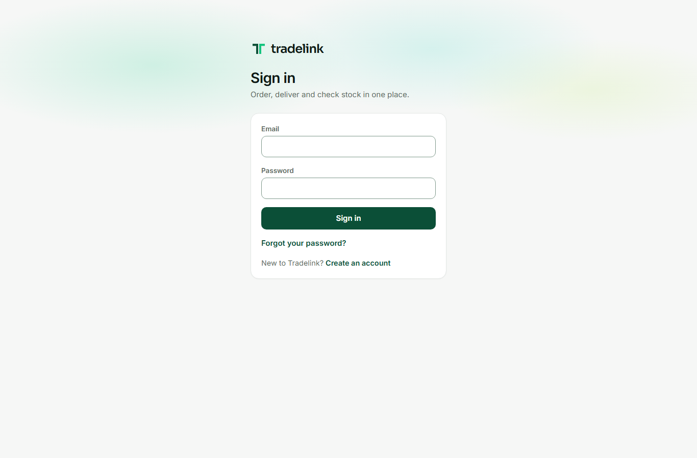

*Figure 1. Signing in.*

**Common problems**

| Message | What to do |
| --- | --- |
| "Check your email and password." | Check for typing mistakes, or reset your password (2.2). |
| "Too many attempts…" | Wait a few minutes, then try again. |
| "Confirm your email first…" | Open the confirmation email you were sent. |

### 2.2 Reset a password

1. On the sign-in page, select **Forgot your password?**, enter your email and send the request.
2. Open the email and select the link.
3. Enter a new password of at least 12 characters twice, and save it. You are signed in.

The page always says the email was sent, so it never reveals which addresses have accounts. If nothing arrives, check your spam folder. Links expire after a while; request a new one if needed.

### 2.3 Create an account

**What this is for:** a new buyer or supplier business joining Tradelink.

**Steps**

1. On the sign-in page, under "New to Tradelink?", select **Create an account**.
2. Choose **buyer** or **supplier**, then enter your business name, your full name, phone, email and a password (twice).
3. Submit the form.

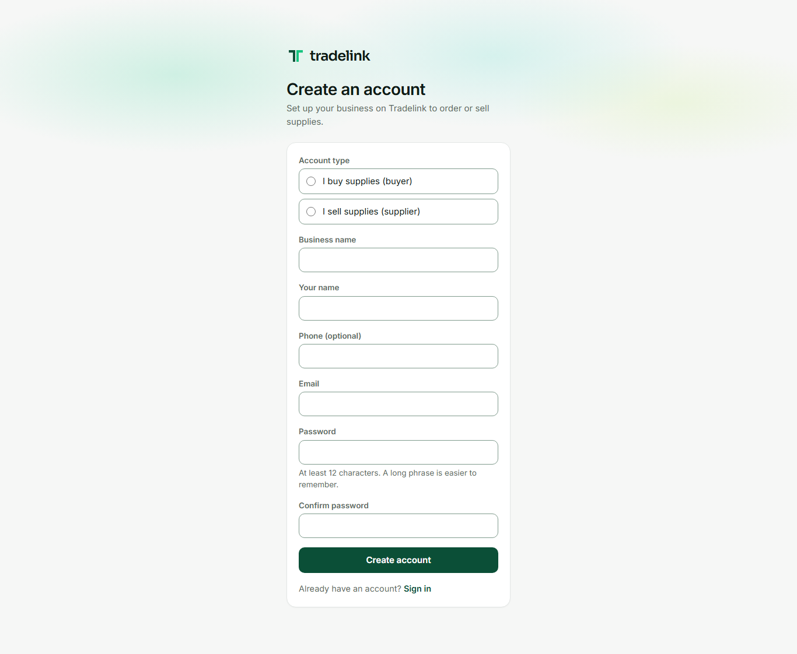

*Figure 2. Creating an account.*

**What happens next:** your business is set up at once. A new buyer is connected to every active supplier, and a new supplier to every active buyer. The Tradelink team is told. If email confirmation is on, you confirm your email first.

**Common problems:** "That business name may already be in use." Another business of the same kind has that name, including a supplier a buyer already added (4.5). Contact the Tradelink team.

<small><em>Not available yet: joining through an invitation link.</em></small>

### 2.4 Add Tradelink to your phone's home screen

Open Tradelink in your phone's browser. On an **iPhone or iPad**, tap **Share** in Safari, then **Add to Home Screen**. On **Android**, open Chrome's menu (three dots) and choose **Add to Home screen** or **Install app**. An icon named **Tradelink AI** opens the app full screen. Tradelink shows no install prompt of its own; if your browser has no such option, keep using the browser.

### 2.5 Use light and dark mode

Select the moon or sun button at the top right to switch. Or open **Settings > Appearance** and choose **System**, **Light** or **Dark**. The choice is remembered on each browser separately.

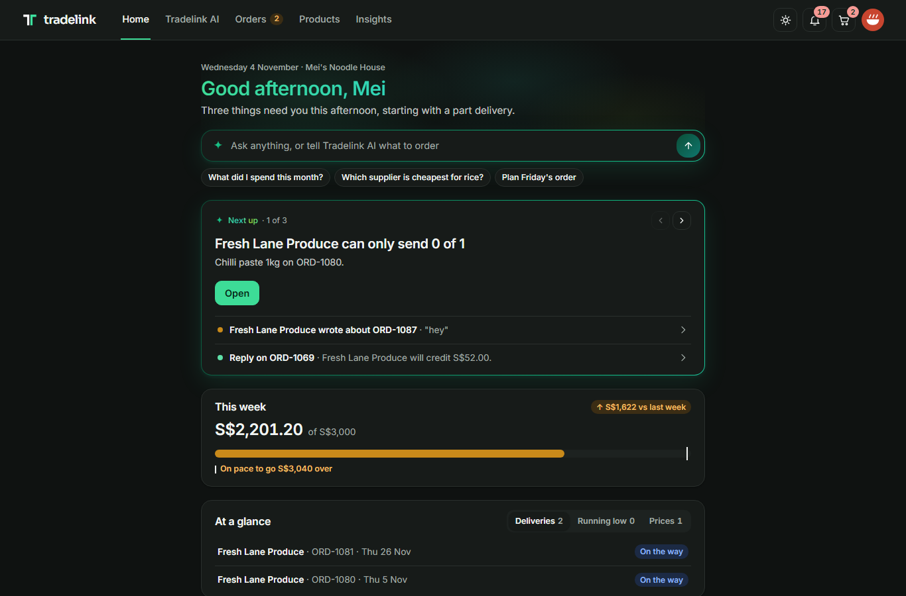

*Figure 3. Dark mode.*

---

## 3. Understanding the app

### 3.1 Home and navigation

Every Home page follows one pattern: a greeting with a one-line summary; **Next up**, the most important task shown large (use the arrows or tap a row to bring another forward); figures for the day or week; and **At a glance** tabs with short lists.

| | Laptop | Phone |
| --- | --- | --- |
| Main sections | Top bar | Tabs along the bottom (admins also get **More**) |
| Alerts | Bell button, top right | Same |
| Settings and Sign out | Account menu (your picture, top right) | Same |

| Role | Sections |
| --- | --- |
| Buyer | Home, Tradelink AI, Orders, Products, Insights (plus the cart button) |
| Supplier | Home, Tradelink AI, Orders, Inventory, Activity |
| Admin | Home, Attention, Orders, Suppliers, Users, Operators, Audit log |

A small number beside a section shows how many things wait for you there.

### 3.2 Status labels

| Applies to | Label | Meaning |
| --- | --- | --- |
| Order | Placed (Pending) | Waiting for the supplier to accept |
| Order | Accepted · Out for delivery · Delivered | On its way through delivery |
| Order | Rejected · Cancelled | Not going ahead (cancelled by the buyer, or because the supplier was suspended) |
| Order | Below minimum | Under the supplier's minimum order value; still sent |
| Delivery check | Check delivery · All here · Problem reported | Not checked yet · everything arrived · something was wrong |
| Second delivery | The rest comes *date* · The rest is on the way | The part a supplier sends later |
| Problem (buyer) | Waiting · Confirm credit · Replacement promised · Supplier replied | The supplier's answer, or none yet |
| Problem (buyer) | Under review · Credit received · Closed | Disputed and with the Tradelink team · settled with a credit · settled without one |

### 3.3 Notifications

Select the **bell** to open the alerts panel. Each alert has a button that goes straight to the right place, such as **Reply**, **Answer** or **Confirm credit**. Select **Mark all as read** to clear the count.

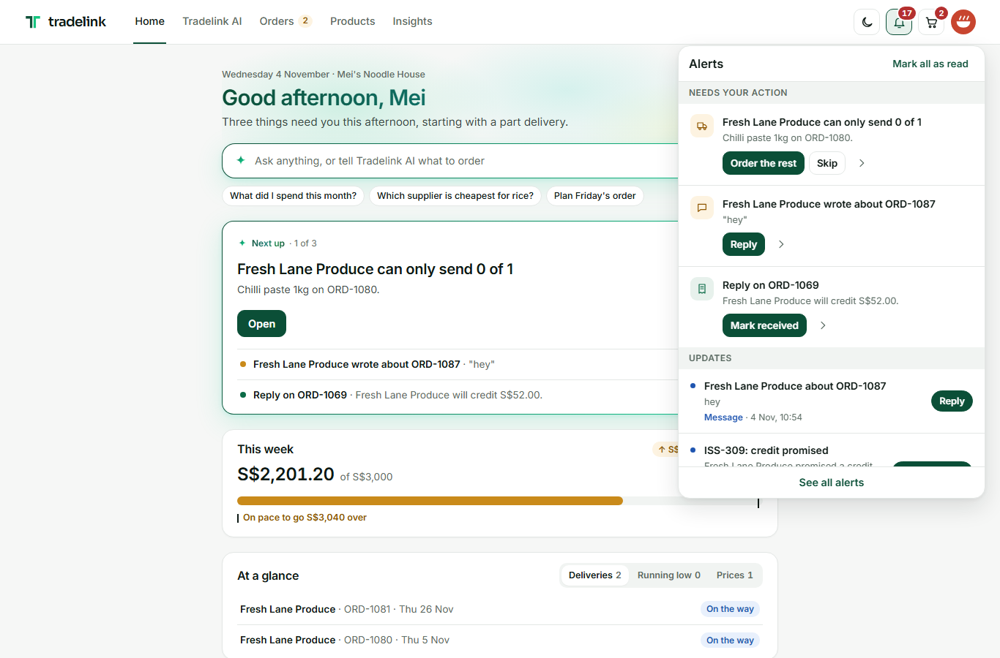

*Figure 4. The alerts panel opens beside the page.*

<small><em>Not available yet: email, text message and phone push notifications. All notifications are inside the app.</em></small>

---

## 4. Buyer guide

### 4.1 Understand Home

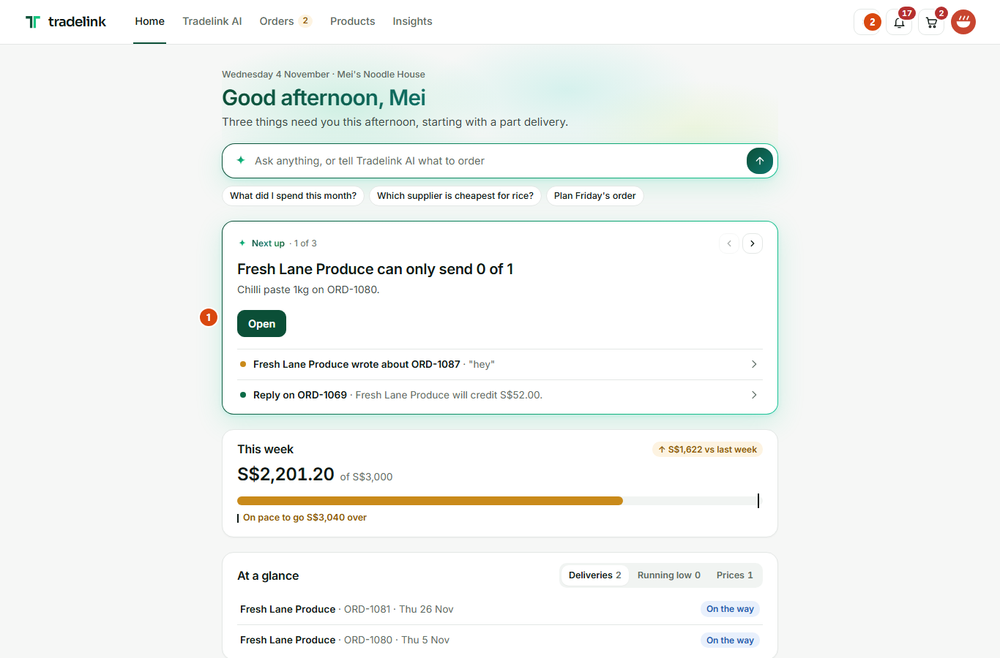

*Figure 5. Buyer Home. (1) Next up. (2) The bell.*

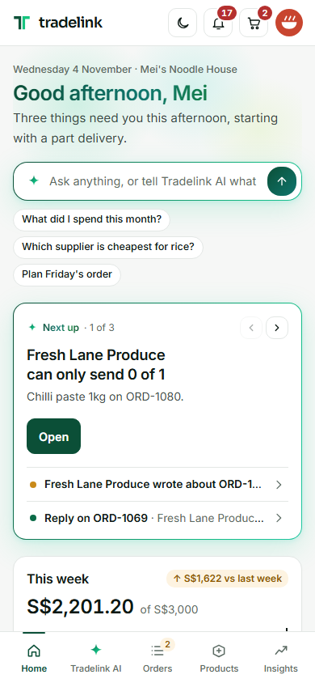

*Figure 6. Buyer Home on a phone.*

| Part | What it shows |
| --- | --- |
| Ask bar | Type a question or instruction for Tradelink AI; the suggestions under it are one-tap questions. |
| Next up | Tasks such as **Place tomorrow's order**, a delivery to check, a credit to confirm or a message to answer. |
| This week | Spending this week against your weekly budget, and whether you are on pace to go over. Opens Insights. |
| At a glance | **Deliveries**, **Running low** and **Prices**. |

### 4.2 Order with Tradelink AI

**What this is for:** ordering by typing what you need, the way you would text a supplier.

**Steps**

1. Open **Tradelink AI**, or type in the ask bar on Home, for example "Add 2 packets of dried noodles to my cart".
2. When Tradelink AI wants to change something, it shows a card marked **Needs your OK** listing exactly what will happen.
3. Select the card's button, such as **Add to cart**, or **Not now** to leave things as they are.

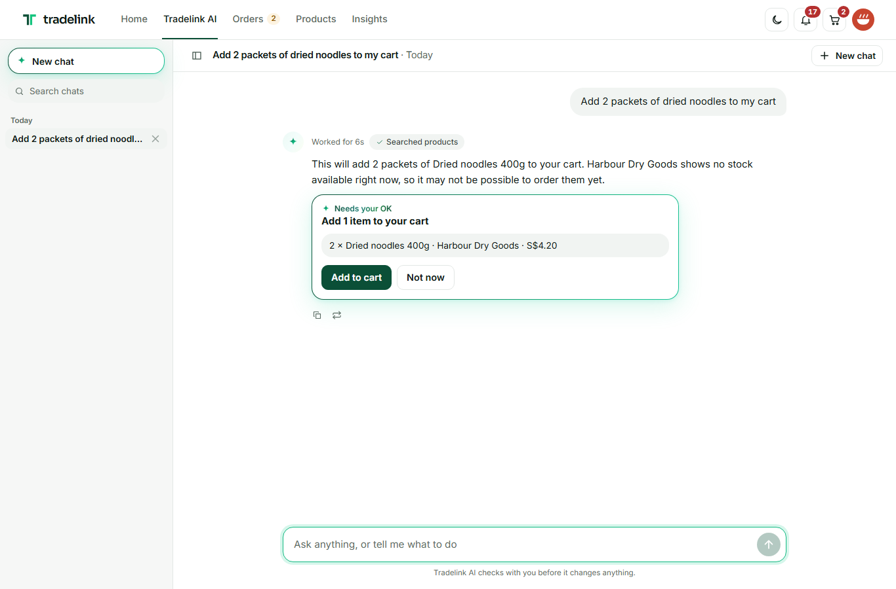

*Figure 7. Tradelink AI waits for your OK.*

**What happens next:** confirmed items go into your cart for review (4.4). If you ask it to **order now**, the confirm card places that one order straight away and leaves your cart as it is.

**Common problems:** "Tradelink AI is not set up yet." means the assistant is switched off; use Products and the cart. "Tradelink AI is not available right now." means try again shortly. There is a limit of 60 messages an hour per person.

### 4.3 Order your usual items

**Before you start:** set up **Settings > Usual items**: your usual quantity, how many are in the shop and how many you use per day.

1. On Home, find **Place tomorrow's order** in Next up. Quantities come from your usual items and how long your stock will last.
2. Choose **Place orders** (send now), **Review in cart** (change first) or **Not today** (hide for today).
3. Or open the cart and select **Add my usual** to add all your usual items.

### 4.4 Review your cart and place the order

**What this is for:** checking every line before anything is sent.

**Steps**

1. Select the **cart** button at the top right.
2. Change quantities with minus and plus, swap a product or remove a line.
3. Read the **Checked** line: it lists anything that blocks the order, such as more than the supplier has in stock.
4. Note the warnings: **Below minimum** ("Below *supplier*'s S$X minimum by S$Y", which never blocks the order) and your budget after this order.
5. Select **Place N orders · S$total**. Each supplier gets its own order.

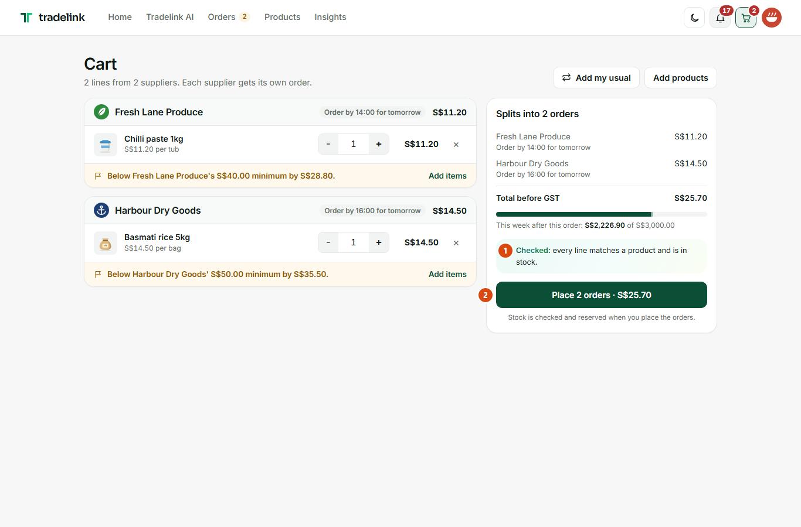

*Figure 8. The cart. (1) The Checked line. (2) Place sends one order to each supplier.*

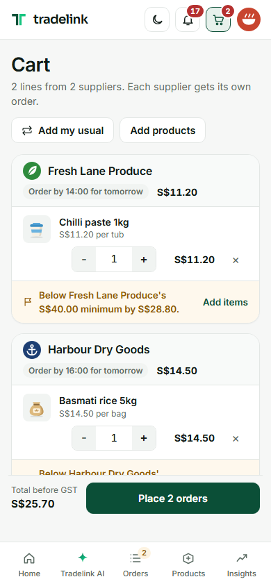

*Figure 9. On a phone, Place stays at the bottom of the screen.*

**What happens next:** "N orders placed and stock reserved." Stock is held for you the moment you place, so another buyer cannot take it. Each supplier gets a **New order** alert.

**Common problems**

- **Place is greyed out:** fix the lines named in the Checked line.
- **"Check the highlighted lines before placing this order.":** another buyer took the last stock first. Lower or remove the highlighted lines.
- **"Waits for the supplier to accept your invitation.":** the supplier is not on Tradelink yet (4.5).

### 4.5 Add a missing product or supplier

| Task | Steps | What happens next |
| --- | --- | --- |
| Product the supplier sells but Tradelink does not list | In the cart, select **Add to catalogue**, or ask Tradelink AI. Enter **Product name**, **Sold by**, **Estimated price (S$)** and **Supplier**. Save. | The product is added as not confirmed, and the supplier gets a **Product added** alert to confirm the real price and stock. |
| Supplier who is not on Tradelink | Ask Tradelink AI, for example "add Ah Seng Trading as a supplier". Fill in the form card (name, contact, phone) and select its button. | The supplier shows as **Invited** in Settings > Suppliers and you can add products for them. After 24 hours, the Tradelink team sees it in their queue. |

If the product already exists you see "This already exists. Choose it from the list."

<small><em>Not available yet: Tradelink does not send the supplier an invitation, and an invited supplier cannot yet take over the record you created. Contact the supplier yourself.</em></small>

### 4.6 Track your orders

Open **Orders** and filter by **All**, **Active**, **To check**, **Delivered**, **Problems** or **Cancelled and rejected**, or search by order number or supplier. Select an order to open it.

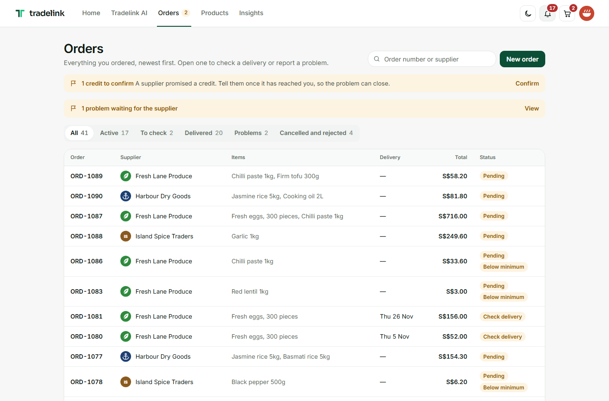

*Figure 10. Orders.*

An order page shows the progress steps and delivery date, the items, and:

- **"*Supplier* cannot send everything"** if it was part accepted, and **"The rest comes *date*"** if the rest comes later (select **Cancel the rest** if you no longer want it);
- **Messages with *supplier***: type and select **Send message**;
- **Change delivery date**: choose the delivery and **New date**, then **Ask *supplier***. Requests from the supplier show **Accept new date** and **Decline**;
- a **Tradelink AI** panel that answers questions about that order.

You can cancel only while the order is waiting for the supplier to accept it.

### 4.7 Check a delivery

**Before you start:** the order is **Out for delivery** or **Delivered**; it shows **Check delivery**.

1. Open the order.
2. Choose **All here** (everything arrived), **Not here yet** (late; only while out for delivery) or **Report a problem** (4.8).

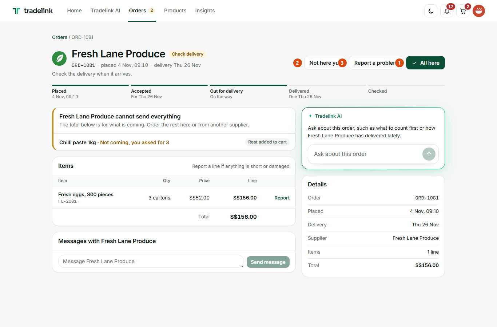

*Figure 11. (1) All here. (2) Not here yet. (3) Report a problem.*

**What happens next:** **All here** marks the order checked and adds the items to your in-shop counts. **Not here yet** asks the supplier for an update. If the order was still out for delivery, either choice also marks it delivered. Reporting late twice shows "You have already reported this order as late."

### 4.8 Report a problem

1. Open the order and select **Report a problem**.
2. Choose the product, the kind of problem (short, damaged, wrong item or expired) and the quantity. Add a note of up to 500 characters if it helps.
3. Send the report.

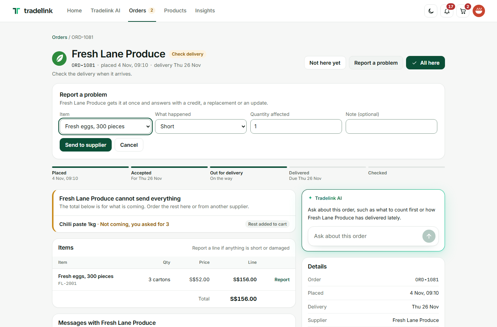

*Figure 12. Reporting a problem.*

**What happens next:** the supplier gets a **Problem reported** alert. The amount is quantity × unit price. The problem shows **Waiting** until the supplier answers with a credit, a replacement or a dispute. Problems unanswered for more than 4 hours, and disputes, go to the Tradelink team. **Orders > Problems** lists every problem you reported.

### 4.9 Check credits

When a supplier promises a credit, the problem shows **Confirm credit** and Orders shows a "credit to confirm" banner. Once the credit has reached you, open the order's problems and select **Mark credit received**. The problem closes as **Credit received** and the supplier is told.

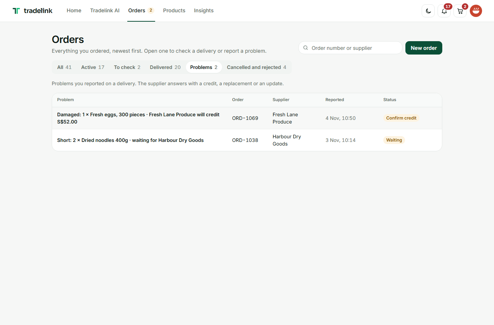

*Figure 13. A problem on an order.*

<small><em>Not available yet: invoices. Tradelink does not hold, check or pay invoices.</em></small>

### 4.10 Products, Insights and Settings

- **Products:** search your suppliers' catalogues, filter by category or supplier, and add to the cart. (Older links to Availability open this page; older links to Ask open Tradelink AI.)
- **Insights:** read only. An "In short" summary; spent this week and last week against your budget; a weekly spend chart; spend by supplier; each supplier's on-time record; price changes.
- **Settings:** weekly budget and switches for **Suggest what to reorder**, **Tell me about price changes** and **Warn me before I go over budget**; usual items; your suppliers (view only, **Connected** or **Invited**); Account and Appearance.

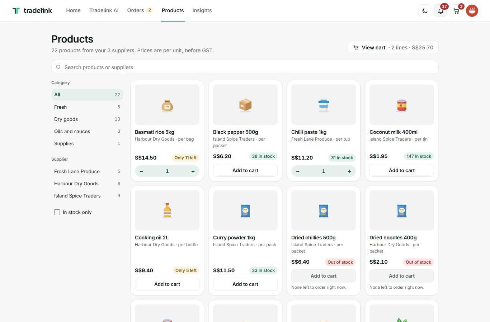

*Figure 14. Products.*

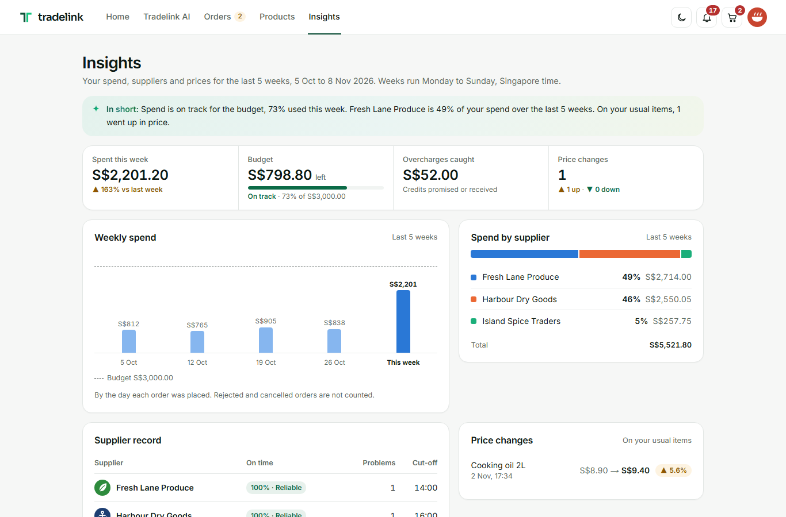

*Figure 15. Insights.*

---

## 5. Supplier guide

### 5.1 Understand Home

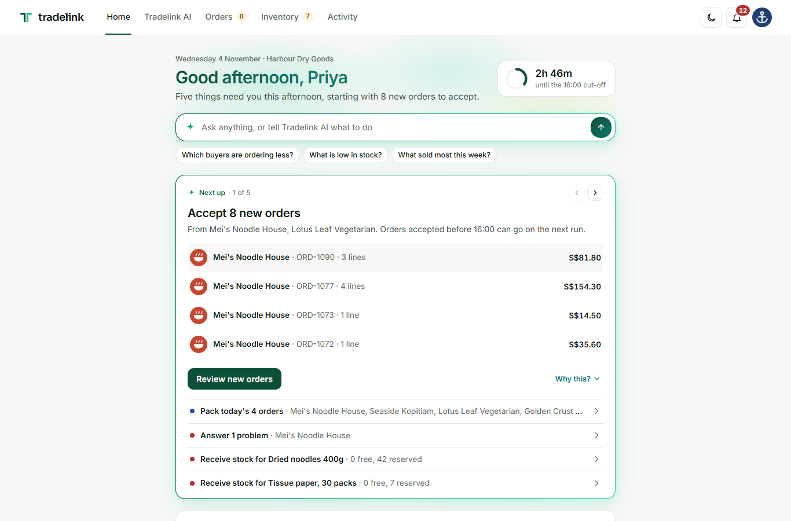

*Figure 16. Supplier Home.*

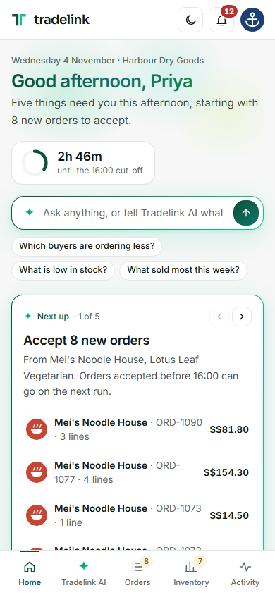

*Figure 17. Supplier Home on a phone.*

| Part | What it shows |
| --- | --- |
| Next up | Oldest job first: accept new orders; pack today's orders as one pick list with **Mark all out for delivery**; answer problems; receive stock for an item running out; a customer who has gone quiet. |
| Today | Order value and new orders so far, against a usual day of the same weekday |
| At a glance | **Customers**, **Running low** and **Coming up** |

### 5.2 Accept, part accept or reject an order

**Before you start:** open **Orders > New**, then the order.

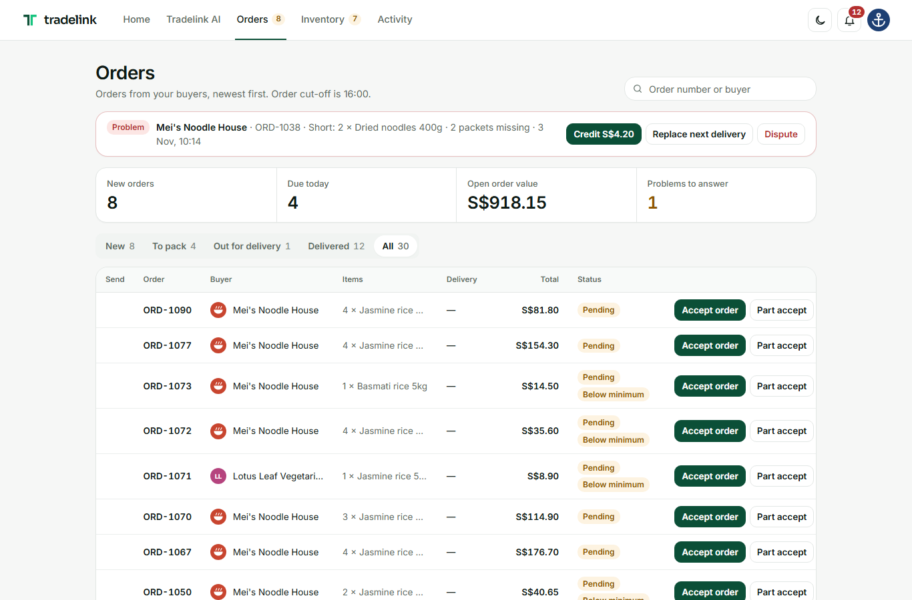

*Figure 18. Orders, with the New, To pack, Out for delivery, Delivered and All tabs.*

**Steps**, choose one:

- **Accept order:** pick the delivery date and confirm.
- **Part accept:** under "How much can you send?", enter how many of each line you can send now. Under "What you cannot send now", choose **Not coming**, or **Send the rest on** and pick a date. Set the delivery date and select **Send part order**.
- **Reject order:** confirm you cannot take it.

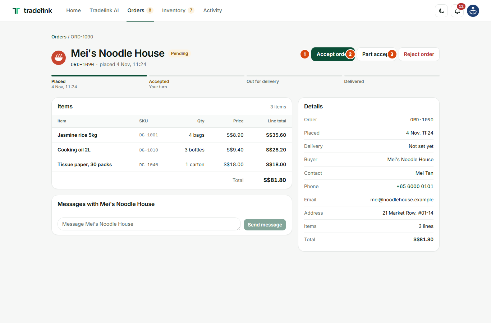

*Figure 19. (1) Accept order. (2) Part accept. (3) Reject order.*

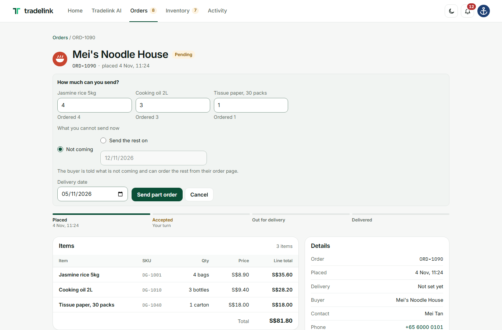

*Figure 20. Part accept.*

**What happens next:** the buyer is told. **Accept** holds the stock and updates line prices to your current prices. **Part accept** releases what you will not send now; if the rest comes later, the order shows a second delivery. **Reject** releases any held stock.

**Common problems**

| Message | What to do |
| --- | --- |
| "Confirm stock for the new products in this order first." | Confirm the buyer-added product in Inventory (5.4). |
| A stock warning | Not enough free stock: part accept, or receive stock first. |
| The date is refused | The delivery date must be today or later. |

### 5.3 Deliver an order

1. Open **Orders > To pack**, then the order.
2. Select **Mark out for delivery** when it leaves, and **Mark delivered** when it arrives.
3. For a second delivery, use **Mark the rest out for delivery** and **Deliver the rest**, or **Cancel the rest** if it will not come.

The buyer is told at each step. On delivery, the stock leaves your inventory and the buyer is asked to check it. For the second delivery you need enough free stock, otherwise you see "There is not enough free stock for the rest yet. Receive stock first."

**Messages and dates:** use **Messages with *buyer*** and **Send message** on the order. To move a date, select **Change delivery date**, pick the delivery and **New date**, then **Ask *buyer***. Buyer requests show **Accept new date** and **Decline**.

### 5.4 Manage inventory

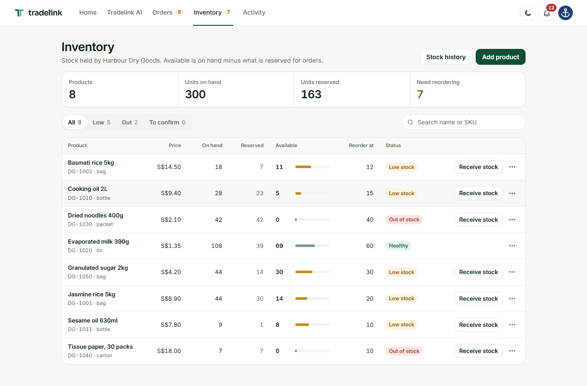

*Figure 21. Inventory, with filters for Low, Out and To confirm.*

| Task | Steps | What happens next |
| --- | --- | --- |
| Add a product | **Add product**: name, unit, price, opening stock, reorder level and category. | Listed for your buyers. |
| Receive stock | **Receive stock** on the product: how many arrived (1 to 9999). | Units added. A buyer-added product becomes active. |
| Confirm a buyer-added product | Filter **To confirm**, then **Confirm stock**: quantity, price and reorder level. | The product becomes active; waiting orders can be accepted. |
| Change a price | **Change price**: the new price. | Buyers see it under Prices. Orders you accept after the change use the new price. |
| Adjust stock | **Adjust stock**: the change, a reason (**Damaged**, **Expired**, **Count correction**) and an optional note. | Recorded in Stock history. |

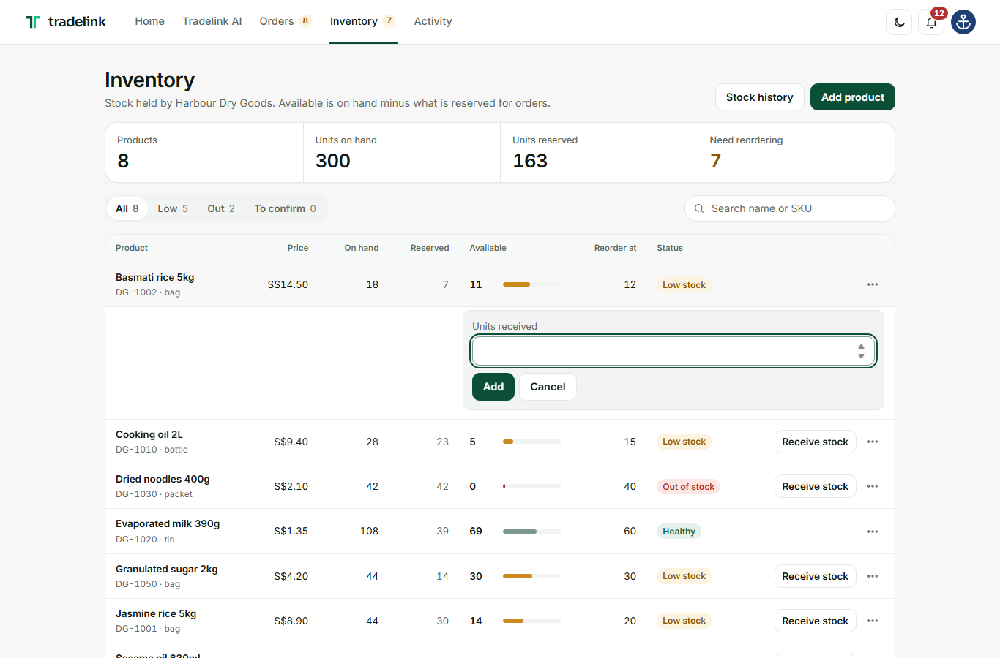

*Figure 22. Receiving stock.*

You cannot lower stock below what is held for orders: "This leaves less stock than is reserved for open orders."

### 5.5 Answer problems

1. Open the order from the alert, or from Home > **Answer problems**, and go to **Problems**.
2. Choose **Credit S$x**, **Replace next delivery** (not for late deliveries), **It is on the way** (late deliveries only) or **Dispute**.

The buyer is told. A promised credit shows **Waiting for buyer to confirm** until the buyer confirms it arrived. A dispute goes to the Tradelink team.

<small><em>Not available yet: invoice queries; buyers cannot raise one.</em></small>

### 5.6 Activity, stock history and settings

- **Activity:** what happened to your orders, stock and account, by day; filter by order, stock or account.
- **Stock history** (under Inventory): every change (Received, Reserved, Released, Delivered, Adjusted) with the units after it and the reason.
- **Settings:** your business profile (contact, product range, lead time, order cut-off, delivery days, minimum order), Account and Appearance.

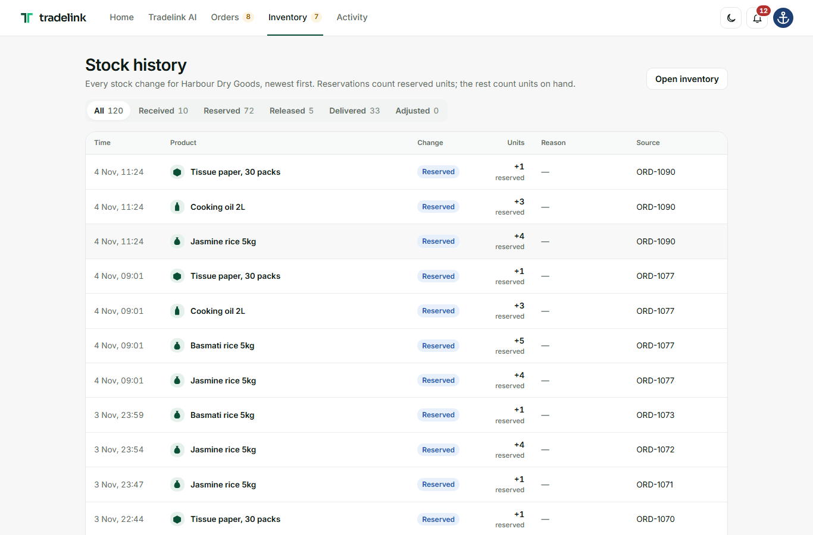

*Figure 23. Stock history.*

---

## 6. Admin guide

### 6.1 Understand Home

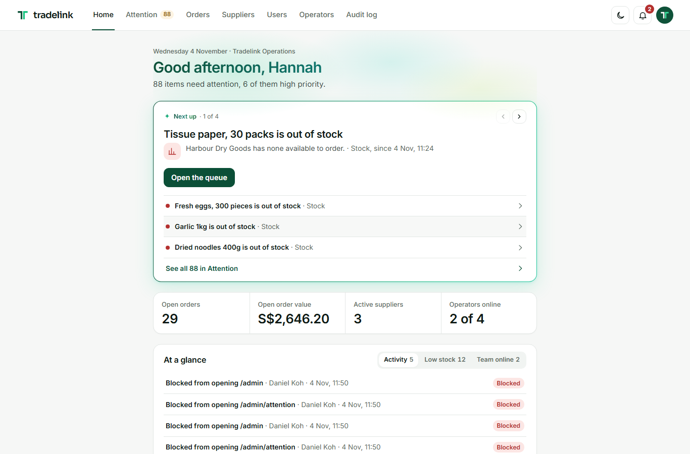

*Figure 24. Admin Home.*

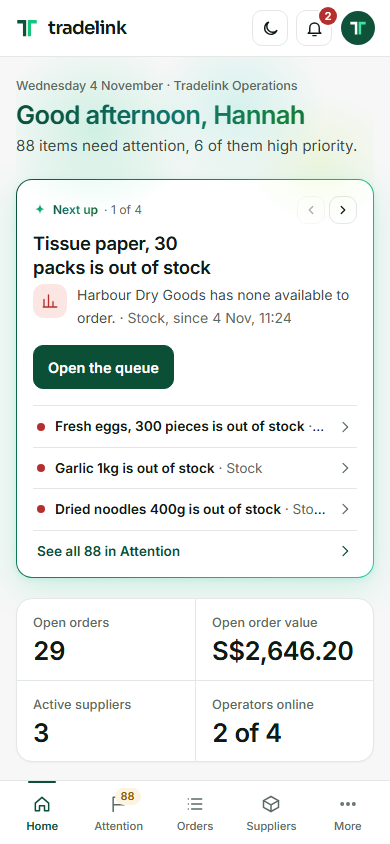

*Figure 25. Admin Home on a phone.*

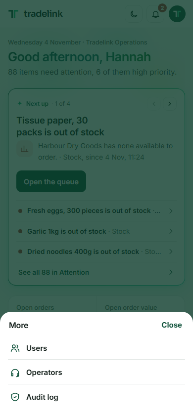

*Figure 26. On a phone, Users, Operators and Audit log open from More.*

Home shows how many items need attention (operators see only their own), **Next up** with the four newest urgent items and **See all in Attention**, tiles for open orders, open order value, active suppliers and operators online, and **At a glance** tabs for **Activity**, **Low stock** and **Team online**.

### 6.2 Work through Needs attention

1. Open **Attention**. High priority comes first, then oldest first.
2. Filter by **All**, **High**, **Medium** or **Unassigned** (operations lead only).
3. Use each item's buttons: **View supplier**; for blocked actions, **Open audit log** and **Mark handled**; for disputes, **Credit buyer** and **Close, no credit** (6.4).

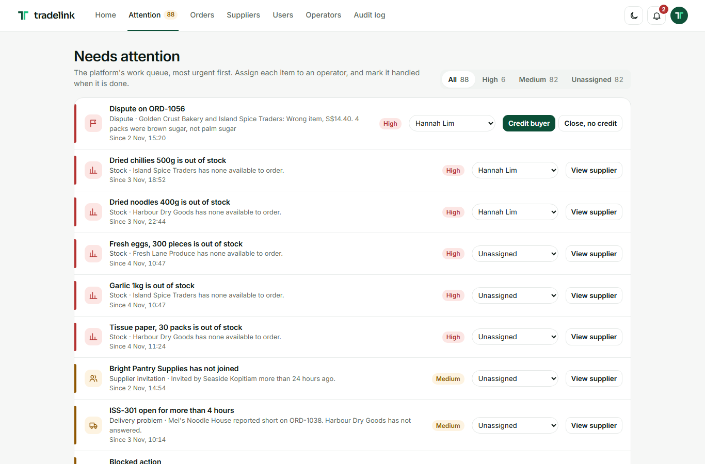

*Figure 27. The attention queue, seen by the operations lead.*

| Item | Priority | Appears when |
| --- | --- | --- |
| Dispute | High | A supplier disputes a buyer's problem |
| Out of stock | High | An active product has no free stock |
| Delivery problem | Medium | A problem is unanswered for more than 4 hours |
| Order waiting | Medium | A supplier has not answered an order for more than 30 minutes |
| Product not confirmed | Medium | A buyer added a product the supplier has not confirmed |
| Running low | Medium | Free stock is at or below the reorder level |
| Supplier invitation | Medium | A supplier a buyer added has not joined after 24 hours |
| Blocked action | Medium | Someone tried something they are not allowed to do |

Most items close by themselves when their cause is fixed. A blocked action stays until someone marks it handled.

### 6.3 Assign operators

**Before you start:** only the **operations lead** (Hannah in the demo) can assign items.

1. In **Attention**, find the item.
2. In **Assigned to**, choose the operator. The choice saves at once.

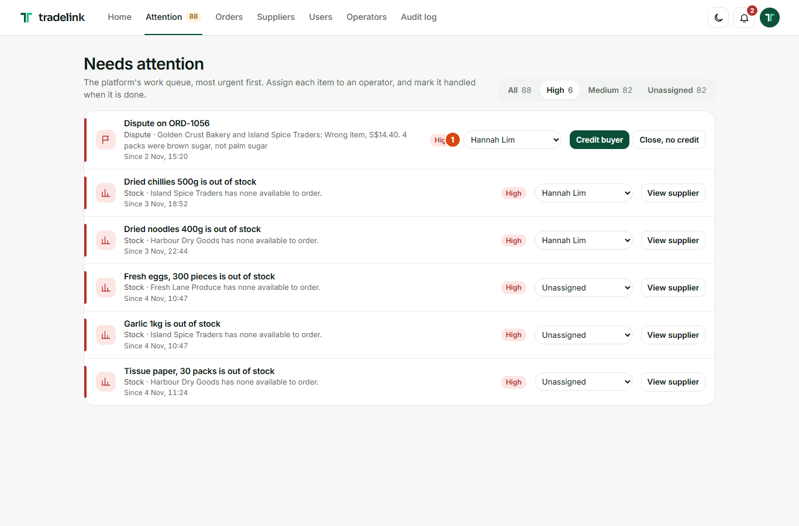

*Figure 28. (1) Assigned to.*

**What happens next:** the item appears in that operator's queue and Home, marked **Assigned to you**. Operators see only their own items.

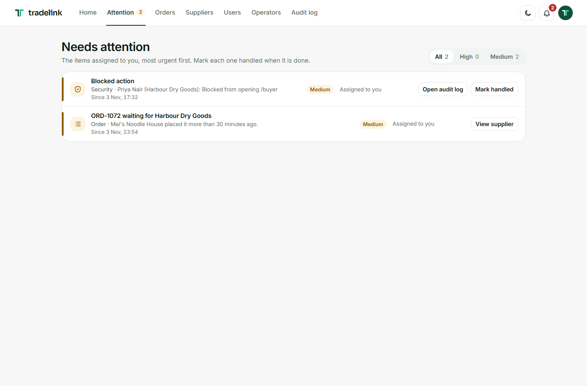

*Figure 29. An operator's view.*

**Common problems:** "This did not save. Reload the page and try again." means the page was open across an app update; reload it. If **Assigned to** is missing, you are not the operations lead.

### 6.4 Manage disputes

Filter **High**. Disputes read "Dispute on ORD-*number*" with both businesses, the problem, the amount and the note. Choose **Credit buyer** (the supplier is asked for the credit and the buyer confirms it when it arrives) or **Close, no credit**. Both businesses are told.

### 6.5 Suppliers, users, operators, orders and the audit log

| Page | What you can do |
| --- | --- |
| **Suppliers** | Filter by **Active**, **Invited**, **Suspended** and **Declined**. Open a supplier for its profile, products and orders. **Suspend** or **Reactivate** with a confirm step. **Low stock** lists products at or below their reorder level. |
| **Users** | View buyers and all accounts, with search; open a buyer for details and orders. View only. |
| **Operators** | View the team and who is online; the lead also sees each operator's item count. View only. |
| **Orders** | Every order, with status filters and search. View only. |
| **Audit log** | Every change and blocked attempt. Filter by **Organisation** (whose person made the change) and **Outcome** (**Allowed** or **Blocked**). Entries cannot be edited. |
| **Notifications** | New accounts, disputes and security events. |

**Suspending a supplier** hides its products, stops new orders and cancels its pending orders, releasing the stock. The supplier and its buyers are told. Orders already accepted can still be delivered.

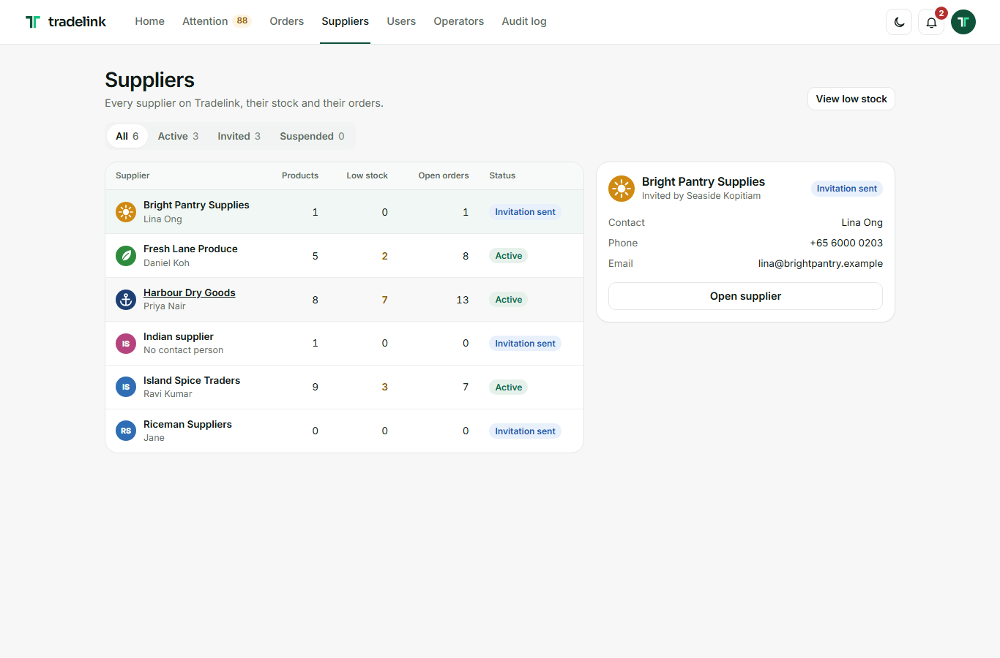

*Figure 30. A supplier's details, with Suspend.*

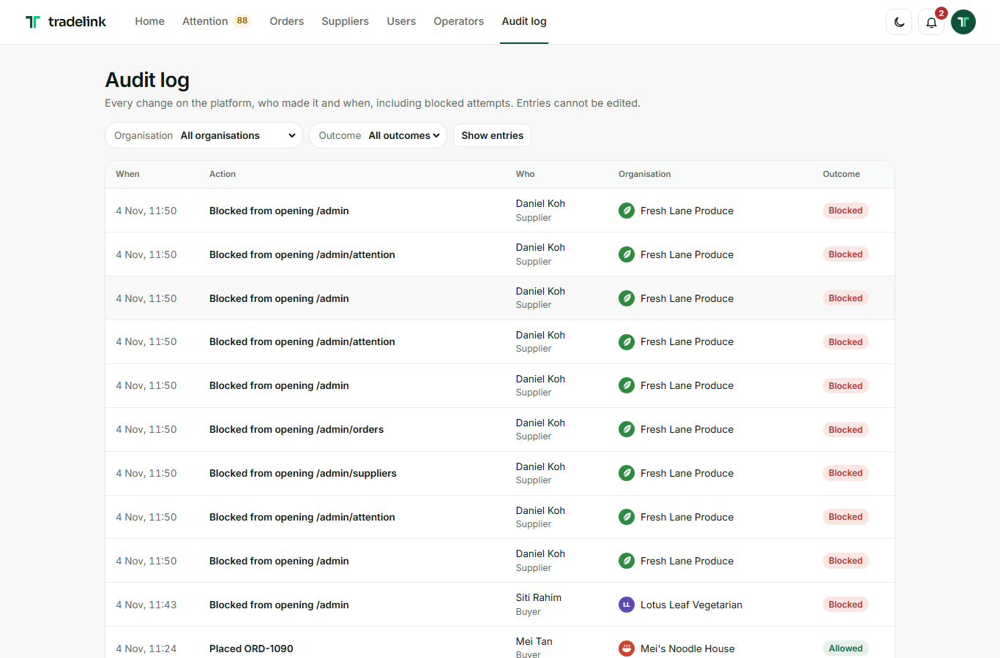

*Figure 31. The audit log.*

<small><em>Not available yet: approving or declining suppliers, inviting people, editing users or operators, and a system status page.</em></small>

---

## 7. Security and privacy tips

- **Keep your password to yourself.** Tradelink staff will never ask for it. Use at least 12 characters.
- **Sign out on shared devices** from the account menu.
- **Check before you confirm.** Tradelink AI changes nothing until you tap its button.
- **Problem notes and messages are visible to the other business,** so keep them to the order.
- **You only see your own business's data.** Every change, and every blocked attempt, is recorded in the audit log.

## 8. Frequently asked questions

| Question | Answer |
| --- | --- |
| Can Tradelink AI order without asking me? | No. It always shows a card and waits for your tap. |
| Why was my order sent although it is below the minimum? | The minimum is a guide; the order is marked **Below minimum** for both sides. |
| When is stock held for me? | When you place the order. It is released if the supplier rejects it or you cancel. |
| Can I change an order after placing it? | Cancel it while it waits for the supplier; after that, message the supplier on the order. |
| Does Tradelink handle invoices or payments? | No. They happen outside Tradelink; credits for problems are tracked in the app. |
| Will I get emails or texts? | Only sign-in emails, such as password resets. Everything else is in the app. |

## 9. Troubleshooting

| What you see | What to do |
| --- | --- |
| "This page did not load" | Select **Try again**. If it repeats, give support the code shown. |
| "This did not save. Reload the page and try again." | Reload the page and repeat the step. |
| "Something went wrong. Try again." | Try again in a moment. |
| An offline page | Reconnect and select **Try again**. |
| "This order changed in another tab. Check it again before confirming." | Check the cart again, then place the order. |
| "Too many requests. Try again in a few minutes." | Wait a few minutes. |
| "You do not have access to do that." | The action belongs to another role or to the operations lead. |

## 10. Glossary

| Term | Meaning |
| --- | --- |
| Buyer, supplier | The two kinds of business that trade through Tradelink |
| Admin, operator | A member of the Tradelink operations team |
| Operations lead | The admin who sees and assigns every attention item |
| Tradelink AI | The built-in assistant; it prepares actions and you confirm them |
| Confirm card | The card Tradelink AI shows before it changes anything |
| Cart | Draft order lines, grouped by supplier, before they are sent |
| Usual items | Products you reorder regularly |
| Held (reserved) stock | Stock set aside for an order |
| Minimum order | The order value a supplier prefers; orders below it are marked, not blocked |
| Part accept, the rest | Accepting part of an order; the rest may come in a second delivery |
| Problem, credit, dispute | Something wrong with a delivery; money taken off what the buyer owes; a supplier disagreeing, decided by the Tradelink team |
| Audit log | The permanent record of every change and blocked attempt |
