# Tradelink User Guide

| Field | Value |
| --- | --- |
| Document | User Guide |
| Product | Tradelink, with Tradelink AI |
| Version | 1.0 |
| Date | 4 November 2026 |
| Status | Draft for review |
| Owner | Janya Mali |
| Applies to | The web app at commit `9250e98` and later |

## Contents

1. [Welcome to Tradelink](#1-welcome-to-tradelink)
2. [Getting started](#2-getting-started)
3. [Understanding the app](#3-understanding-the-app)
4. [Buyer guide](#4-buyer-guide)
5. [Supplier guide](#5-supplier-guide)
6. [Admin guide](#6-admin-guide)
7. [Security and privacy tips](#7-security-and-privacy-tips)
8. [Frequently asked questions](#8-frequently-asked-questions)
9. [Troubleshooting](#9-troubleshooting)
10. [Glossary](#10-glossary)
11. [Document history](#11-document-history)

### About this guide

| Topic | Detail |
| --- | --- |
| **Purpose** | Help you complete everyday tasks in Tradelink, step by step. |
| **Audience** | Buyers (shops and food businesses), suppliers, and the Tradelink operations team. No technical knowledge is needed. |
| **Scope** | What the app does today. Features that are not available yet are named where you might look for them, so you are not left searching. |

All businesses, people, products and amounts in the screenshots are fictional demo data.

Each task follows the same pattern: **What this is for**, **Before you start**, **Steps**, a screenshot, **What happens next** and **Common problems**. Numbered orange circles in a screenshot match the numbered notes under it.

---

## 1. Welcome to Tradelink

### What it does

Tradelink replaces ordering over WhatsApp and phone calls between small food businesses and their suppliers. In one app:

- **Buyers** order from all their suppliers, track deliveries, check what arrived and sort out problems.
- **Suppliers** receive orders, accept all or part of them, deliver them, keep stock up to date and answer problems.
- **The Tradelink operations team** (admins) watch for anything that needs attention, settle disputes and look after suppliers.

**Tradelink AI** is an assistant built into the app. You can ask it questions or tell it what to do in plain words, for example "add 2 packets of dried noodles to my cart". It always shows you what it is about to do and waits for you to tap a button before anything changes.

### Who it is for

| Role | Who they are | Main things they do |
| --- | --- | --- |
| Buyer | A shop, kopitiam, bakery or restaurant that buys stock | Order, check deliveries, report problems, watch spending |
| Supplier | A business that sells to buyers | Accept and deliver orders, manage stock and prices, answer problems |
| Admin | The Tradelink operations team | Work through the attention queue, settle disputes, look after suppliers |

### Supported devices and browsers

Tradelink is a web app. You open it in a browser; there is nothing to download from an app store.

| Device | What is supported |
| --- | --- |
| Laptop or desktop | Chrome is tested automatically. Screens of 760 pixels wide or more show the laptop layout. |
| Phone | Chrome on an Android phone is tested automatically (Pixel 7 size). Screens narrower than 760 pixels show the phone layout. |
| Other browsers | Up-to-date Safari, Edge and Firefox are not covered by automated tests. |

You need an internet connection. Without one, Tradelink shows an offline page and you can try again when you are back online.

---

## 2. Getting started

### 2.1 Sign in

**What this is for:** opening your Tradelink account.

**Before you start:** you need the email address and password for your account. Demo accounts share one password, which the project owner gives out privately.

**Steps**

1. Open Tradelink. You see the **Sign in** page.
2. Enter your **Email** and **Password**.
3. Select **Sign in**.

*Figure 1. The sign-in page on a laptop.*

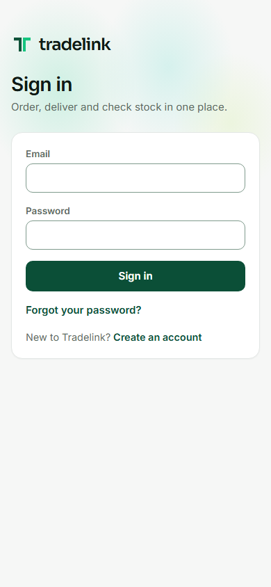

*Figure 2. The same page on a phone.*

**What happens next:** Tradelink opens the Home page for your role: buyer, supplier or admin. If you followed a link to a particular page, it opens that page.

**Common problems**

| Message | What to do |
| --- | --- |
| "Check your email and password." | Check for typing mistakes, or reset your password (see 2.2). |
| "Too many attempts…" | Wait a few minutes before trying again. |
| "Confirm your email first…" | Open the confirmation email you were sent when you created the account. |
| A notice that a link has expired | Request a new link. |

### 2.2 Reset a password

**What this is for:** choosing a new password when you have forgotten yours.

**Before you start:** you need access to the email inbox for your account.

**Steps**

1. On the sign-in page, select **Forgot your password?**
2. Enter your email address and send the request.
3. Open the email and select the link in it.
4. Enter a new password of at least 12 characters, enter it again to confirm, and save it.

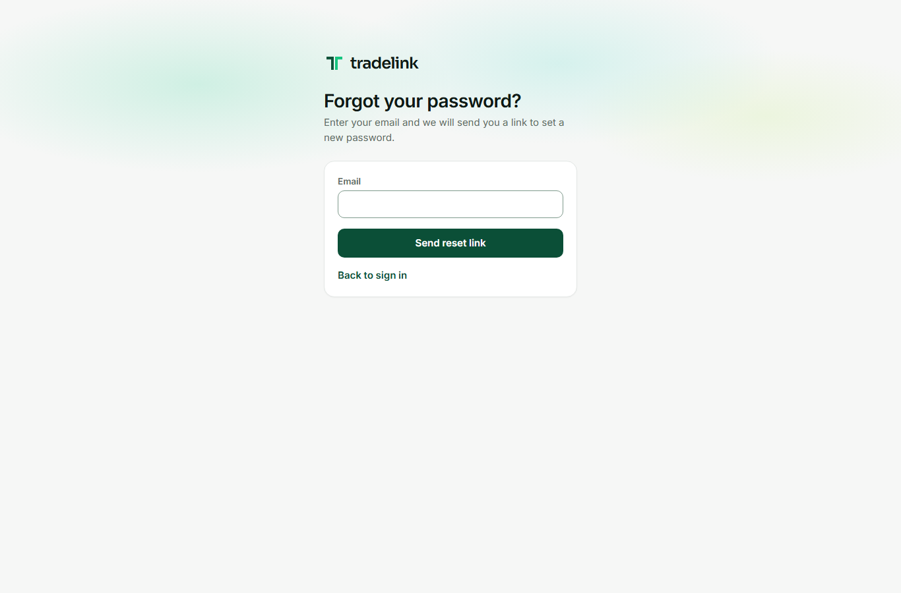

*Figure 3. The forgot password page.*

**What happens next:** you are signed in with your new password.

**Common problems**

- **The page always says the email was sent.** This is deliberate: Tradelink never reveals which email addresses have accounts. If nothing arrives, check your spam folder and the spelling of your address.
- **"The link has expired."** Links work for a limited time. Request a new one.

### 2.3 Create an account

**What this is for:** a new buyer or supplier business joining Tradelink.

**Before you start:** decide whether you are joining as a buyer or a supplier. You need your business name, your full name, a phone number and an email address.

**Steps**

1. On the sign-in page, under "New to Tradelink?", select **Create an account**.
2. Choose **buyer** or **supplier**.
3. Enter your business name, your full name, phone number and email address.
4. Choose a password and enter it again to confirm.
5. Submit the form.

*Figure 4. Creating an account.*

**What happens next**

- Your business is set up straight away. A new buyer is connected to every active supplier, and a new supplier to every active buyer.
- The Tradelink team is told that a new account was created.
- If email confirmation is switched on, Tradelink asks you to confirm your email first.

**Common problems**

- **"That business name may already be in use."** Another business of the same kind already has that name. This includes a supplier that a buyer has already added to Tradelink (see 4.6). Contact the Tradelink team.

> **Not available yet:** joining through an invitation link. Supplier invitations are not sent by email, and an invited supplier cannot yet take over the record a buyer created for them.

### 2.4 Add Tradelink to your phone's home screen

**What this is for:** opening Tradelink from an icon, like an app.

**Before you start:** open Tradelink in your phone's browser and sign in.

**Steps**

1. Open the browser menu. In Chrome, this is the three dots; in Safari, it is the Share button.
2. Choose **Add to Home screen** or **Install app**. The wording depends on your browser.
3. Confirm.

**What happens next:** an icon named **Tradelink AI** appears on your home screen and opens the app full screen. Tradelink does not show its own install prompt; the option is always in your browser's menu.

**Common problems**

- **No install option.** Some browsers do not offer it. Use Tradelink in the browser instead; everything works the same.

### 2.5 Use light and dark mode

**What this is for:** choosing a light or dark screen.

**Steps**

1. Select the moon or sun button at the top right of any page to switch between light and dark.
2. Or open **Settings** from your account menu and go to **Appearance**. Choose **System** (follow your device), **Light** or **Dark**.

*Figure 5. Buyer Home in dark mode.*

**What happens next:** the change applies at once.

**Common problems**

- **My choice did not follow me to another device.** The setting is remembered on each browser separately. Set it once on each device.

---

## 3. Understanding the app

### 3.1 The Home page

Every role starts on a Home page with the same pattern:

1. A greeting and a one-line summary of the day.
2. **Next up**: the most important thing to do now, shown large. Use the arrows, or tap a row underneath, to bring another item forward. "1 of 3" tells you how many there are.
3. Figures for the day or week.
4. **At a glance** tabs with short lists, such as deliveries or low stock.

### 3.2 Navigation on phone and laptop

| | Laptop (760 pixels wide or more) | Phone |
| --- | --- | --- |
| Main sections | Across the top bar | Tabs along the bottom of the screen |
| More sections | All visible in the top bar | Admins get a **More** tab for Users, Operators and Audit log |
| Alerts | Bell button at the top right | Bell button at the top right |
| Settings and Sign out | Account menu (your picture at the top right) | Account menu |
| Cart (buyers) | Cart button at the top right, showing the number of lines | Same |

| Role | Sections |
| --- | --- |
| Buyer | Home, Tradelink AI, Orders, Products, Insights |
| Supplier | Home, Tradelink AI, Orders, Inventory, Activity |
| Admin | Home, Attention, Orders, Suppliers, Users, Operators, Audit log |

A small number next to a section shows how many things wait for you there, for example deliveries to check.

*Figure 6. On a phone, extra admin sections open from More.*

### 3.3 Status labels

**Orders**

| Label | Meaning |
| --- | --- |
| Placed (Pending) | Sent to the supplier, waiting for them to accept |
| Accepted | The supplier will deliver on the confirmed date |
| Out for delivery | On its way |
| Delivered | The supplier has marked it delivered |
| Rejected | The supplier cannot take the order |
| Cancelled | The buyer cancelled it, or it was cancelled because the supplier was suspended |
| Below minimum | The order is under the supplier's minimum order value. It is still sent. |

**Checking a delivery (buyers)**

| Label | Meaning |
| --- | --- |
| Check delivery | Delivered but not yet checked by you |
| All here | You confirmed everything arrived |
| Problem reported | You reported something wrong |

**Second delivery (when a supplier sends part of an order later)**

| Label | Meaning |
| --- | --- |
| The rest comes *date* | Waiting for the second delivery |
| The rest is on the way | The second delivery is out |
| Delivered or Cancelled | The rest arrived, or will not come |

**Problems, as a buyer sees them**

| Label | Meaning |
| --- | --- |
| Waiting | The supplier has not answered yet |
| Confirm credit | The supplier promised a credit. Confirm once it reaches you. |
| Replacement promised | The supplier will replace the items on the next delivery |
| Supplier replied | For a late delivery: the supplier says it is on the way |
| Under review | The supplier disputed it, and the Tradelink team will decide |
| Credit received | You confirmed the credit arrived |
| Closed | Settled with no credit |

### 3.4 Notifications

Tradelink tells you about changes inside the app: new orders, accepted orders, deliveries, problems, credits, messages and date changes.

1. Select the **bell** at the top right to open the alerts panel. Each alert has a button that takes you straight to the right place, such as **Reply**, **Answer** or **Confirm credit**.
2. For the full list, open the Alerts page. Buyers see the tabs **All**, **Needs action** and **Updates**. Select **Mark all as read** to clear the count.

*Figure 7. The alerts panel opens beside the page.*

> **Not available yet:** email, text message and phone push notifications. All notifications are inside the app.

---

## 4. Buyer guide

### 4.1 Understand Home

**What this is for:** seeing what needs you today at a glance.

*Figure 8. Buyer Home. (1) Next up shows the most important task. (2) The bell opens your alerts.*

*Figure 9. Buyer Home on a phone, with the bottom tabs.*

| Part of the page | What it shows |
| --- | --- |
| Ask bar | Type a question or an instruction for Tradelink AI. Suggestions under it are one-tap questions. |
| Next up | Tasks such as **Place tomorrow's order**, a delivery to check, a credit to confirm or a message to answer. |
| This week | What you have spent this week against your weekly budget, and whether you are on pace to go over. Select it to open Insights. |
| At a glance | **Deliveries** on the way, items **Running low**, and recent **Prices** changes. |

When nothing needs you, Home says: "Nothing needs you right now. Your usual items are covered and every delivery is checked."

### 4.2 Create an order with Tradelink AI

**What this is for:** ordering by typing what you need, the way you would text a supplier.

**Before you start:** you need suppliers with products on Tradelink.

**Steps**

1. Open **Tradelink AI**, or type in the ask bar on Home.
2. Type what you need, for example "Add 2 packets of dried noodles to my cart".
3. Read the reply. When Tradelink AI wants to change something, it shows a card marked **Needs your OK** listing exactly what will happen.
4. Select the card's button, for example **Add to cart**, to go ahead, or **Not now** to leave things as they are.

*Figure 10. Tradelink AI shows what it will do and waits for your OK.*

**What happens next**

- Items you confirm go into your cart, to review before you place the order (see 4.4).
- If you ask it to **order now**, the confirm card places that one order straight away and leaves your cart as it is.

**Common problems**

- **"Tradelink AI is not set up yet."** The assistant is not switched on for this installation. Use Products and the cart instead.
- **"Tradelink AI is not available right now."** Try again in a moment.
- **The reply mentions low or no stock.** You can still add the item, but the order may be short. Check the cart before placing.
- **You sent many messages quickly.** There is a limit of 60 messages an hour per person.

### 4.3 Order your usual items

**What this is for:** reordering what you buy regularly, without typing.

**Before you start:** set up your usual items in **Settings > Usual items**: how many you usually order, how many you have in the shop, and how many you use per day.

**Steps**

1. On Home, look for **Place tomorrow's order** in Next up. Tradelink suggests quantities from your usual items and how long your stock will last.
2. Choose one:
   - **Place orders** sends the orders straight away.
   - **Review in cart** puts the lines in your cart so you can change them first.
   - **Not today** hides the suggestion for today.
3. Or open the cart and select **Add my usual** to add all your usual items.

**What happens next:** placed orders go to each supplier. Lines in the cart wait for you to review them (see 4.4).

**Common problems**

- **No suggestion appears.** Your usual items are covered for now, or you have not set any up.

### 4.4 Review your cart and place the order

**What this is for:** checking every line before anything is sent to a supplier.

**Before you start:** add items from Products, Tradelink AI or **Add my usual**.

**Steps**

1. Select the **cart** button at the top right.
2. Check each supplier's lines. Use the minus and plus buttons to change quantities, swap a product, or remove a line.
3. Read the **Checked** line. It lists anything that blocks the order, such as more than the supplier has in stock.
4. Look at the warnings:
   - **Below minimum:** "Below *supplier*'s S$X minimum by S$Y". You can still place the order; the supplier sees the same warning.
   - **Budget:** how much of your weekly budget is left after this order.
5. Select **Place N orders · S$total**. You get one order for each supplier.

*Figure 11. The cart. (1) The Checked line lists anything that must be fixed. (2) Place sends one order to each supplier.*

*Figure 12. On a phone, the Place button stays at the bottom of the screen.*

**What happens next:** "N orders placed and stock reserved." Stock is held for you the moment you place the order, so another buyer cannot take it. Each supplier gets a **New order** alert.

**Common problems**

- **Place is greyed out.** Fix the lines named in the Checked line first.
- **A line turns red after you select Place.** Another buyer took the last stock a moment earlier. Lower the quantity or remove the line.
- **"Waits for the supplier to accept your invitation."** The line is for a supplier that is not on Tradelink yet (see 4.6).

### 4.5 Add a product that is missing

**What this is for:** ordering something your supplier sells but that is not listed in Tradelink yet.

**Steps**

1. In the cart, select **Add to catalogue**. Or ask Tradelink AI, for example "add pandan leaves from Fresh Lane", and fill in the form card it shows.
2. Enter the **Product name**, how it is **Sold by**, the **Estimated price (S$)** and the **Supplier**.
3. Save.

**What happens next:** the product is added as **not confirmed**, and the supplier gets a **Product added** alert. The supplier confirms the real price and stock before the line can be filled.

**Common problems**

- **"This already exists. Choose it from the list."** The supplier already lists a product with that name. Search Products for it.

### 4.6 Add a supplier who is not on Tradelink

**What this is for:** recording a supplier you buy from who has not joined yet.

**Steps**

1. Open **Tradelink AI** and ask it to add the supplier, for example "add Ah Seng Trading as a supplier".
2. Fill in the form card: business name, contact person and phone.
3. Select the card's button to add the supplier.

**What happens next**

- The supplier is listed as **Invited** in Settings > Suppliers. You can add products for them.
- If they have not joined after 24 hours, the Tradelink team sees it in their attention queue.

> **Not available yet:** Tradelink does not send the supplier an invitation email or link. Contact the supplier yourself. An invited supplier cannot yet join and take over the record you created; the Tradelink team will help.

### 4.7 Track your orders

**What this is for:** following each order from placing to delivery.

**Steps**

1. Open **Orders**.
2. Use the filters: **All**, **Active**, **To check**, **Delivered**, **Problems**, **Cancelled and rejected**. You can also search by order number or supplier.
3. Select an order to open it.

*Figure 13. Orders on a laptop.*

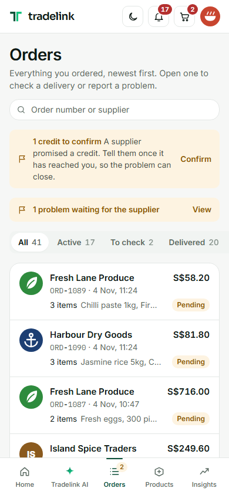

*Figure 14. Orders on a phone.*

On an order page you can see:

- the progress steps and the delivery date;
- the items and amounts;
- **"*Supplier* cannot send everything"** if the supplier accepted only part of the order;
- **"The rest comes *date*"** if the rest comes in a second delivery. Select **Cancel the rest** if you no longer want it;
- the **conversation**, with messages and date change requests.

**Messages and date changes**

- To message the supplier, type in **Messages with *supplier*** at the bottom of the order and select **Send message**. You can also ask Tradelink AI, for example "tell Harbour Dry Goods the back door is open"; it shows the message for your OK before sending.
- The **Tradelink AI** panel on the order page answers questions about that order, such as what to count first.
- To ask for a different delivery date, select **Change delivery date** in the messages section, choose which delivery and the **New date**, then select **Ask *supplier***. You can also ask Tradelink AI.
- When the supplier asks to move a date, the order and the alert show **Accept new date** and **Decline**.

**Common problems**

- **Cancel order is missing.** You can cancel only while the order is still waiting for the supplier to accept it.

### 4.8 Check a delivery

**What this is for:** confirming what arrived, so your stock counts stay right and problems are caught early.

**Before you start:** the order is **Out for delivery** or **Delivered**.

**Steps**

1. Open the order. Orders waiting for a check show **Check delivery**.
2. Choose one:
   - **All here**: everything arrived.
   - **Not here yet**: the delivery is late. This is only shown while the order is out for delivery.
   - **Report a problem**: something is short, damaged, wrong or expired (see 4.9).

*Figure 15. Checking a delivery. (1) All here. (2) Not here yet. (3) Report a problem.*

**What happens next**

- **All here** marks the order checked and adds the items to your in-shop counts.
- **Not here yet** asks the supplier for an update.
- If the order was still out for delivery, either choice also marks it delivered.

**Common problems**

- **"You have already reported this order as late."** Wait for the supplier's answer.

### 4.9 Report a problem

**What this is for:** telling the supplier that part of a delivery was short, damaged, the wrong item, or expired.

**Steps**

1. Open the order and select **Report a problem**.
2. Choose the product, the kind of problem and the quantity affected.
3. Add a short note if it helps (up to 500 characters).
4. Send the report.

*Figure 16. Reporting a problem on a delivery.*

**What happens next:** the supplier gets a **Problem reported** alert. The amount is worked out as quantity × unit price. The problem shows as **Waiting** until the supplier answers with a credit, a replacement or a dispute. Problems unanswered for more than 4 hours, and disputes, go to the Tradelink team.

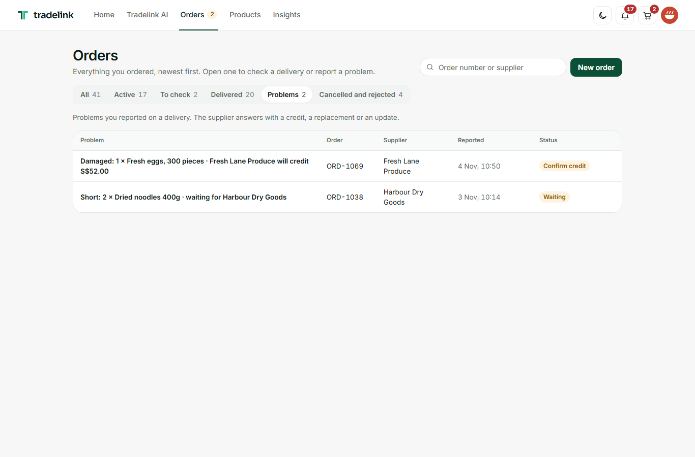

*Figure 17. Orders > Problems lists every problem you reported.*

### 4.10 Check credits

**What this is for:** making sure a credit the supplier promised really reached you.

**Steps**

1. When a supplier promises a credit, the problem shows **Confirm credit**, and Orders shows a "credit to confirm" banner.
2. Once the credit has reached you, open the order's problems and select **Mark credit received**.

*Figure 18. A problem on an order.*

**What happens next:** the problem closes as **Credit received**, and the supplier is told.

> **Not available yet:** invoices. Tradelink does not hold, check or pay invoices, and an invoice query cannot be raised. Credits are tracked as described above.

### 4.11 Products, Insights and Settings

**Products:** search the catalogue of your connected suppliers. Filter by category or supplier, and add items to your cart. Product availability is part of this page.

*Figure 19. Products, with search and filters.*

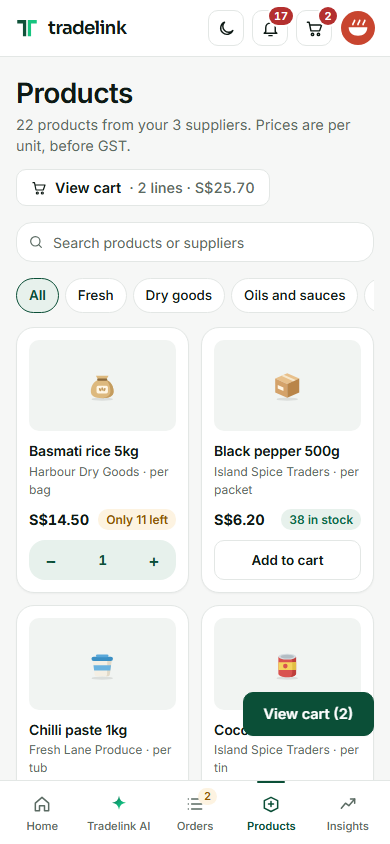

*Figure 20. Products on a phone, with filter chips.*

**Insights:** a read-only summary of your buying:

- an "In short" summary;
- spent this week and last week, your budget, and what is left;
- a weekly spend chart and spend by supplier;
- each supplier's on-time record;
- price changes.

*Figure 21. Insights.*

**Settings**

| Section | What you can change |
| --- | --- |
| Budget and alerts | Weekly budget, and switches for **Suggest what to reorder**, **Tell me about price changes** and **Warn me before I go over budget** |
| Usual items | Usual order quantity, how many are in your shop, and use per day |
| Suppliers | View only: each supplier shows **Connected** or **Invited** |
| Account and Appearance | Your account details, and light or dark mode |

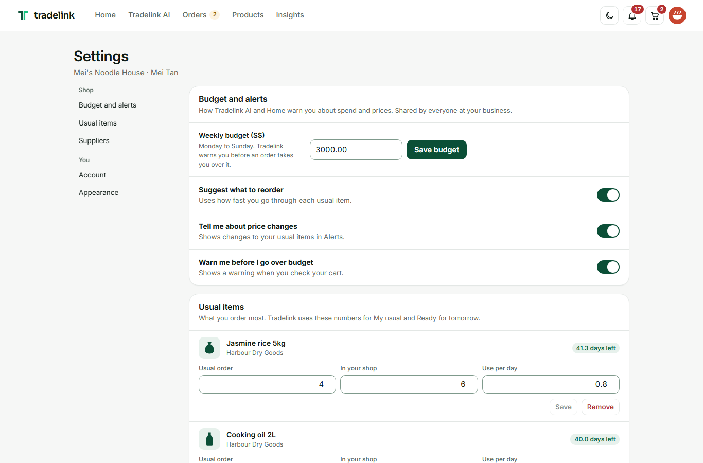

*Figure 22. Buyer Settings.*

> **Ask and Availability:** older links to Ask open Tradelink AI, and older links to Availability open Products.

---

## 5. Supplier guide

### 5.1 Understand Home

**What this is for:** seeing the jobs waiting for you.

*Figure 23. Supplier Home.*

*Figure 24. Supplier Home on a phone.*

| Part of the page | What it shows |
| --- | --- |
| Next up | The oldest job first: • Accept new orders. • Pack today's orders, as one pick list added up across orders, with **Mark all out for delivery**. • Answer problems. • Receive stock for an item that is running out. • A customer who has gone quiet. |
| Today | Order value and new orders so far, against a usual day of the same weekday |
| At a glance | **Customers**, **Running low** and **Coming up** |

### 5.2 Accept, part accept or reject an order

**What this is for:** answering a new order.

**Before you start:** open **Orders > New**, then the order.

*Figure 25. Orders, with the New, To pack, Out for delivery, Delivered and All tabs.*

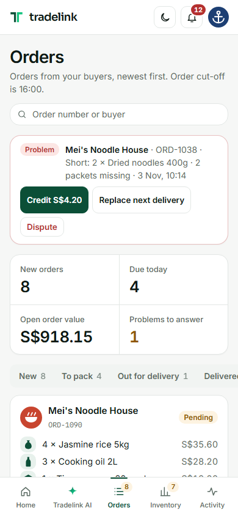

*Figure 26. Orders on a phone.*

**Steps**

1. Choose one:
   - **Accept order**: pick the delivery date and confirm.
   - **Part accept**: under "How much can you send?", enter how many of each line you can send now. Under "What you cannot send now", choose **Not coming**, or **Send the rest on** and pick a date. Set the delivery date and select **Send part order**.
   - **Reject order**: confirm that you cannot take it.

*Figure 27. A new order. (1) Accept order. (2) Part accept. (3) Reject order.*

*Figure 28. Part accept: how much you can send now, and what happens to the rest.*

**What happens next**

- **Accept:** the buyer is told. The stock is held and the line prices are updated to your current prices.
- **Part accept:** the buyer is told what you will send. Stock you will not send now is released. If the rest comes later, the order shows a second delivery.
- **Reject:** the buyer is told, and any held stock is released.

**Common problems**

| Message | What to do |
| --- | --- |
| "Confirm stock for the new products in this order first." | The order includes a product a buyer added. Confirm its price and stock in Inventory first (see 5.4). |
| "Check the highlighted lines…" or a stock warning | You do not have enough free stock. Part accept, or receive stock first. |
| The delivery date is refused | The date must be today or later. |

### 5.3 Deliver an order

**Steps**

1. Open **Orders > To pack**, then the order.
2. Select **Mark out for delivery** when it leaves.
3. Select **Mark delivered** when it arrives.
4. For a second delivery, use **Mark the rest out for delivery** and **Deliver the rest**. Select **Cancel the rest** if it will not come.

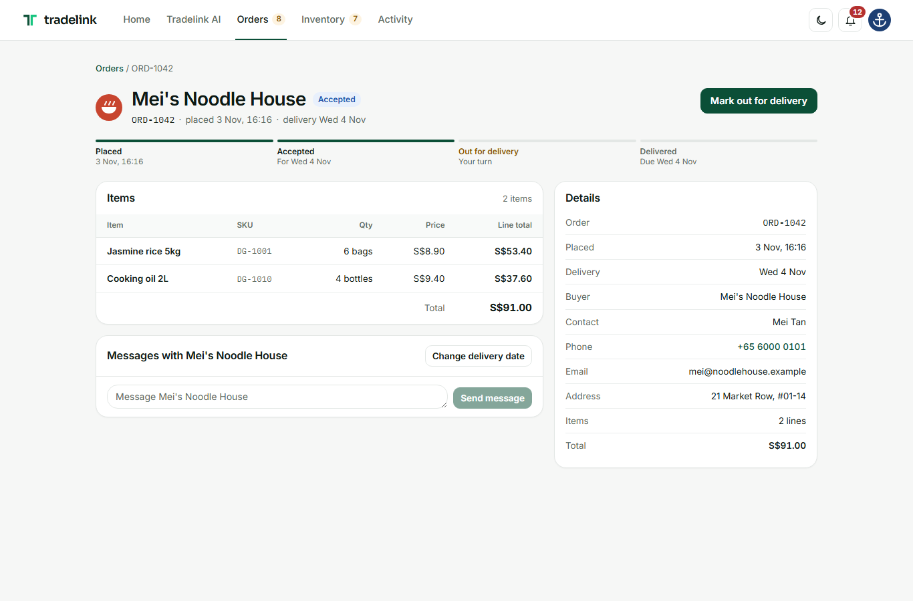

*Figure 29. An accepted order, ready to go out.*

**What happens next:** the buyer is told at each step. On delivery, the stock leaves your inventory, and the buyer is asked to check the delivery.

**Messages and date changes:** to message the buyer, use **Messages with *buyer*** on the order and select **Send message**. To ask to move a delivery date, select **Change delivery date**, pick the delivery and the **New date**, and select **Ask *buyer***; Tradelink AI can do the same. Requests from the buyer show on the order and in the alert with **Accept new date** and **Decline**.

**Common problems**

- **"There is not enough free stock for the rest yet. Receive stock first."** You need enough free stock for the second delivery.

### 5.4 Manage inventory

**What this is for:** keeping stock, prices and products up to date.

*Figure 30. Inventory, with filters for Low, Out and To confirm.*

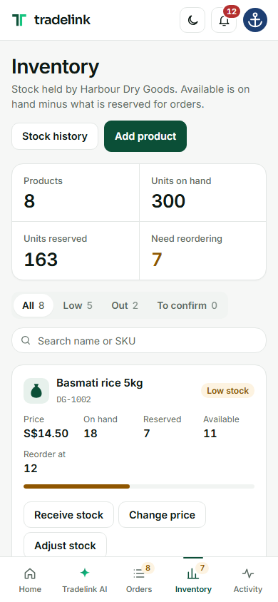

*Figure 31. Inventory on a phone.*

| Task | Steps | What happens next |
| --- | --- | --- |
| Add a product | Select **Add product**. Enter the name, unit, price, opening stock, reorder level and category. Save. | The product is listed for your buyers. |
| Receive stock | Select **Receive stock** on the product. Enter how many arrived (1 to 9999). Save. | The units are added. A product a buyer added becomes active. |
| Confirm a product a buyer added | Filter **To confirm**. Select **Confirm stock**. Enter the quantity, price and reorder level. Save. | The product becomes active, and waiting orders can be accepted. |
| Change a price | Select **Change price**. Enter the new price. Save. | Buyers see the change in their Prices list. Orders you accept after the change use the new price. |
| Adjust stock | Select **Adjust stock**. Enter the change, a reason (**Damaged**, **Expired** or **Count correction**) and a note if needed. Save. | The change is recorded in Stock history. |

*Figure 32. Receiving stock.*

**Common problems**

- **"This leaves less stock than is reserved for open orders."** You cannot lower stock below what is already held for orders.

### 5.5 Answer problems

**What this is for:** settling a problem a buyer reported.

**Steps**

1. Open the order from the alert, or from Home > **Answer problems**. Go to the **Problems** section.
2. Choose an answer:
   - **Credit S$x**: promise a credit for the amount shown.
   - **Replace next delivery**: not available for late deliveries.
   - **It is on the way**: for late deliveries only.
   - **Dispute**: you disagree. The Tradelink team decides.

**What happens next**

- The buyer is told.
- A promised credit shows **Waiting for buyer to confirm** until the buyer confirms it arrived.
- A dispute goes to the Tradelink team's queue.

> **Not available yet:** invoice queries. The invoice problem type exists in the system, but buyers cannot raise one.

### 5.6 Activity, stock history and settings

- **Activity:** a feed of what happened to your orders, stock and account, grouped by day. Filter by order, stock or account.
- **Stock history:** every stock change (Received, Reserved, Released, Delivered, Adjusted), with the units after the change and the reason. It is under Inventory.
- **Settings:** your business profile: contact details, product range, lead time, order cut-off time, delivery days and minimum order. Account and Appearance are there too.

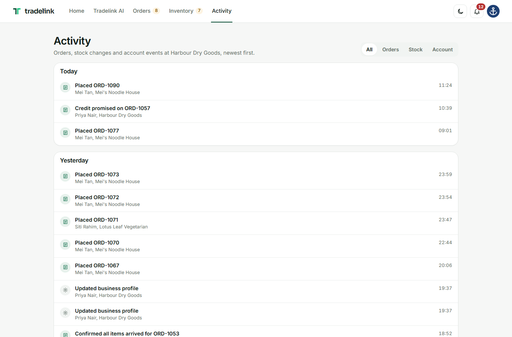

*Figure 33. Activity.*

*Figure 34. Stock history.*

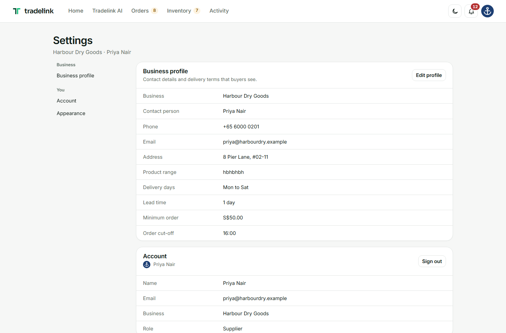

*Figure 35. The business profile in Settings.*

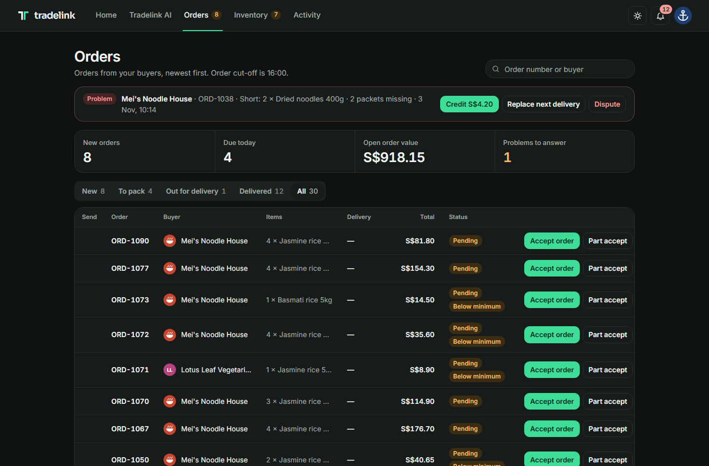

*Figure 36. Supplier Orders in dark mode.*

---

## 6. Admin guide

### 6.1 Understand Home

*Figure 37. Admin Home.*

*Figure 38. Admin Home on a phone.*

| Part of the page | What it shows |
| --- | --- |
| Summary line | How many items need attention, and how many are high priority. Operators see only items assigned to them. |
| Next up | The four newest urgent items, with **See all in Attention** for the rest |
| Tiles | Open orders, open order value, active suppliers and operators online |
| At a glance | **Activity**, **Low stock** and **Team online** |

### 6.2 Work through Needs attention

**What this is for:** making sure nothing on the platform is left waiting.

**Steps**

1. Open **Attention**. Items are sorted with high priority first, then oldest first.
2. Use the filters: **All**, **High**, **Medium**, and **Unassigned** (operations lead only).
3. For each item, use its buttons:
   - **View supplier** opens the supplier involved.
   - **Open audit log** is shown for blocked actions.
   - **Mark handled** is shown for blocked actions.
   - **Credit buyer** and **Close, no credit** are shown for disputes (see 6.4).

*Figure 39. The attention queue, seen by the operations lead.*

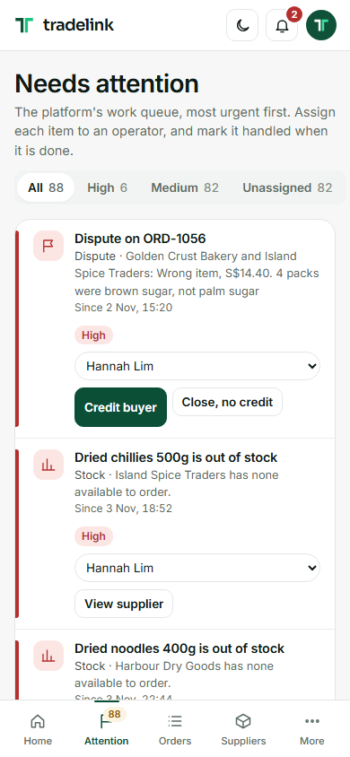

*Figure 40. The attention queue on a phone.*

**What creates an item**

| Item | Priority | Appears when |
| --- | --- | --- |
| Dispute | High | A supplier disputes a buyer's problem |
| Out of stock | High | An active product has no free stock |
| Delivery problem | Medium | A problem is unanswered for more than 4 hours |
| Order waiting | Medium | A supplier has not answered an order for more than 30 minutes |
| Product not confirmed | Medium | A buyer added a product and the supplier has not confirmed it |
| Running low | Medium | Free stock is at or below the reorder level |
| Supplier invitation | Medium | A supplier a buyer added has not joined after 24 hours |
| Blocked action | Medium | Someone tried something they are not allowed to do |

**What happens next:** most items close by themselves when their cause is fixed, for example when stock arrives or the supplier answers. A blocked action stays until someone marks it handled.

### 6.3 Assign operators

**What this is for:** sharing out the queue so each item has an owner.

**Before you start:** only the **operations lead** can assign items. In the demo, this is Hannah.

**Steps**

1. In **Attention**, find the item.
2. In **Assigned to**, choose the operator. The choice saves straight away.

*Figure 41. (1) Assigned to: the operations lead picks an operator.*

**What happens next:** the item appears in that operator's queue and on their Home. Operators see only items assigned to them, marked **Assigned to you**.

*Figure 42. An operator sees only their own items.*

**Common problems**

- **"This did not save. Reload the page and try again."** The page was open across an update of the app. Reload it.
- **The Assigned to choice is missing.** You are not the operations lead.

### 6.4 Manage disputes

**What this is for:** deciding a problem when the buyer and supplier disagree.

**Steps**

1. Open **Attention** and filter **High**. Disputes read "Dispute on ORD-*number*", with both businesses, the problem, the amount and the note.
2. Choose **Credit buyer** or **Close, no credit**.

**What happens next:** both businesses are told. **Credit buyer** asks the supplier for the credit, and the buyer confirms it when it arrives. **Close, no credit** ends the problem.

### 6.5 Suppliers, buyers, users and operators

| Page | What you can do |
| --- | --- |
| **Suppliers** | Filter by **Active**, **Invited**, **Suspended** and **Declined**. Open a supplier to see its profile, products and orders. **Suspend** or **Reactivate** a supplier, with a confirm step. **Low stock** lists products at or below their reorder level. |
| **Users** | View buyers and all accounts, with search. Open a buyer to see its details and orders. View only. |
| **Operators** | View the team and who is online. The operations lead also sees how many items each operator has. View only. |

**Suspending a supplier:** hides its products, stops new orders, and cancels its pending orders, releasing the stock. The supplier and its buyers are told. The supplier can still deliver orders already accepted.

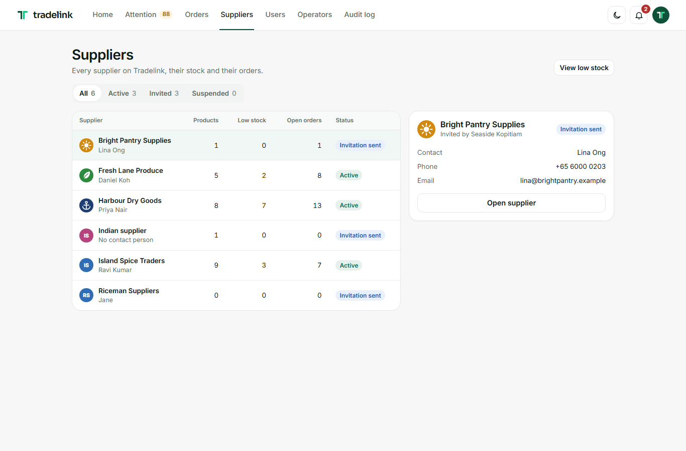

*Figure 43. Suppliers.*

*Figure 44. A supplier's details, with Suspend.*

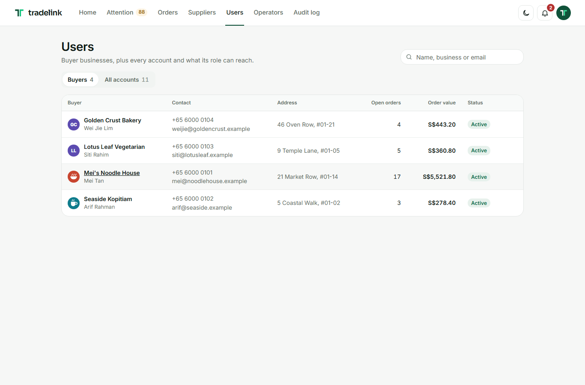

*Figure 45. Users.*

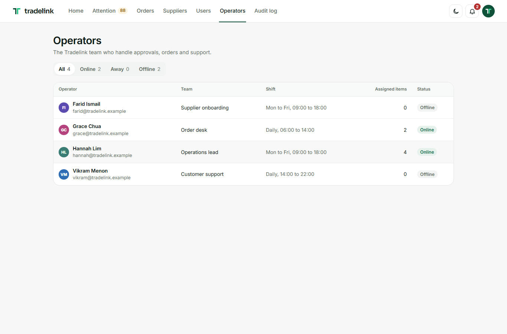

*Figure 46. Operators.*

> **Not available yet:** approving or declining suppliers, inviting people, and editing buyers, users or operators.

### 6.6 Notifications, all orders and the audit log

- **Notifications:** new accounts, disputes and security events.
- **Orders:** every order on the platform, with status filters and search by order number. View only.
- **Audit log:** every change, who made it and when, including blocked attempts. Filter by **Organisation** (the business whose person made the change) and **Outcome** (**Allowed** or **Blocked**). Entries cannot be edited or deleted.

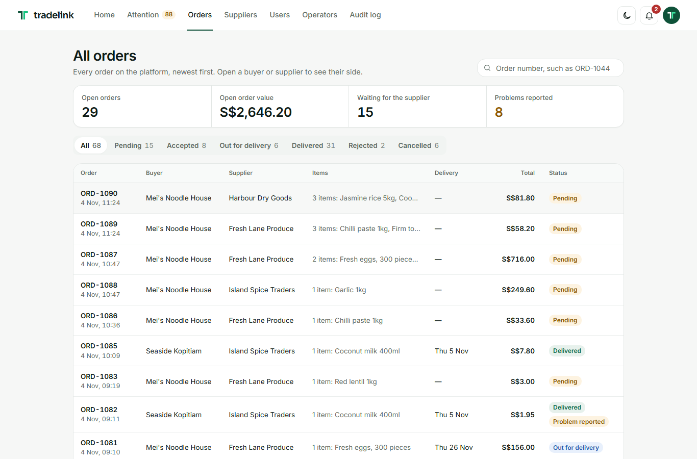

*Figure 47. All orders.*

*Figure 48. The audit log.*

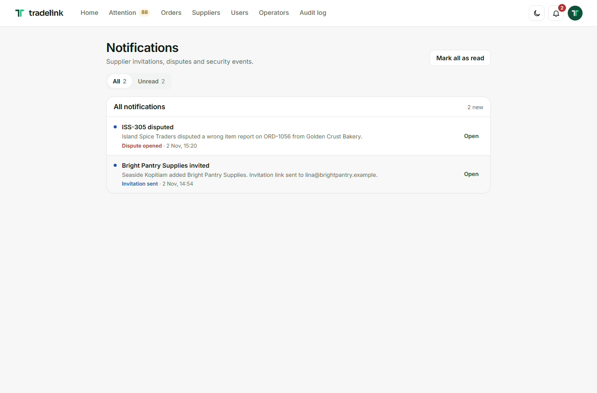

*Figure 49. Admin notifications.*

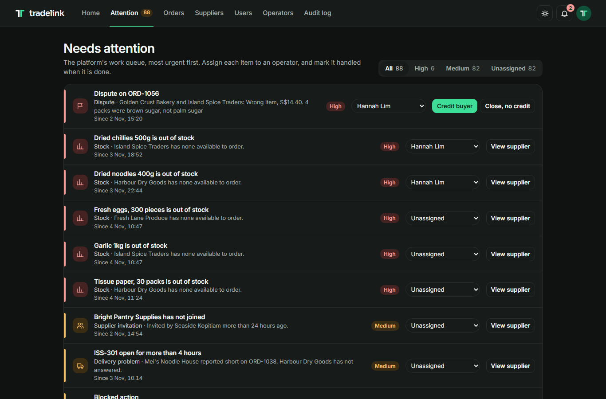

*Figure 50. The attention queue in dark mode.*

> **Not available yet:** a system status page.

---

## 7. Security and privacy tips

- **Keep your password to yourself.** Tradelink staff will never ask for it.
- **Use a long password.** At least 12 characters; a short phrase is easier to remember.
- **Sign out on shared devices.** Use the account menu > **Sign out**.
- **Check before you confirm.** Tradelink AI never changes anything until you tap its button. Read the card first.
- **Text you type is shared with the other business.** Problem notes and order messages are visible to them, so keep them to the order.
- **You only see your own business's data.** Buyers see their own orders and their suppliers' catalogues. Suppliers see orders sent to them. The Tradelink team sees what it needs to support you.
- **Every change is recorded.** The audit log keeps who did what and when, including blocked attempts.

## 8. Frequently asked questions

| Question | Answer |
| --- | --- |
| Do I need to install anything? | No. Tradelink runs in your browser. You can add it to your home screen (see 2.4). |
| Can Tradelink AI place an order without asking me? | No. It always shows a card and waits for you to tap its button. |
| Why was my order sent although it is below the minimum? | The minimum is a guide. The order is marked **Below minimum** so both sides can see it. |
| When is stock held for me? | When you place the order. It is released if the supplier rejects it or you cancel it. |
| Can I change an order after placing it? | You can cancel it while it is waiting for the supplier. After that, message the supplier through Tradelink AI. |
| Why did my dark mode setting not follow me to my phone? | The setting is remembered per browser. |
| Does Tradelink handle invoices or payments? | No. Payments and invoices happen outside Tradelink. Credits for problems are tracked in the app. |
| Will I get emails or text messages? | Only sign-in emails, such as password resets. All other notifications are in the app. |
| A supplier I use is not on Tradelink. | Add them through Tradelink AI (see 4.6) and let them know yourself. |

## 9. Troubleshooting

| What you see | Why | What to do |
| --- | --- | --- |
| "This page did not load" | Something went wrong loading the page | Select **Try again**. If it keeps happening, give the support team the code shown. |
| "This did not save. Reload the page and try again." | The page was open while the app was updated, or the connection dropped | Reload the page and repeat the step. |
| "Something went wrong. Try again." | An unexpected error | Try again in a moment. |
| An offline page | No internet connection | Reconnect and select **Try again**. |
| "Check the highlighted lines before placing this order." | Another order took the stock first | Lower the highlighted quantities, or remove those lines. |
| "This order changed in another tab. Check it again before confirming." | The cart was changed in another tab or device | Check the cart again, then place the order. |
| "Too many requests. Try again in a few minutes." | You sent many messages or requests in a short time | Wait a few minutes and try again. |
| "You do not have access to do that." | The action belongs to another role, or to the operations lead | Ask the right person, or the Tradelink team. |
| The bell count does not go down | Alerts are still unread | Open the bell panel and select **Mark all as read**. |

## 10. Glossary

| Term | Meaning |
| --- | --- |
| Buyer | A business that orders stock through Tradelink |
| Supplier | A business that sells to buyers through Tradelink |
| Admin, operator | A member of the Tradelink operations team |
| Operations lead | The admin who sees and assigns every attention item |
| Tradelink AI | The built-in assistant. It suggests and prepares actions; you confirm them. |
| Confirm card | The card Tradelink AI shows before it changes anything |
| Cart | Your draft order lines, grouped by supplier, before they are sent |
| Usual items | Products you reorder regularly, with your usual quantity and daily use |
| Held or reserved stock | Stock set aside for an order and not available to others |
| Minimum order | The order value a supplier prefers. Orders below it are marked, not blocked. |
| Part accept | A supplier accepting only some of an order, with the rest later or not at all |
| Second delivery, "the rest" | The part of an order a supplier sends on a later date |
| Problem | Something wrong with a delivery: short, damaged, wrong item, expired or late |
| Credit | Money the supplier agrees to take off what the buyer owes |
| Dispute | A supplier disagreeing with a problem. The Tradelink team decides. |
| Needs attention | The admin work queue |
| Audit log | The permanent record of every change and blocked attempt |

## 11. Document history

| Version | Date | Author | Change |
| --- | --- | --- | --- |
| 1.0 | 4 November 2026 | Janya Mali, drafted with Claude | First version, written from the running app and its code |
